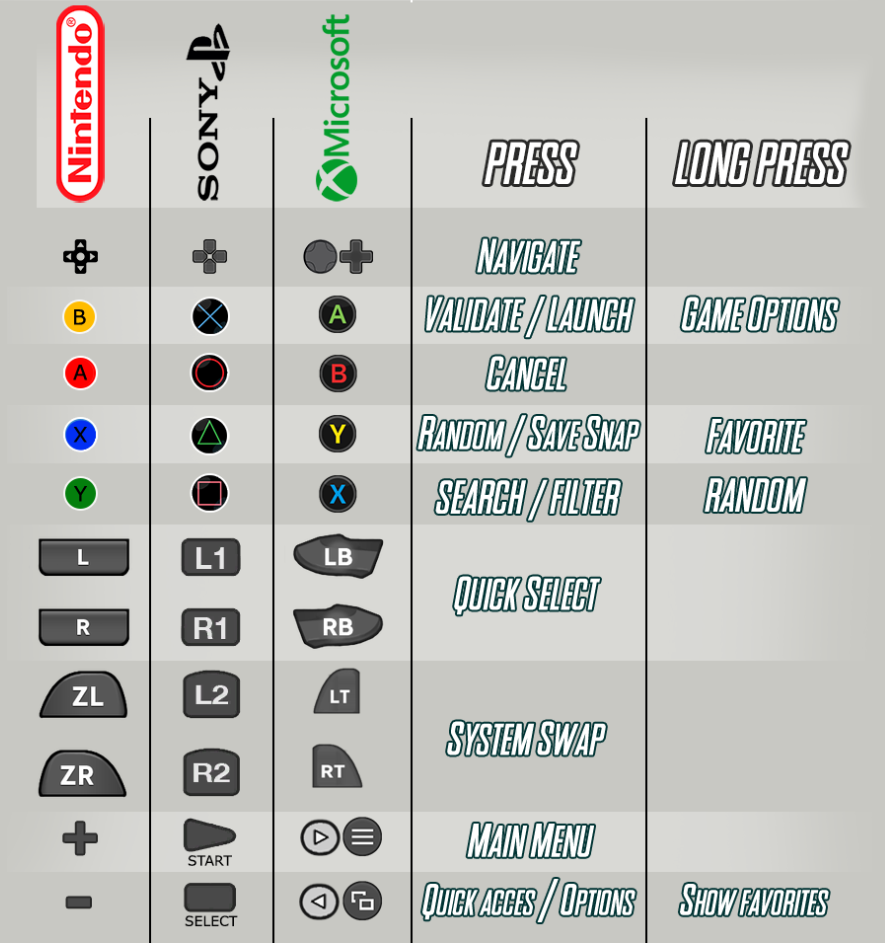

# Navigation Keys

You can navigate RetroBat with a controller or a keyboard.

A detailed PDF guide (`notice.pdf`) is also available in your RetroBat folder or here:



## Controller

Buttons are named by their position on the controller: for example, **South** is the bottom face button (B on Nintendo, ✕ on PlayStation, A on Xbox).

| Action                               | Long press       | Nintendo           | PlayStation        | Xbox               |
| ------------------------------------ | ---------------- | ------------------ | ------------------ | ------------------ |
| Navigate                             |                  | D-pad / left stick | D-pad / left stick | D-pad / left stick |
| Validate / Launch a game             | Game options     | B                  | ✕                  | A                  |
| Back / Cancel                        |                  | A                  | ◯                  | B                  |
| Random game / Save snap              | Add to favorites | X                  | △                  | Y                  |
| Search / Filter                      | Random game      | Y                  | ▢                  | X                  |
| Quick select (jump through the list) |                  | L / R              | L1 / R1            | LB / RB            |
| Previous / next system               |                  | ZL / ZR            | L2 / R2            | LT / RT            |
| Main menu                            |                  | +                  | START              | Menu (☰)           |
| Quick access / Options               | Show favorites   | −                  | SELECT             | View (⧉)           |
| Skip to the next song                |                  | Left stick click   | L3                 | Left stick click   |

<figure><figcaption></figcaption></figure>

## Keyboard

<table><thead><tr><th>Action</th><th width="204.5">Long press</th><th>Key</th></tr></thead><tbody><tr><td>Navigate</td><td></td><td>Arrow keys</td></tr><tr><td>Validate / Launch a game</td><td>Game options</td><td><code>X</code></td></tr><tr><td>Back / Cancel</td><td></td><td><code>Z</code></td></tr><tr><td>Random game / Save snap</td><td>Add to favorites</td><td><code>Q</code></td></tr><tr><td>Search / Filter</td><td>Random game</td><td><code>S</code></td></tr><tr><td>Quick select (jump through the list)</td><td></td><td><code>Page Up</code> / <code>Page Down</code></td></tr><tr><td>Previous / next system</td><td></td><td><code>Home</code> / <code>End</code></td></tr><tr><td>Main menu</td><td></td><td><code>Enter</code></td></tr><tr><td>Quick access / Options</td><td>Show favorites</td><td><code>Backspace</code></td></tr><tr><td>Hotkey</td><td></td><td><code>Right Ctrl</code></td></tr><tr><td>Skip to the next song</td><td></td><td><code>Insert</code></td></tr><tr><td>Screen reader on / off</td><td></td><td><code>F3</code></td></tr></tbody></table>


The keyboard keys are the same whatever your keyboard layout (AZERTY or QWERTY): use the key with the letter shown in the table.


<figure><figcaption></figcaption></figure>
