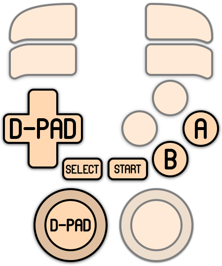
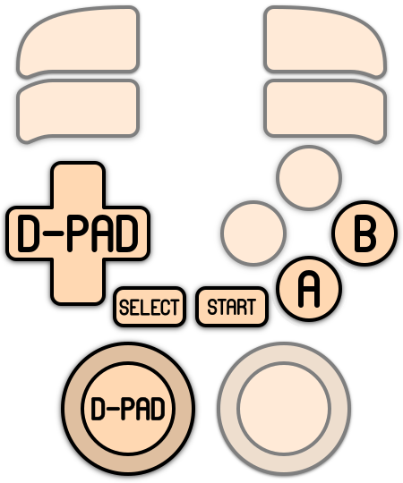

# Bandai Playdia

<figure><figcaption></figcaption></figure>

## Overview

The **Playdia** (プレイディア) is a Bandai home console released only in Japan on September 23, 1994, priced at 24,800 yen. Bandai sold it as a "Quick Interactive System": games are interactive cartoons played from a CD-ROM, where the player steers the story by picking one of a few answers on screen. The wireless infrared controller is stored in the front of the console.

Designed for children, the Playdia relies on Bandai licenses: **Sailor Moon**, **Dragon Ball Z**, **Ultraman**, **Anpanman**, **SD Gundam**… Much of the library is educational (the **Playdia iQ Kids** series: hiragana, numbers, first English words). Sales stayed low and the console was discontinued in 1996, with around thirty games.

RetroBat offers one emulator: the **playdiaemu** libretro core (PlaydiaEmu).



## At a glance

|                              |                          |
| ---------------------------- | ------------------------ |
| **Games folder**             | `roms\playdia`           |
| **Extensions**               | .cue .iso .bin .img .zip |
| **Default emulator**         | libretro: playdiaemu     |
| **BIOS**                     | None                     |
| **Controller configuration** | Automatic                |
| **Save states**              | libretro core            |
| **RetroAchievements**        | No                       |
| **Netplay**                  | No                       |

## Which emulator should I use?

<table><thead><tr><th width="187">Emulator</th><th>Strengths</th><th>Limitations</th></tr></thead><tbody><tr><td><strong>libretro: playdiaemu</strong> (default)</td><td>No BIOS, reads Redump <code>.zip</code> archives directly, save states.</td><td>Recent emulator: the picture is recognizable but not yet identical to the real console, and not every game has been tested to the end. No rewind, no netplay.</td></tr></tbody></table>

## BIOS

No BIOS is needed: PlaydiaEmu reads the discs with its own player (high-level emulation), without the console's internal program.

## Which game format?

<table><thead><tr><th width="171.5">Format</th><th>Notes</th></tr></thead><tbody><tr><td><strong>.cue</strong> (+ .bin)</td><td>Redump CD image (two tracks). The recommended format.</td></tr><tr><td><strong>.zip</strong></td><td>Redump archive holding the <code>.cue</code> and <code>.bin</code> files (or a single <code>.bin</code> / <code>.iso</code>). Read directly, without extraction.</td></tr><tr><td><strong>.iso</strong>, <strong>.bin</strong>, <strong>.img</strong></td><td>Single-track image.</td></tr></tbody></table>

`.chd` files are not supported: keep your games as `.cue` / `.bin` or `.zip`.

## Controls

### Automatic configuration

RetroBat sets up the controller automatically. The Playdia controller only has a D-pad and a few buttons: in games, the D-pad and buttons are used to pick an answer on screen.

<table><thead><tr><th width="244">RetroBat controller</th><th>Playdia</th></tr></thead><tbody><tr><td>D-pad, left stick</td><td>D-pad</td></tr><tr><td>EAST</td><td>A</td></tr><tr><td>SOUTH</td><td>B</td></tr><tr><td>START</td><td>Start</td></tr><tr><td>SELECT</td><td>Select</td></tr></tbody></table>

**CONTROLS > SWAP A/B BUTTONS** puts A on SOUTH and B on EAST.

|                                           |                                                |
| ----------------------------------------- | ---------------------------------------------- |
|  |  |

When a game waits for an answer and you press nothing, it moves on by itself after about ten seconds, with the default choice.

### Hotkeys

playdiaemu uses the standard RetroArch hotkeys (see the [**Hotkeys**](../../../navigation/hotkeys.md) page). Rewind (HOTKEY + LEFT) is not available with this core.

## Folders

<table><thead><tr><th width="209">Content</th><th>Folder</th></tr></thead><tbody><tr><td>Save states</td><td><code>saves\playdia\libretro.playdiaemu</code></td></tr><tr><td>Screenshots</td><td><code>screenshots</code></td></tr></tbody></table>

The Playdia has no save memory: only save states keep your progress.

## Known issues

| Issue                                                   | Solution                                                                             |
| ------------------------------------------------------- | ------------------------------------------------------------------------------------ |
| A `.chd` game does not show up or does not start        | The core cannot read `.chd` files: use the Redump `.cue` / `.bin` or `.zip`.         |
| A save state does not load                              | It is tied to the disc: it only loads on the exact same game (same image).           |
| The game stays on the BANDAI logo                       | Press A (EAST) to skip the logo.                                                     |
| The picture does not look exactly like the real console | Video emulation is recent and still being improved; core updates come with RetroBat. |
