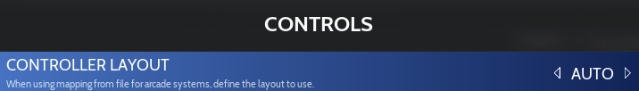

# Amiga 500

<div align="left"><figure><figcaption></figcaption></figure></div>

## Overview

The **Amiga 500** is a home computer released by Commodore in 1987. Built around a Motorola 68000 processor and a set of custom chips (Agnus, Denise and Paula, known as the **OCS** chipset), it offered graphics and sound far ahead of the other computers of its time: 4096 colours, hardware scrolling and sprites, 4-channel digital sound.

Affordable and plugged into the family TV, it became the computer of a whole generation, especially in Europe, where it dominated the games market until the mid-1990s. It was followed by the **Amiga 500+** (1991) and the **Amiga 600** (1992), which use the improved **ECS** chipset and Kickstart 2.

Its library counts thousands of games: _Shadow of the Beast_, _Lemmings_, _Speedball 2_, _Sensible Soccer_, _Cannon Fodder_, _Turrican II_, _Another World_, _The Secret of Monkey Island_, _Pinball Dreams_, _Lotus Turbo Challenge_, _The Settlers_… as well as a famous demo scene.

This system (Amiga OCS/ECS) covers the Amiga 500, 500+, 600 and 2000.



## At a glance

<table><thead><tr><th width="244"></th><th></th></tr></thead><tbody><tr><td>Games folder</td><td>📁 roms \ 📂 amiga500</td></tr><tr><td>File extensions</td><td>.adf .adz .dms .ipf .hdf .lha .uae .ags .rp9 .m3u .zip .7z</td></tr><tr><td>Default emulator</td><td>libretro: puae</td></tr><tr><td>BIOS</td><td>Kickstart required</td></tr><tr><td>Controller autoconfig</td><td>Yes (except Amiga Forever)</td></tr><tr><td>RetroAchievements</td><td>No</td></tr><tr><td>Netplay</td><td>No</td></tr><tr><td>Save state manager (ES)</td><td>libretro cores, Amiberry</td></tr></tbody></table>

## Which emulator to choose?

<table><thead><tr><th>Emulator</th><th width="285.75">Strengths</th><th>Limits</th></tr></thead><tbody><tr><td><strong>libretro: puae</strong> (default)</td><td>Reliable, all formats, virtual keyboard, Pad2Key</td><td></td></tr><tr><td>libretro: amiberry</td><td>Recent UAE engine, WHDLoad and .rp9 support, Pad2Key</td><td></td></tr><tr><td>amiberry</td><td>Standalone version: very good compatibility, choice of model and memory, light pen, Amiberry menu</td><td>2 players</td></tr><tr><td>winuae</td><td>The reference Amiga emulator, the most accurate</td><td>2 players</td></tr><tr><td>amigaforever</td><td>Plays the .rp9 packages of Cloanto's commercial Amiga Forever</td><td>Amiga Forever must be installed, no autoconfig</td></tr></tbody></table>

## BIOS

### Kickstart files

The Amiga needs its system ROM, the **Kickstart**. Copy it to the `bios` folder (or `bios\amiga`).

| Kickstart              | Short name      | Amiga Forever name     | MD5 (short name)                 | Used for                                 |
| ---------------------- | --------------- | ---------------------- | -------------------------------- | ---------------------------------------- |
| Kickstart 1.3 (A500)   | kick34005.A500  | amiga-os-130.rom       | 82a21c1890cae844b3df741f2762d48d | **Required** – Amiga 500 (default model) |
| Kickstart 1.2 (A500)   | kick33180.A500  | amiga-os-120.rom       | 85ad74194e87c08904327de1a9443b7a | Optional – A500 KS 1.2 model             |
| Kickstart 2.04 (A500+) | kick37175.A500  | amiga-os-204.rom       | dc10d7bdd1b6f450773dfb558477c230 | Optional – Amiga 500+ model              |
| Kickstart 3.1 (A600)   | kick40063.A600  | amiga-os-310-a600.rom  | e40a5dfb3d017ba8779faba30cbd1c8e | Optional – Amiga 600 model               |
| Kickstart 3.1 (A1200)  | kick40068.A1200 | amiga-os-310-a1200.rom | 646773759326fbac3b2311fd8c8793ee | Optional – some WHDLoad games            |
| Amiga Forever key      | rom.key         |                        |                                  | Optional – encrypted Amiga Forever ROMs  |


RetroBat checks that the Kickstart 1.3 is present. The other files are listed as OPTIONAL.


### Which file name should I use?

* The **short names** (`kick34005.A500`…) work with every emulator: use them if you are not sure.
* Amiberry, lr-amiberry and WinUAE also accept the **Amiga Forever** names (`amiga-os-130.rom`…) and the usual TOSEC names.
* The Amiga Forever ROMs are encrypted: copy the **rom.key** file supplied with Amiga Forever next to them.

### Choosing the Amiga model

By default, RetroBat emulates an **Amiga 500 with Kickstart 1.3**, which runs almost every game of the system. To emulate another model, use the model option (EMULATION submenu):

<div align="left"><figure><figcaption></figcaption></figure></div>

<table><thead><tr><th width="169.5">Emulator</th><th width="195.25">Option</th><th>Models</th></tr></thead><tbody><tr><td>lr-puae</td><td>MODEL</td><td>A500, A500+, A600…</td></tr><tr><td>lr-amiberry</td><td>MODEL</td><td>A500, A500+, A600…</td></tr><tr><td>Amiberry</td><td>MODEL</td><td>A500 (KS 1.3), A500 (KS 1.2), A500+ (KS 2.04), A600 (KS 3.1)</td></tr><tr><td>WinUAE</td><td>EMULATED MODEL</td><td>Amiga 500, Amiga 500+</td></tr></tbody></table>

Each model needs its own Kickstart (see the table above).

## Game formats

### Formats

<table><thead><tr><th width="112.75">Format</th><th>Description</th></tr></thead><tbody><tr><td>.adf</td><td>Standard floppy disk image (.adz: compressed .adf, .dms: DiskMasher archive)</td></tr><tr><td>.ipf</td><td>Copy-protected floppy image (SPS). Needs the <code>capsimg.dll</code> plugin, supplied with RetroBat in <code>bios</code></td></tr><tr><td>.lha</td><td><strong>WHDLoad</strong> game: a floppy game installed to run from a hard drive, without disk swapping</td></tr><tr><td>.hdf</td><td>Hard disk image</td></tr><tr><td>.uae</td><td>UAE configuration file (your own settings), Amiberry and WinUAE</td></tr><tr><td>.ags</td><td>Amiga Game Selector (WinUAE)</td></tr><tr><td>.rp9</td><td>Amiga Forever package (Amiga Forever, lr-amiberry)</td></tr><tr><td>.m3u</td><td>Multi-disk game</td></tr><tr><td>.zip / .7z</td><td>Compressed disk images</td></tr></tbody></table>


For a simple experience, prefer the **WHDLoad** versions (.lha) of the games: they start straight away, load faster and do not ask you to swap disks.


### Multi-disk games

Use a .m3u file to group the disks of a game. Example for _Monkey Island_: create `Monkey Island.m3u` in the `roms\amiga500` folder with this content:

```
Monkey Island (Disk 1).adf
Monkey Island (Disk 2).adf
Monkey Island (Disk 3).adf
Monkey Island (Disk 4).adf
```

Changing disk:

* **libretro cores**: use the disk hotkeys (HOTKEY + L1 to eject/insert, HOTKEY + L2/R2 to select the previous/next disk), or the virtual keyboard menu.
* **Amiberry**: the first disks go to the floppy drives (**FLOPPY DRIVES** option, up to 4), the others to the disk swapper of the Amiberry menu.
* **WinUAE**: also finds the next disks by itself when they are named "Disk 1", "Disk 2"…

## Controls

### Controller autoconfiguration

The Amiga has two ports: the **joystick** is in port 2 and the **mouse** in port 1. RetroBat follows this layout: player 1's controller goes to port 2 and your PC mouse to port 1.

| Emulator             | Autoconfig | Players |
| -------------------- | ---------- | ------- |
| lr-puae, lr-amiberry | Yes        | 2       |
| Amiberry             | Yes        | 2       |
| WinUAE               | Yes        | 2       |
| Amiga Forever        | No         |         |

Your PC keyboard works as the Amiga keyboard with every emulator.

### Default layout

| Amiga                | libretro cores | Amiberry |
| -------------------- | -------------- | -------- |
| Joystick             | D-pad          | D-pad    |
| Fire button 1 (red)  | SOUTH          | SOUTH    |
| Fire button 2 (blue) | EAST           | EAST     |
| Space bar            | NORTH          |          |
| Mouse                | Analog sticks  | PC mouse |
| Mouse buttons        | L2 / R2        | PC mouse |
| Virtual keyboard     | SELECT         | SELECT   |
| Emulator menu        |                | R3       |

<div align="left"><figure><figcaption></figcaption></figure></div>

### Useful control options

<table><thead><tr><th width="139.5">Emulator</th><th width="262.75">Option</th><th>Description</th></tr></thead><tbody><tr><td>lr-puae</td><td>PAD BUTTON LAYOUT</td><td>Other button layouts (jump on a button…)</td></tr><tr><td>lr-puae</td><td>MOUSE CONTROL</td><td>Which sticks control the mouse</td></tr><tr><td>Amiberry</td><td>PORT 1 DEVICE / PORT 2 DEVICE</td><td>Mouse, joystick (player 2) or nothing in each port</td></tr><tr><td>Amiberry</td><td>SWAP JOYSTICK PORTS</td><td>For the few games that want the joystick in port 1</td></tr><tr><td>Amiberry</td><td>MENU BUTTON / VIRTUAL KEYBOARD BUTTON</td><td>Change the buttons that open the menu and the virtual keyboard</td></tr><tr><td>WinUAE</td><td>SWAP JOYSTICK PORTS / SECOND CONTROLLER</td><td>Swap the ports, put player 2 in port 1</td></tr></tbody></table>

### Games that need the keyboard

Many Amiga games use the keyboard (space bar, F1-F10 keys, answers in adventure games…). With the libretro cores, use **Pad2Key** to map keys on your controller, or the virtual keyboard (SELECT).

### Hotkeys

**libretro cores**: [standard RetroBat hotkeys](../../../../navigation/hotkeys.md).

| Hotkey         | Amiberry   | WinUAE | Amiga Forever |
| -------------- | ---------- | ------ | ------------- |
| HOTKEY + START | Quit       | Quit   |               |
| HOTKEY + WEST  | Save state |        |               |
| HOTKEY + NORTH | Load state |        |               |

The Amiberry menu opens with R3 or F12, the WinUAE menu with F12.

### Light pen

Amiberry emulates a **light pen** (or a **Trojan Phazer** gun) with your mouse or your light gun: enable **ENABLE GUN** (GUNS submenu) and choose the **GUN TYPE**.

## Folders

<table><thead><tr><th width="139.5">Emulator</th><th width="275.25">Content</th><th>Folder</th></tr></thead><tbody><tr><td>lr-puae</td><td>Saves</td><td><code>saves\amiga500</code></td></tr><tr><td>lr-amiberry</td><td>Saves</td><td><code>saves\amiga500\LR-amiberry</code></td></tr><tr><td>libretro</td><td>Save states</td><td><code>saves\amiga500\libretro.&#x3C;core></code></td></tr><tr><td>Amiberry</td><td>Save states, disk saves, NVRAM</td><td><code>saves\amiga500\amiberry</code></td></tr><tr><td>Amiberry</td><td>Screenshots</td><td><code>screenshots\amiberry</code></td></tr><tr><td>Amiberry</td><td>Your .uae configurations</td><td><code>emulators\amiberry\Configurations</code></td></tr><tr><td>WinUAE</td><td>Save states</td><td><code>saves\amiga500\winuae</code></td></tr><tr><td>WinUAE</td><td>Disk saves / WHDLoad saves</td><td><code>saves\amiga500\winuae\saveimages</code> / <code>saves\amiga500\winuae\whdload</code></td></tr><tr><td>WinUAE</td><td>Screenshots / videos</td><td><code>screenshots\winuae</code> / <code>records\winuae</code></td></tr></tbody></table>

## Guides

### Playing WHDLoad games

WHDLoad games (.lha) start automatically with every emulator except Amiga Forever: RetroBat or the emulator prepares the hard drive environment. With Amiberry, the **WHDLOAD: SPLASH SCREEN** and **WHDLOAD: WAIT FOR BUTTON** options show the WHDLoad screen before the game; with lr-puae, use **WHDLOAD SPLASH SCREEN**.

Some WHDLoad games need a Kickstart 3.1: add `kick40068.A1200` (and `kick40063.A600`) to the bios folder.

### Using your own .uae configuration

Amiberry and WinUAE start the **.uae** files you put in `roms\amiga500` as they are: RetroBat does not change them. This lets you prepare a precise configuration (memory, accelerator board, hard drives) for a game or for Workbench.

### Improving accuracy

* **Amiberry**: **ACCURACY** option, CYCLE EXACT for demos and timing-sensitive games (needs a fast PC).
* **WinUAE**: **CYCLE EXACT** option.
* **lr-puae**: **CPU COMPATIBILITY** option.

## Known issues

<table><thead><tr><th width="316.5">Problem</th><th>Solution</th></tr></thead><tbody><tr><td>"Kickstart not found" or black screen</td><td>Copy kick34005.A500 (Kickstart 1.3) to the bios folder.</td></tr><tr><td>Amiga Forever ROMs do not work</td><td>Copy rom.key next to them.</td></tr><tr><td>.ipf games do not start</td><td>Check that capsimg.dll is in the bios folder.</td></tr><tr><td>The joystick does not respond in a game</td><td>The game wants the joystick in port 1: enable SWAP JOYSTICK PORTS (Amiberry, WinUAE).</td></tr><tr><td>The game asks for another disk</td><td>Use a .m3u file, or the WHDLoad version of the game.</td></tr><tr><td>The game needs the keyboard</td><td>Use your PC keyboard, the virtual keyboard (SELECT) or Pad2Key.</td></tr></tbody></table>
