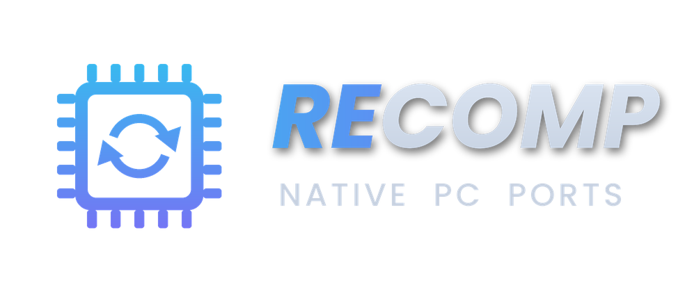

# Recompilations

<figure><figcaption></figcaption></figure>

## Overview

This page covers native PC ports of console games, such as recompilations and decompilations. No emulator is involved: RetroBat starts the port's executable directly and waits for it to close.

RetroBat doesn't ship these ports. Install them with Quiver Launcher or download them from their project pages, then supply the original game data as each port requires.

## At a glance

<table><thead><tr><th width="250.25"></th><th></th></tr></thead><tbody><tr><td><strong>Games folder</strong></td><td><code>roms\recomp</code></td></tr><tr><td><strong>Extensions</strong></td><td>.lnk .game .m3u .bat .decomp</td></tr><tr><td><strong>Default emulator</strong></td><td>quiverlauncher</td></tr><tr><td><strong>BIOS</strong></td><td>None (original game data required depending on the port)</td></tr><tr><td><strong>Controller configuration</strong></td><td>No, set it up in each port</td></tr><tr><td><strong>Save states</strong></td><td>No</td></tr><tr><td><strong>RetroAchievements</strong></td><td>No</td></tr><tr><td><strong>Netplay</strong></td><td>No</td></tr></tbody></table>

## Controls

* RetroBat doesn't auto-configure controllers for these ports. Configure controls inside each port.
* **HOTKEY + START** closes the game and returns to RetroBat. In Quiver Launcher, it closes the launcher.

## Quiver Launcher



Quiver Launcher downloads, installs and updates community ports from GitHub and GitLab releases.

* **Opening it:** select Quiver Launcher from the RetroBat menu (downloaded on first use), or set **RUN LAUNCHER** to ON in a [game's advanced settings](../../../navigation/game-options.md).

<figure><figcaption></figcaption></figure>

<figure><figcaption></figcaption></figure>

* **Adding games:**
  1. Install games in Quiver Launcher and provide their data.
  2. Add them to RetroBat automatically by enabling **MAIN MENU > GAME SETTINGS > SCAN RECOMPILATION (QUIVERLAUNCHER)**, or manually by moving a desktop shortcut into `roms\recomp`.
  3. Refresh the gamelist or restart RetroBat.
* If a game folder has several executables, choose one in Quiver Launcher first, or the automatic scan skips it.
* **When starting a game:** it launches directly, follows RetroBat's fullscreen/windowed setting, and stores its config and saves in `emulators\quiverlauncher\Apps\<game>`. For Perfect Dark, the **REGION** option selects the Europe, USA or Japan executable.

## Ports installed outside Quiver Launcher

A port installed anywhere else on your computer can also be added to `roms\recomp`:

* **Shortcut (`.lnk`):** a shortcut that doesn't point to a Quiver game is started as is, with its target, arguments and working folder.
* **`.game` file:** a text file with the path to the executable on the first line. The following lines are passed as arguments.
* **`.m3u` file:** a text file with the path to the executable on its first line.
* **`.bat` file:** the batch file is run directly.

In `.game` and `.m3u` files, a path starting with `.\` is relative to the file's folder.

If the game's process has a different name from the executable, create a `.gameexe` file with the same base name, containing the process name.

## Decomp ports (.decomp)

A `.decomp` file placed in a console's folder makes the port appear in that console's gamelist. It always launches as a decomp port, regardless of the selected emulator. For example, a Star Fox 64 port can sit in `roms\n64`.

Systems that accept `.decomp` files: MAME, CPS-III, Model 1, Model 2, Model 3, Naomi, Naomi 2, Saturn, Super Nintendo, Nintendo 64, GameCube, Wii, Wii U, Switch, Game Boy Advance, Nintendo DS, Nintendo 3DS, PlayStation, PlayStation 2, PlayStation 3, PlayStation 4, PSP, PS Vita, Xbox and Xbox 360, as well as `roms\recomp`.


RetroBat scans subfolders, so console-format files (such as `.zip` or `.wad`) inside a port folder also appear in the gamelist.


* **Contents of the file:** it can be empty, in which case RetroBat starts the first `.exe` next to it. To pick a specific executable, write its name on the first line without `.exe`. Only the file's own folder is searched, and unmatched names fall back to the first executable.
* **Process name mismatch:** create a `.gameexe` file with the same base name, containing the process name. RetroBat waits up to about 6 seconds for it, then waits for it to close.

## Upgrading from N64RecompLauncher

Quiver Launcher replaces N64RecompLauncher. Copy `roms\n64recomp` to `roms\recomp`, then reinstall your games in Quiver Launcher, since they don't transfer.

To keep your saves, copy them from `emulators\n64recomplauncher\RecompiledGames\<game>` to `emulators\quiverlauncher\Apps\<game>`.
