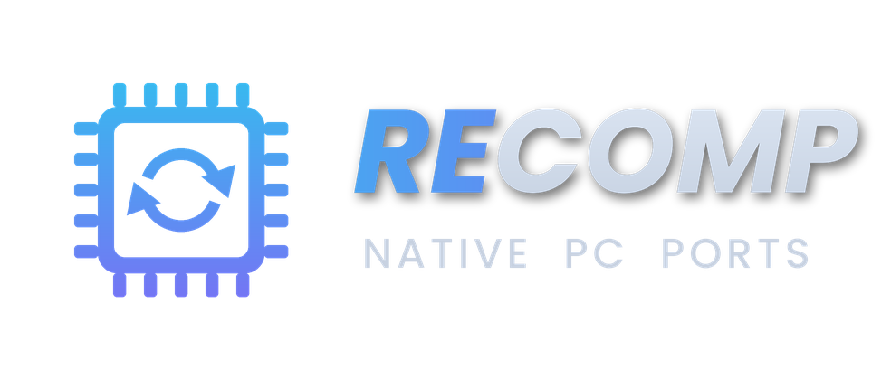

# Recompilations

<div align="left"><figure><figcaption></figcaption></figure></div>

Recompiled and decompiled ports are console games rebuilt as native Windows programs (Majora's Mask, Banjo-Kazooie, Star Fox 64, Sonic Unleashed...). No emulator is involved: RetroBat starts the port's executable directly and waits for it to close.

RetroBat does not ship these ports. They are installed with **Quiver Launcher**, or downloaded by hand from their official project page. Each port has its own instructions to provide the original game data (ROM, ISO or game files).

This system can contain:

* games installed with Quiver Launcher (shortcuts `.lnk`),
* decompilation ports with a `.decomp` file (in original system's roms\ subfolder)

## Information

<table data-header-hidden><thead><tr><th width="240"></th><th></th></tr></thead><tbody><tr><td><strong>Emulators</strong></td><td><ul><li>quiverlauncher</li></ul></td></tr><tr><td><strong>File folder</strong></td><td><span data-gb-custom-inline data-tag="emoji" data-code="1f4c2">📂</span> roms \ <span data-gb-custom-inline data-tag="emoji" data-code="1f4c2">📂</span> recomp</td></tr><tr><td><strong>File extension</strong></td><td>.lnk</td></tr></tbody></table>

## Controls

RetroBat does not perform automatic controller configuration for these ports. Configure the controls inside each port.

**HOTKEY + START** closes the game started from RetroBat and returns to RetroBat. In Quiver Launcher, it closes the launcher.


A game started from inside Quiver Launcher must be closed from its own menu. Leave the **Close to tray** option of Quiver Launcher disabled, otherwise closing the launcher only hides it and RetroBat keeps waiting.


## System Features

### Quiver Launcher

Quiver Launcher downloads, installs and updates community ports from their GitHub and GitLab releases:



#### Opening Quiver Launcher

* From the RetroBat menu entries, select **Quiver Launcher**. RetroBat downloads it on first use.
* Or set **RUN LAUNCHER** to ON in the advanced settings of a game of this system: the launcher opens instead of the game.

<div align="left"><figure><figcaption><p>Start QuiverLauncher from the RetroBat menu....</p></figcaption></figure></div>

<div align="left"><figure><figcaption><p>... or select RUN LAUNCHER from the gamelist</p></figcaption></figure></div>

RetroBat starts Quiver Launcher in fullscreen (unless RetroBat runs in a window), with gamepad navigation enabled. Usage statistics are disabled by default.

#### Adding games

1. Open Quiver Launcher and install the games you want.
2. Follow the instructions of each game to provide the original game data.
3. Add the games to RetroBat, automatically or manually:
   * **Automatically**: enable **MAIN MENU > GAME SETTINGS > SCAN RECOMPILATION (QUIVERLAUNCHER)**. At each start, RetroBat creates a shortcut in `roms\recomp` for every game installed in Quiver Launcher.
   * **Manually**: in Quiver Launcher, create a desktop shortcut for the game, then move this shortcut from your desktop to `roms\recomp`.
4. Refresh the gamelist or restart RetroBat.


If a game folder contains several executables, select the executable to use in Quiver Launcher first. Until then, the automatic scan skips this game.


#### What RetroBat does when starting a Quiver game

* The game is started directly, without opening Quiver Launcher.
* Fullscreen or windowed mode follows the RetroBat settings for recompilations.
* The game stores its configuration and saves in its own folder (`emulators\quiverlauncher\Apps\<game>`), instead of the Windows user folder.
* **Perfect Dark**: the **REGION** option selects the Europe, USA or Japan executable.

### Decomp ports (.decomp)

A `.decomp` port can be placed in the folder of its original console, to appear in the same gamelist as the console games (for example a Star Fox 64 port listed with the Nintendo 64 games). Whatever emulator is selected for the system or the game, a `.decomp` file is always started as a decomp port.

```
roms
└── n64
    ├── (Nintendo 64 games)
    └── Starship
        ├── Starship.exe
        └── Star Fox 64.decomp
```

The `.decomp` extension is currently accepted by the following systems:

<table><thead><tr><th width="280.25">System</th><th>Folder</th></tr></thead><tbody><tr><td>MAME</td><td><code>roms\mame</code></td></tr><tr><td>CPS-III</td><td><code>roms\cps3</code></td></tr><tr><td>Model 2</td><td><code>roms\model2</code></td></tr><tr><td>Model 3</td><td><code>roms\model3</code></td></tr><tr><td>Naomi</td><td><code>roms\naomi</code></td></tr><tr><td>Naomi 2</td><td><code>roms\naomi2</code></td></tr><tr><td>Super Nintendo</td><td><code>roms\snes</code></td></tr><tr><td>Nintendo 64</td><td><code>roms\n64</code></td></tr><tr><td>GameCube</td><td><code>roms\gamecube</code></td></tr><tr><td>Wii</td><td><code>roms\wii</code></td></tr><tr><td>Switch</td><td><code>roms\switch</code></td></tr><tr><td>Game Boy Advance</td><td><code>roms\gba</code></td></tr><tr><td>PlayStation</td><td><code>roms\psx</code></td></tr><tr><td>PlayStation 2</td><td><code>roms\ps2</code></td></tr><tr><td>PlayStation 3</td><td><code>roms\ps3</code></td></tr><tr><td>Xbox</td><td><code>roms\xbox</code></td></tr><tr><td>Xbox 360</td><td><code>roms\xbox360</code></td></tr></tbody></table>


RetroBat scans the subfolders of the console folder. If the port folder contains files using an extension of that console (for example `.zip` or `.wad` files in `roms\n64`), they also appear in the gamelist. Hide them from the gamelist, or keep these files out of the port folder when the port allows it.


#### Content of the .decomp file

The `.decomp` file can stay empty: RetroBat then starts the first executable (`.exe`) found next to it.

If the folder contains several executables, write the name of the executable to start on the first line, **without the `.exe` extension**:

```
Starship
```

* Only the folder containing the `.decomp` file is searched, not its subfolders.
* Empty lines and lines starting with `#` are ignored.
* If the name does not match any executable of the folder, RetroBat starts the first executable found.

The port is started from the folder containing the `.decomp` file.

If the game process has another name than the executable, create a `.gameexe` file with the same name as the `.decomp` file, in the same folder, containing the name of the game process (with or without `.exe`). RetroBat waits up to about 6 seconds for this process to appear, then waits until it closes.

### Upgrading from N64RecompLauncher

Quiver Launcher replaces N64RecompLauncher.

* Copy the content of the `roms\n64recomp` folder to `roms\recomp` .
* Games installed with N64RecompLauncher are not transferred: install them again in Quiver Launcher.
* Your saves stay in `emulators\n64recomplauncher\RecompiledGames\<game>`. Copy them to the folder of the same game in `emulators\quiverlauncher\Apps\<game>`.
