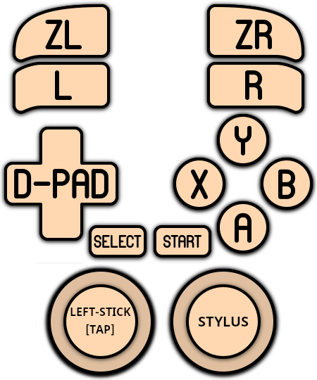
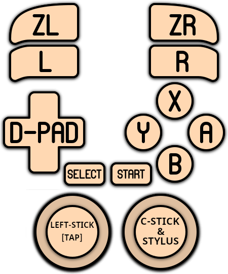
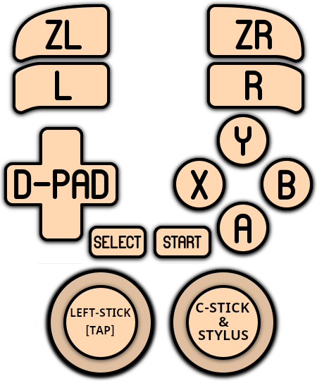

# Nintendo 3DS

<figure><figcaption></figcaption></figure>

## Overview

The **Nintendo 3DS** is a handheld console released by Nintendo in 2011. It has two screens: the top one shows glasses-free 3D, the bottom one is a touch screen used with a stylus. It also has a circle pad, a gyroscope and three cameras. The **New 3DS** (2014) adds a small stick (C-stick), the ZL and ZR triggers and a faster CPU: a few games only run on this model (**Xenoblade Chronicles 3D**).

Its games include **Mario Kart 7**, **Super Mario 3D Land**, **The Legend of Zelda: A Link Between Worlds**, **Ocarina of Time 3D**, **Pokémon X / Y**, **Pokémon Sun / Moon**, **Animal Crossing: New Leaf**, **Fire Emblem Awakening**, **Monster Hunter 4 Ultimate**, **Kid Icarus: Uprising** and **Luigi's Mansion 2**.

RetroBat offers several emulators: **Azahar** (default), the **azahar** libretro core, **Azahar Plus**, **Mandarine**, **Citra** and **BizHawk** (Encore core).



## At a glance

<table><thead><tr><th width="232.75"></th><th></th></tr></thead><tbody><tr><td><strong>Games folder</strong></td><td><code>roms\3ds</code></td></tr><tr><td><strong>Extensions</strong></td><td>.3ds .3dsx .z3dsx .cia .zcia .elf .axf .cci .zcci .cxi .zcxi .app .m3u .zip .7z .squashfs .decomp</td></tr><tr><td><strong>Default emulator</strong></td><td>azahar</td></tr><tr><td><strong>BIOS</strong></td><td>None</td></tr><tr><td><strong>Controller setup</strong></td><td>Automatic, every emulator</td></tr><tr><td><strong>Save states</strong></td><td>Azahar, Azahar Plus, azahar core, BizHawk</td></tr><tr><td><strong>RetroAchievements</strong></td><td>No</td></tr><tr><td><strong>Netplay</strong></td><td>No</td></tr><tr><td><strong>Light guns</strong></td><td>—</td></tr><tr><td><strong>Wheels</strong></td><td>—</td></tr><tr><td><strong>Optional BIOS</strong></td><td><code>aes_keys.txt</code>, <code>seeddb.bin</code> in <code>bios</code> (BizHawk)</td></tr></tbody></table>

## Which emulator should I use?

<table><thead><tr><th width="183.25">Emulator</th><th>Strengths</th><th>Limitations</th></tr></thead><tbody><tr><td><strong>azahar</strong> (default)</td><td>Official successor of Citra, the most up to date. Up to 18x resolution, Vulkan or OpenGL, compressed formats (.zcci, .zcia…), save states managed by RetroBat, controller hotkeys aligned with RetroBat.</td><td>Only reads decrypted games.</td></tr><tr><td><strong>libretro: azahar</strong></td><td>Same emulation in RetroArch: shaders, RetroArch hotkeys, touch screen with the mouse or the right stick.</td><td>No launch through <code>.m3u</code> (installed games).</td></tr><tr><td><strong>azahar-plus</strong></td><td>Modified Azahar that reads every file accepted by the older Citra versions.</td><td>Unofficial project.</td></tr><tr><td><strong>mandarine</strong></td><td>Another Citra-based version (Mandarine Neo).</td><td>No Azahar compressed formats. Save states not managed by RetroBat.</td></tr><tr><td><strong>citra</strong></td><td>The original Citra.</td><td>No longer developed since 2024. No Azahar compressed formats.</td></tr><tr><td><strong>bizhawk</strong> (Encore)</td><td>BizHawk tools (recording, TAS), touch screen with the right stick.</td><td>No Azahar compressed formats.</td></tr></tbody></table>

## BIOS

No BIOS is needed.

BizHawk also uses, when present in `bios`, `aes_keys.txt` (decryption keys) and `seeddb.bin` (keys of some downloaded games).

## Which game format?

<table><thead><tr><th width="241.5">Format</th><th>Description</th></tr></thead><tbody><tr><td><strong>.cci</strong> / <strong>.3ds</strong></td><td>Cartridge dump. It must be decrypted. If Azahar refuses a <code>.3ds</code>, rename it to <code>.cci</code> (same format) or use Azahar Plus.</td></tr><tr><td><strong>.cxi</strong></td><td>Standalone application (executable content of a game).</td></tr><tr><td><strong>.3dsx</strong> / <strong>.elf</strong> / <strong>.axf</strong></td><td>Homebrew.</td></tr><tr><td><strong>.cia</strong></td><td>Installation file: it is installed into the emulated console (see <a href="nintendo-3ds.md#running-an-installed-game-.cia-eshop"><strong>Guides</strong></a>), it does not start directly.</td></tr><tr><td><strong>.zcci</strong> / <strong>.zcxi</strong> / <strong>.z3dsx</strong> / <strong>.zcia</strong></td><td>Azahar compressed formats (Azahar <strong>Tools > Compress ROM File</strong> menu). Read by Azahar, Azahar Plus and the azahar core.</td></tr><tr><td><strong>.app</strong> / <strong>.m3u</strong></td><td>Game installed in the emulated console; the <code>.m3u</code> holds the path of the <code>.app</code> (see <a href="nintendo-3ds.md#running-an-installed-game-.cia-eshop"><strong>Guides</strong></a>).</td></tr><tr><td><strong>.zip</strong> / <strong>.7z</strong> / <strong>.squashfs</strong></td><td>Archive holding the game, extracted at launch.</td></tr><tr><td><strong>.decomp</strong></td><td>PC port, see the <a href="../../others/recomp.md"><strong>Recompilations</strong></a> page.</td></tr></tbody></table>

Games must be decrypted: dumped from your console with GodMode9, for example. An encrypted game does not start with Azahar.

## Controls

### Automatic setup

Buttons are mapped by position, as on the console:

<table><thead><tr><th width="299">RetroBat controller</th><th>3DS</th></tr></thead><tbody><tr><td>EAST / SOUTH / NORTH / WEST</td><td>A / B / X / Y</td></tr><tr><td>D-pad</td><td>D-pad</td></tr><tr><td>Left stick</td><td>Circle pad</td></tr><tr><td>Right stick</td><td>C-stick (New 3DS); touch screen pointer with the azahar core and BizHawk (see below)</td></tr><tr><td>L1 / R1</td><td>L / R</td></tr><tr><td>L2 / R2</td><td>ZL / ZR (New 3DS)</td></tr><tr><td>START / SELECT</td><td>START / SELECT</td></tr></tbody></table>

**CONTROLS > INVERT FACE BUTTONS** places the buttons by their name on an Xbox controller (A on SOUTH, B on EAST…).

| Standard                                         | Inverted                                         |
| ------------------------------------------------ | ------------------------------------------------ |
| .png>) | .png>) |

### Touch screen

* **Azahar, Azahar Plus, Mandarine, Citra**: click in the bottom screen with the mouse. With Azahar and Azahar Plus, **CONTROLS > TOUCH DEVICE** can also use a CemuHook device. **CONTROLS > USE TOUCH PROFILE** loads a "touch from button" profile created in the emulator (a controller button touches a point of the screen): enter the exact profile name.
* **azahar core**: mouse (unless **CONTROLS > DISABLE MOUSE** is on) or pointer on the right stick, depending on **CONTROLS > RIGHT STICK FUNCTION** (C-STICK AND TOUCHSCREEN POINTER by default, TOUCHSCREEN POINTER, C-STICK). **L3** touches the screen where the pointer is. **CONTROLS > HIDE TOUCHSCREEN POINTER** hides it when it does not move.
* **BizHawk**: pointer on the right stick, depending on **CONTROLS > RIGHT STICK FUNCTION**.

With the azahar core and BizHawk, the tattoo shown follows the function chosen for the right stick.

<table><thead><tr><th width="364">Option</th><th>Control layout</th></tr></thead><tbody><tr><td><strong>Right-Stick as Touchscreen Pointer</strong></td><td></td></tr><tr><td><strong>Right-Stick as Touchscreen Pointer (inverted)</strong></td><td></td></tr><tr><td><strong>Right-Stick as C-Stick &#x26; Touchscreen Pointer</strong></td><td></td></tr><tr><td><strong>Right-Stick as C-Stick &#x26; Touchscreen Pointer (inverted)</strong></td><td></td></tr></tbody></table>

### Gyroscope

* **Azahar, Azahar Plus, Mandarine, Citra**: **CONTROLS > USE MOTION**: MOUSE (default), CONTROLLER (controller with a gyroscope: DualShock 4, DualSense, Switch Pro…) or CEMUHOOK.
* **azahar core**: **CONTROLS > ENABLE MOTION** (controller with a gyroscope).

### Hotkeys

Azahar and Azahar Plus use the RetroBat hotkeys:

<table><thead><tr><th width="223.25">Action</th><th>Controller</th><th>Keyboard</th></tr></thead><tbody><tr><td>Exit</td><td>HOTKEY + START</td><td><code>Esc</code></td></tr><tr><td>Save state</td><td>HOTKEY + WEST</td><td><code>F2</code></td></tr><tr><td>Load state</td><td>HOTKEY + NORTH</td><td><code>F4</code></td></tr><tr><td>Screenshot</td><td>HOTKEY + R3</td><td><code>F8</code></td></tr><tr><td>Pause</td><td>HOTKEY + SOUTH</td><td><code>P</code></td></tr><tr><td>Fast forward (hold)</td><td>HOTKEY + Right</td><td>—</td></tr><tr><td>Swap screens</td><td>HOTKEY + L1</td><td>—</td></tr><tr><td>Change screen layout</td><td>HOTKEY + R1</td><td>—</td></tr><tr><td>Fullscreen</td><td>—</td><td><code>F1</code></td></tr></tbody></table>

* **Mandarine**: HOTKEY + START (exit), HOTKEY + SOUTH (pause), HOTKEY + R3 (screenshot), HOTKEY + L3 (fullscreen).
* **Citra**: HOTKEY + START (exit).
* **azahar core**, **BizHawk**: RetroArch and BizHawk hotkeys.

For more details, see the [**Hotkeys**](../../../../navigation/hotkeys.md) page.

## Folders

<table><thead><tr><th width="364">Content</th><th>Folder</th></tr></thead><tbody><tr><td>Azahar, Azahar Plus, azahar core: internal memory and SD card</td><td><code>saves\3ds\azahar\nand</code>, <code>saves\3ds\azahar\sdmc</code> (shared by all three)</td></tr><tr><td>Azahar: save states</td><td><code>saves\3ds\azahar\states</code> (Azahar Plus: <code>saves\3ds\azahar-plus\states</code>)</td></tr><tr><td>azahar core: save states</td><td><code>saves\3ds\libretro.azahar</code></td></tr><tr><td>Mandarine</td><td><code>saves\3ds\mandarine\nand</code>, <code>saves\3ds\mandarine\sdmc</code></td></tr><tr><td>Citra</td><td><code>saves\3ds\Citra\nand</code>, <code>saves\3ds\Citra\sdmc</code></td></tr><tr><td>BizHawk</td><td><code>saves\3ds\bizhawk\user</code></td></tr><tr><td>Configuration (Azahar, Azahar Plus, Mandarine, Citra)</td><td><code>emulators\&#x3C;emulator>\user\config\qt-config.ini</code></td></tr><tr><td>Screenshots</td><td><code>screenshots\azahar</code> (Azahar, Azahar Plus), <code>screenshots\mandarine</code>, <code>screenshots\citra</code></td></tr></tbody></table>

## Guides

### Running an installed game (.cia, eShop)

A `.cia` is installed into the memory of the emulated console, then the installed game is launched with a `.m3u` file (Azahar, Azahar Plus, Mandarine, Citra).

1. Start the emulator from the `emulators` folder, **File > Install CIA** menu, and choose the `.cia`.
2. Right-click the installed game, **Create Shortcut > Add to Desktop**.
3. Copy the path of the `.app` shown in the shortcut (last part of the target, without the quotes) to a text file.
4. Save this file with the `.m3u` extension in `roms\3ds`, then update the game list.

<figure><figcaption></figcaption></figure>

### Custom textures

1. Put the texture pack in `emulators\<emulator>\user\load\textures\<game ID>` (azahar core: `saves\3ds\azahar\load\textures\<game ID>`). The game ID is shown in the emulator: right-click the game, **Open Custom Texture Location**.
2. Turn on **VISUAL RENDERING > CUSTOM TEXTURES**, and if needed **VISUAL RENDERING > PREFETCH CUSTOM TEXTURES** (Azahar, Mandarine, Citra: loads the whole pack at startup).

### Screen layout

**VIDEO > SCREEN LAYOUT POSITIONING** chooses the layout: TOP-BOTTOM SCREEN (default), SINGLE SCREEN ONLY, LARGE SCREEN / SMALL SCREEN, SIDE BY SIDE, SEPARATED WINDOWS and HYBRID (Azahar, Mandarine, Citra). **VIDEO > SWAP SCREEN** puts the bottom screen first.

With the RetroBat default decorations, Azahar places both screens inside the decoration: the chosen layout is then ignored.

### Region and language

**EMULATION > REGION** forces the console region (automatic by default, from the game). **EMULATION > LANGUAGE** changes the console language, used by games that offer it; by default, the RetroBat language.

## Known issues

<table><thead><tr><th width="364">Issue</th><th>Solution</th></tr></thead><tbody><tr><td>Azahar shows an error at launch (encrypted or unsupported game)</td><td>The game must be decrypted. Try renaming the <code>.3ds</code> to <code>.cci</code>, or use Azahar Plus.</td></tr><tr><td>A <code>.cia</code> does not start</td><td>Install it first in the emulator (see <a href="nintendo-3ds.md#running-an-installed-game-.cia-eshop"><strong>Guides</strong></a>).</td></tr><tr><td>A game requires a New 3DS</td><td>With the azahar core, set <strong>EMULATION > 3DS MODEL</strong> to NEW 3DS (default value).</td></tr><tr><td>The game stutters the first time an effect is shown</td><td>Keep <strong>VIDEO > USE ASYNCHRONOUS SHADER COMPILATION</strong> on (default with Azahar).</td></tr><tr><td>An Azahar save state launched from RetroBat does not load</td><td>Azahar cannot load a state at launch: RetroBat sends the load key (<code>F4</code>) once the game has started. Do not touch the keyboard meanwhile, or load it with HOTKEY + NORTH.</td></tr></tbody></table>
