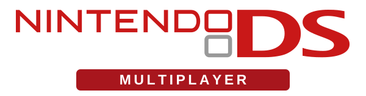

# Nintendo DS Multiplayer

<figure><figcaption></figcaption></figure>

## Overview

**Nintendo DS Multiplayer** lets several players play **Nintendo DS** games on a single PC: 2 to 4 DS consoles are shown side by side in the same window, linked by an emulated local wireless connection, with one controller per player. This brings back multi-console games (DS Wireless Play) and **DS Download Play** (a single cartridge for the whole group).

This system uses the **melondsds\_splitscreen** libretro core (melonDS DS Splitscreen 1.1, modified version of melonDS DS 1.4.0). It is **experimental**: test release, still limited compatibility (see **Known issues**).

To play DS games alone, use the **Nintendo DS** system (see the [**Nintendo DS**](nintendo-ds.md) page).

## At a glance

<table><thead><tr><th width="241.5"></th><th></th></tr></thead><tbody><tr><td><strong>Games folder</strong></td><td><code>roms\ndsmultiplayer</code></td></tr><tr><td><strong>Extensions</strong></td><td>.nds .zip .7z</td></tr><tr><td><strong>Default emulator</strong></td><td>libretro: melondsds_splitscreen</td></tr><tr><td><strong>BIOS</strong></td><td><code>bios7.bin</code>, <code>bios9.bin</code>, <code>firmware.bin</code> in <code>bios</code> (required for DS Download Play)</td></tr><tr><td><strong>Controller setup</strong></td><td>Automatic, one controller per player (2 to 4 players)</td></tr><tr><td><strong>Save states</strong></td><td>No</td></tr><tr><td><strong>RetroAchievements</strong></td><td>No</td></tr><tr><td><strong>Netplay</strong></td><td>No</td></tr><tr><td><strong>Light guns</strong></td><td>—</td></tr><tr><td><strong>Wheels</strong></td><td>—</td></tr><tr><td><strong>Optional BIOS</strong></td><td>—</td></tr></tbody></table>

## Which emulator should I use?

<table><thead><tr><th width="217">Emulator</th><th>Strengths</th><th>Limitations</th></tr></thead><tbody><tr><td><strong>libretro: melondsds_splitscreen</strong> (only emulator)</td><td>2 to 4 DS in a single window, emulated local wireless connection, Multi-Card and DS Download Play, separate save for each player.</td><td>Test release. Player 1 sound only. Software rendering, experimental JIT recompiler (off by default): needs a powerful PC with 3 or 4 players. No save states, rewind, run-ahead, RetroAchievements, cheats, microphone or GBA slot.</td></tr></tbody></table>

## BIOS

<table><thead><tr><th width="169.5">File</th><th width="125.25">Folder</th><th>Role</th></tr></thead><tbody><tr><td><code>bios7.bin</code></td><td><code>bios</code></td><td>DS ARM7 BIOS</td></tr><tr><td><code>bios9.bin</code></td><td><code>bios</code></td><td>DS ARM9 BIOS</td></tr><tr><td><code>firmware.bin</code></td><td><code>bios</code></td><td>Firmware of a DS or DS Lite (bootable)</td></tr></tbody></table>

These are the same files as for the Nintendo DS system.

* **DS Download Play**: all three files are required, and **EMULATION > USE BUILT-IN BIOS** must stay off.
* **Multi-Card**: the files are optional, the core built-in BIOS is enough.

The RetroBat BIOS check lists them as optional, since they are only needed for DS Download Play.

## Which game format?

<table><thead><tr><th width="192.75">Format</th><th>Description</th></tr></thead><tbody><tr><td><strong>.nds</strong></td><td>DS cartridge dump.</td></tr><tr><td><strong>.zip</strong> / <strong>.7z</strong></td><td>Archive holding the <code>.nds</code>.</td></tr></tbody></table>

DSi-exclusive games are refused. DSi-enhanced DS games run in DS mode.

## Controls

### Core menu

At launch, the core shows the **Select Players** screen:

<table><thead><tr><th width="212.75">Button (player 1)</th><th>Action</th></tr></thead><tbody><tr><td>D-pad left / right</td><td>Number of players (2 to 4)</td></tr><tr><td>NORTH</td><td>Mode: <strong>Multi-Card</strong> or <strong>Download Play</strong> (DS Download Play)</td></tr><tr><td>EAST or START</td><td>Start</td></tr></tbody></table>

This screen is shown at each launch. The number of players and the mode offered at first are set in RetroBat with **EMULATION > NUMBER OF PLAYERS** (2 by default) and **EMULATION > LOCAL MULTIPLAYER MODE** (Multi-Card by default): then you only have to press EAST.

### Automatic setup

Each player uses their own controller (ports 1 to 4):

<table><thead><tr><th width="302.75">RetroBat controller</th><th>DS</th></tr></thead><tbody><tr><td>EAST / SOUTH / NORTH / WEST</td><td>A / B / X / Y</td></tr><tr><td>D-pad</td><td>D-pad</td></tr><tr><td>L1 / R1</td><td>L / R</td></tr><tr><td>START / SELECT</td><td>START / SELECT</td></tr><tr><td>Right stick</td><td>Touch screen cursor</td></tr><tr><td>R2</td><td>Touch the screen</td></tr></tbody></table>

Each player controls the touch screen with their own controller (right stick to move the cursor, R2 to touch).

### Hotkeys

Standard RetroArch hotkeys (HOTKEY = SELECT), for example HOTKEY + START to exit. Save states and rewind do not work with this core. For more details, see the [**Hotkeys**](../../../../navigation/hotkeys.md) page.

## Folders

<table><thead><tr><th width="252.75">Content</th><th>Folder</th></tr></thead><tbody><tr><td>BIOS</td><td><code>bios</code></td></tr><tr><td>Game saves (one per player)</td><td><code>saves\ndsmultiplayer\&#x3C;game>.&#x3C;crc32>.splitscreen-p1.srm</code> … <code>-p4.srm</code></td></tr></tbody></table>

Saves are separate from those of the Nintendo DS system: progress made on `nds` is not reused here.

## Guides

### Multi-Card game (each player has the cartridge)

1. Start the game, choose the number of players and **Multi-Card**, then EAST.
2. Each player opens the game's multiplayer menu on their console (for example "Multiplayer" or "Wireless Play").
3. One player creates the game, the others join it.

### DS Download Play game (a single cartridge)

1. Check the BIOS and firmware (see **BIOS**) and that **EMULATION > USE BUILT-IN BIOS** is off.
2. Start the game, choose the number of players and **Download Play** (NORTH to switch the mode), then EAST. To skip this at each game, set **EMULATION > LOCAL MULTIPLAYER MODE** to **DOWNLOAD PLAY**.
3. Player 1 has the cartridge: they create the game in the game.
4. Guests start without a cartridge, on the DS Download Play search screen: they select the game and confirm (right stick to move the cursor, R2 to touch). If their firmware shows another menu, they open DS Download Play with R2. During startup, EAST, SOUTH or R2 gives control back to the player's controller.

### Options

| Option                                 | Effect                                                                                 |
| -------------------------------------- | -------------------------------------------------------------------------------------- |
| **EMULATION > NUMBER OF PLAYERS**      | Number of players offered on the Select Players screen (2, 3 or 4).                    |
| **EMULATION > LOCAL MULTIPLAYER MODE** | Mode offered on the Select Players screen: **MULTI-CARD** or **DOWNLOAD PLAY**.        |
| **EMULATION > CONSOLE LANGUAGE**       | Language of the emulated consoles (the firmware one with FIRMWARE LANGUAGE).           |
| **EMULATION > USE BUILT-IN BIOS**      | Core BIOS instead of the files of the `bios` folder. Keep it off for DS Download Play. |
| **EMULATION > JIT RECOMPILER**         | Improves performance, experimental with several consoles (off by default).             |
| **AUDIO > BIT DEPTH**                  | Sound quality (automatic by default: 10 bits for the DS).                              |
| **AUDIO > INTERPOLATION**              | Sound smoothing.                                                                       |

## Known issues

| Issue                                                                                                             | Solution                                                                                                                                                                                         |
| ----------------------------------------------------------------------------------------------------------------- | ------------------------------------------------------------------------------------------------------------------------------------------------------------------------------------------------ |
| Compatibility                                                                                                     | According to the author (a single test machine, Legion Go S), these work: **Mario Party DS** (DS Download Play), **Diddy Kong Racing DS**, **Shrek Smash n' Crash Racing**, **Burnout Legends**. |
| **Mario Kart DS** freezes in multiplayer                                                                          | Known core issue. Solo races side by side work.                                                                                                                                                  |
| DS Download Play refuses to start ("Download Play requires native Nintendo DS BIOS files and bootable firmware.") | Copy `bios7.bin`, `bios9.bin` and `firmware.bin` to `bios` and turn off **EMULATION > USE BUILT-IN BIOS**.                                                                                       |
| No sound for players 2 to 4                                                                                       | Normal: only player 1 sound is played.                                                                                                                                                           |
| The game slows down with 3 or 4 players                                                                           | The core emulates each console with software rendering: turn on **EMULATION > JIT RECOMPILER** (experimental: turn it off if a game crashes) or reduce the number of players.                    |
| A DSi game does not start                                                                                         | DSi-exclusive games are not supported.                                                                                                                                                           |
| No decoration around the picture                                                                                  | Normal: the picture width depends on the number of players (4:3 with 2 players, 2:1 with 3, 8:3 with 4).                                                                                         |
| The netplay option is offered                                                                                     | It has no effect: the core does not support netplay. Play on a single PC.                                                                                                                        |
