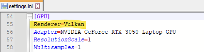

# Configuration des systèmes et des jeux

Un des grands avantages de RetroBat est que les émulateurs se configurent **depuis les menus de RetroBat**, pour tous les jeux, pour un système ou pour un seul jeu. Vous n'avez pas besoin d'ouvrir les émulateurs pour les configurer.


Ne modifiez pas dans un émulateur un réglage qui existe aussi dans RetroBat : RetroBat écrit sa propre valeur dans la configuration de l'émulateur à chaque lancement de jeu, votre modification serait donc écrasée. Voir Comment ça marche ?


## Les trois niveaux de configuration

Les réglages disponibles dans RetroBat sont appelés **fonctionnalités** (« features »). Ils peuvent être définis à trois niveaux :

<table><thead><tr><th width="127">Niveau</th><th width="373.75">Où</th><th>S'applique à</th></tr></thead><tbody><tr><td><strong>Global</strong></td><td><strong>MENU PRINCIPAL</strong> > <strong>PARAMÈTRES DES JEUX</strong></td><td>Tous les systèmes et tous les jeux</td></tr><tr><td><strong>Système</strong></td><td>Vue Jeux > <strong>SELECT</strong> (<a href="view-options.md">Options d'affichage</a>) > <strong>CONFIGURATION AVANCÉE DU SYSTÈME</strong></td><td>Tous les jeux du système</td></tr><tr><td><strong>Jeu</strong></td><td>Vue Jeux > maintenir <strong>Sud</strong> sur un jeu (<a href="game-options.md">Options du jeu</a>) > <strong>CONFIGURATION AVANCÉE DU JEU</strong></td><td>Ce jeu uniquement</td></tr></tbody></table>

**Le réglage le plus précis l'emporte toujours :** un réglage du jeu remplace celui du système, qui remplace le réglage global.


Seuls les réglages les plus courants (filtres vidéo, décorations, format d'affichage, mise à l'échelle entière, autoconfiguration des manettes…) existent au niveau global. Les réglages propres à chaque émulateur ne sont disponibles qu'aux niveaux système et jeu.


## Ouvrir la configuration

### Pour un système

Dans la Vue Jeux du système, appuyez sur **SELECT** et choisissez **CONFIGURATION AVANCÉE DU SYSTÈME** :

<figure><figcaption>
Accéder aux fonctionnalités depuis les OPTIONS D'AFFICHAGE
</figcaption></figure>

Les réglages s'appliqueront à tous les jeux de ce système.

### Pour un jeu

Dans la Vue Jeux, maintenez **Sud** sur le jeu et choisissez **CONFIGURATION AVANCÉE DU JEU** (ou appuyez sur **Nord** dans le menu Options du jeu) :

<figure><figcaption></figcaption></figure>

Les réglages s'appliqueront uniquement à ce jeu.

## Le menu de configuration

<figure><figcaption>
Exemple de réglages pour NES avec le core FCEUMM
</figcaption></figure>

Le menu commence toujours par la ligne **ÉMULATEUR** : choisissez l'émulateur et le core à utiliser. **Changez d'abord l'émulateur** : le menu se recharge et affiche les réglages disponibles pour l'émulateur choisi. Chaque émulateur a ses propres réglages, la liste change donc d'un émulateur à l'autre.

Les réglages sont ensuite regroupés ainsi :

<table><thead><tr><th width="251.5">Groupe</th><th>Contenu</th></tr></thead><tbody><tr><td><strong>GENERAL SETTINGS</strong></td><td>Réglages disponibles pour la plupart des émulateurs : filtres vidéo, décorations (bezels) et tatouage, format d'affichage, mode vidéo, mise à l'échelle entière, lissage…</td></tr><tr><td><strong>ADVANCED SETTINGS</strong></td><td>Réglages propres à l'émulateur ou au core, organisés en sous-menus (voir ci-dessous)</td></tr><tr><td><strong>PORT SETTINGS</strong></td><td>Pour les ports : réglages du jeu sélectionné</td></tr></tbody></table>

Les sous-menus les plus fréquents des **ADVANCED SETTINGS** sont :

<table><thead><tr><th width="256.5">Sous-menu</th><th>Contenu</th></tr></thead><tbody><tr><td><strong>ÉMULATION</strong></td><td>Machine émulée, région, langue, BIOS, performances…</td></tr><tr><td><strong>VIDÉO</strong></td><td>Moteur de rendu, résolution interne, index de l'écran, orientation de l'écran…</td></tr><tr><td><strong>RENDU VISUEL</strong></td><td>Mise à l'échelle, filtrage des textures, anticrénelage, effets d'écran…</td></tr><tr><td><strong>SYNCHRONISATION VIDÉO</strong></td><td>V-Sync et autres réglages de synchronisation</td></tr><tr><td><strong>AUDIO</strong></td><td>Réglages audio (fréquence d'échantillonnage, filtres…)</td></tr><tr><td><strong>RÉDUCTION DE LA LATENCE</strong></td><td>Réglages pour réduire le décalage des commandes</td></tr><tr><td><strong>INTERFACE UTILISATEUR</strong></td><td>Affichage des FPS, notifications de l'émulateur…</td></tr><tr><td><strong>PILOTES</strong></td><td>Pilotes vidéo, audio et des manettes</td></tr><tr><td><strong>CONTRÔLES</strong></td><td>Type de manette, sticks analogiques, affectations…</td></tr><tr><td><strong>PISTOLETS</strong> / <strong>VOLANTS</strong></td><td>Réglages des pistolets et des volants</td></tr><tr><td><strong>TURBO</strong></td><td>Boutons turbo</td></tr><tr><td><strong>PATCHS</strong> / <strong>CORRECTIFS</strong> / <strong>HACKS MANUELS</strong></td><td>Patchs et correctifs pour certains jeux</td></tr></tbody></table>

<figure><figcaption>
Exemple du sous-menu ÉMULATION pour le core FCEUMM
</figcaption></figure>

Certains émulateurs ont leurs propres sous-menus, par exemple **HACKS MANUELS** et **CORRECTIFS** pour PCSX2 :

<figure><figcaption></figcaption></figure>


Sélectionnez un réglage pour afficher sa description en bas de l'écran.


## Que signifie « AUTO » ?

<table><thead><tr><th width="144">Niveau</th><th>AUTO signifie…</th></tr></thead><tbody><tr><td>Global</td><td>La valeur par défaut choisie par l'équipe RetroBat, en général la plus compatible</td></tr><tr><td>Système</td><td>La valeur globale s'il y en a une, sinon la valeur par défaut de RetroBat</td></tr><tr><td>Jeu</td><td>La valeur définie pour le système</td></tr></tbody></table>

Pour annuler un réglage, remettez-le sur **AUTO**.

## Comment ça marche ?

Quand vous modifiez un réglage, RetroBat l'enregistre dans le fichier `emulationstation\.emulationstation\es_settings.cfg`.

Au lancement d'un jeu, RetroBat :

1. lit les réglages globaux, puis ceux du système, puis ceux du jeu (le plus précis l'emporte) ;
2. écrit les valeurs correspondantes dans les fichiers de configuration de l'émulateur ;
3. démarre l'émulateur.

**Exemple :** utiliser le rendu Vulkan pour les jeux PlayStation avec DuckStation.

1. Dans la Vue Jeux PlayStation, appuyez sur **SELECT** > **CONFIGURATION AVANCÉE DU SYSTÈME**.

<figure><figcaption></figcaption></figure>

2. Ouvrez le sous-menu **PILOTES** du groupe **ADVANCED SETTINGS**.

<figure><figcaption></figcaption></figure>

3. Réglez **VIDÉO** sur **VULKAN**.

<figure><figcaption></figcaption></figure>

Au lancement d'un jeu, RetroBat écrit `Renderer = Vulkan` dans la section `[GPU]` du fichier `emulators\duckstation\settings.ini` :

<figure><figcaption></figcaption></figure>

Si le réglage est laissé sur **AUTO**, RetroBat écrit `Renderer = Automatic` : c'est pour cela qu'une modification faite directement dans DuckStation serait perdue.


* Les réglages disponibles dans RetroBat sont écrits à chaque lancement, avec votre valeur ou la valeur par défaut de RetroBat : modifiez-les toujours dans RetroBat.
* Les réglages qui n'existent pas dans RetroBat sont en général conservés : vous pouvez les modifier dans l'émulateur.
* Pour configurer vous-même les contrôles dans un émulateur, réglez **AUTOCONFIGURER LES MANETTES** sur **OFF** pour ce système ou ce jeu.



Les réglages d'un jeu sont liés au **nom de son fichier**. Si vous renommez le fichier, ses réglages sont perdus. Deux fichiers portant le même nom dans un même système partagent les mêmes réglages.


## En cas de problème

* **Un réglage n'a pas d'effet :** vérifiez qu'il n'est pas remplacé au niveau du jeu, et que le bon émulateur est sélectionné.
* **Vérifier ce que RetroBat a appliqué :** les fichiers de log indiquent les valeurs appliquées au lancement :
  * `emulationstation\emulatorLauncher.log` (lancement du jeu et configuration de l'émulateur)
  * `emulationstation\.emulationstation\es_log.txt` (interface de RetroBat)
* **Revenir à la configuration par défaut :** remettez les réglages sur **AUTO**.

## Je ne trouve pas le réglage dont j'ai besoin

Si un émulateur propose un réglage que vous aimeriez modifier depuis RetroBat, contactez l'équipe RetroBat sur [Discord](https://discord.gg/GVcPNxwzuT) ou sur le [forum](https://retrobat.forumgaming.fr/) : il pourra être ajouté dans une prochaine version.

En attendant, vous pouvez le modifier directement dans l'émulateur : les réglages qui n'existent pas dans RetroBat ne sont en général pas écrasés.
