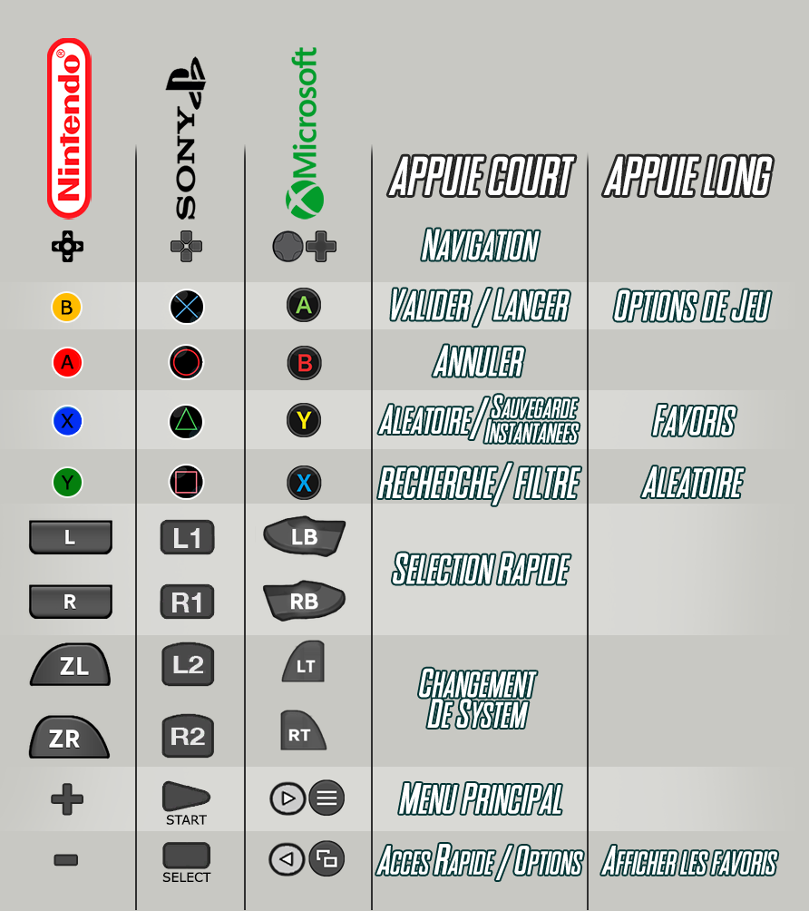
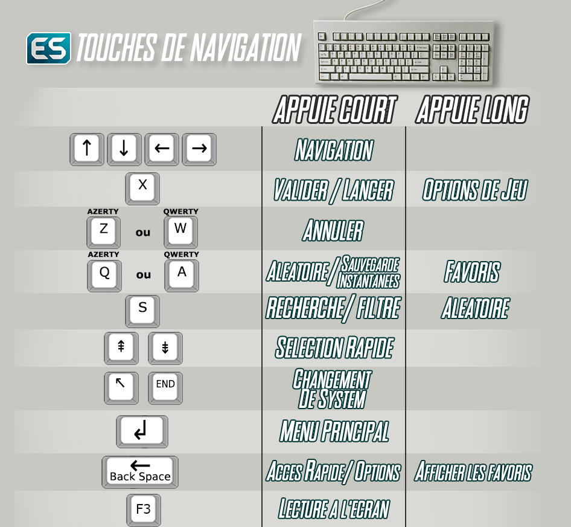

# Navigation

Vous pouvez naviguer dans les écrans et menus de RetroBat avec une manette ou un clavier.

Une notice détaillée au format PDF (`notice_french.pdf`) est également disponible dans votre dossier RetroBat ou ici:



## Manette

Les boutons sont désignés par leur position sur la manette : par exemple, **Sud** est le bouton du bas (B sur Nintendo, ✕ sur PlayStation, A sur Xbox).

| Action                                   | Appui long           | Nintendo             | PlayStation          | Xbox                 |
| ---------------------------------------- | -------------------- | -------------------- | -------------------- | -------------------- |
| Naviguer                                 |                      | Croix / Stick gauche | Croix / Stick gauche | Croix / stick gauche |
| Valider / Lancer un jeu                  | Options du jeu       | B                    | ✕                    | A                    |
| Retour / Annuler                         |                      | A                    | ◯                    | B                    |
| Jeu au hasard / SaveStates               | Ajouter aux favoris  | X                    | △                    | Y                    |
| Rechercher / Filtrer                     | Jeu au hasard        | Y                    | ▢                    | X                    |
| Sélection rapide (défiler dans la liste) |                      | L / R                | L1 / R1              | LB / RB              |
| Système précédent / suivant              |                      | ZL / ZR              | L2 / R2              | LT / RT              |
| Menu principal                           |                      | +                    | START                | Menu (☰)             |
| Accès rapide / Options                   | Afficher les favoris | −                    | SELECT               | Affichage (⧉)        |
| Passer à la musique suivante             |                      | Clic stick gauche    | L3                   | Clic stick gauche    |

<figure><figcaption></figcaption></figure>

## Clavier

<table><thead><tr><th>Action</th><th width="195.75">Appui long</th><th>Touche</th></tr></thead><tbody><tr><td>Naviguer</td><td></td><td>Flèches</td></tr><tr><td>Valider / Lancer un jeu</td><td>Options du jeu</td><td><code>X</code></td></tr><tr><td>Retour / Annuler</td><td></td><td><code>Z</code></td></tr><tr><td>Jeu au hasard / SaveStates</td><td>Ajouter aux favoris</td><td><code>Q</code></td></tr><tr><td>Rechercher / Filtrer</td><td>Jeu au hasard</td><td><code>S</code></td></tr><tr><td>Sélection rapide (défiler dans la liste)</td><td></td><td><code>Page préc.</code> / <code>Page suiv.</code></td></tr><tr><td>Système précédent / suivant</td><td></td><td><code>Début</code> (↖) / <code>Fin</code></td></tr><tr><td>Menu principal</td><td></td><td><code>Entrée</code></td></tr><tr><td>Accès rapide / Options</td><td>Afficher les favoris</td><td><code>Retour arrière</code> (⌫)</td></tr><tr><td>Hotkey</td><td></td><td><code>Ctrl droit</code></td></tr><tr><td>Passer à la musique suivante</td><td></td><td><code>Inser</code></td></tr><tr><td>Activer / désactiver la lecture d'écran</td><td></td><td><code>F3</code></td></tr></tbody></table>


Les touches sont les mêmes quelle que soit la disposition de votre clavier (AZERTY ou QWERTY) : utilisez la touche portant la lettre indiquée dans le tableau.


<figure><figcaption></figcaption></figure>
