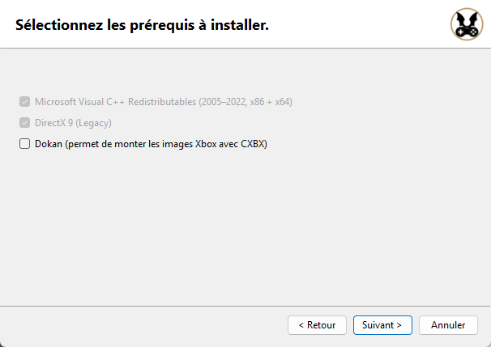

# Installation & Premier démarrage

## Installation

* Téléchargez la dernière version de l'installeur sur le [site web RetroBat](https://www.retrobat.org/telechargement/).
* Lancez le programme d'installation et cliquez sur **Suivant**.

<figure><figcaption></figcaption></figure>

* Lisez et acceptez la licence utilisateur, puis cliquez sur **Suivant**.

<figure><figcaption></figcaption></figure>

* Sélectionnez les prérequis manquants à installer, puis cliquez sur **Suivant**.


L'installeur installe automatiquement les prérequis nécessaires (Visual C++ Redistributables, DirectX). S'ils sont déjà installés, cette page n'apparaît pas.


<figure><figcaption></figcaption></figure>

* Choisissez le dossier d'installation et cliquez sur **Installer**.


**Où installer RetroBat**

Installez RetroBat dans un chemin court, à l'intérieur d'un dossier, par exemple `C:\RetroBat` ou `D:\Jeux\RetroBat`.

À éviter :

* L'installation directement à la racine d'un lecteur (les fichiers de RetroBat se retrouveraient mélangés au reste de `D:\`). Créez toujours un dossier.
* Les espaces, accents ou caractères spéciaux dans le chemin.
* Les chemins trop longs ou les sous-dossiers trop nombreux : ils posent problème à certains émulateurs (par exemple le core libretro MAME).
* `C:\Program Files` ou `C:\Program Files (x86)` : Windows y limite l'écriture, les réglages et sauvegardes risquent de ne pas être enregistrés.
* Les dossiers synchronisés avec OneDrive (Bureau, Documents, Images sont souvent synchronisés par défaut).


<figure><figcaption></figcaption></figure>

* Attendez la fin de l'installation, puis cliquez sur **Terminer**.

<figure><figcaption></figcaption></figure>

Pour connaître le rôle de chaque dossier, consultez [Structure du répertoire RetroBat](structure-du-repertoire-retrobat.md).

## Premier démarrage

Double-cliquez sur le fichier `RetroBat.exe` dans votre dossier RetroBat, ou utilisez le raccourci sur le bureau.

Après une courte vidéo d'intro, la **Vue Système** s'affiche.

<figure><figcaption></figcaption></figure>


Au premier lancement, RetroBat utilise la langue de Windows si elle est prise en charge : anglais, français, japonais, espagnol, allemand, italien, néerlandais, portugais, russe, coréen, chinois, polonais et arabe.


Vous pouvez naviguer au clavier ou à la manette (voir [Navigation](../navigation/navigation-keys.md)).

Si votre manette n'est pas configurée automatiquement :

* Appuyez sur un bouton : l'écran **CONFIGURER LES MANETTES** apparaît.

<figure><figcaption></figcaption></figure>

* Maintenez un bouton appuyé sur la manette à configurer : l'écran **CONFIGURATION** apparaît

<figure><figcaption></figcaption></figure>

* Pour chaque entrée, appuyez sur le bouton correspondant de votre manette. Si votre manette n'a pas ce bouton, maintenez n'importe quel bouton appuyé pour passer à la suite.


Nous recommandons d'utiliser **SELECT** (ou **Back**/**View** sur les manettes Xbox) comme **hotkey**. La hotkey se combine avec d'autres boutons pour déclencher des raccourcis, comme quitter un jeu ou faire une sauvegarde instantanée. Voir Raccourcis.


**Félicitations !** RetroBat est installé et lancé. Étape suivante : Ajouter des jeux.
