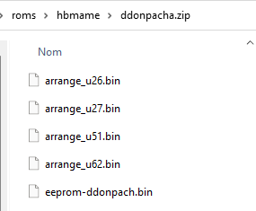
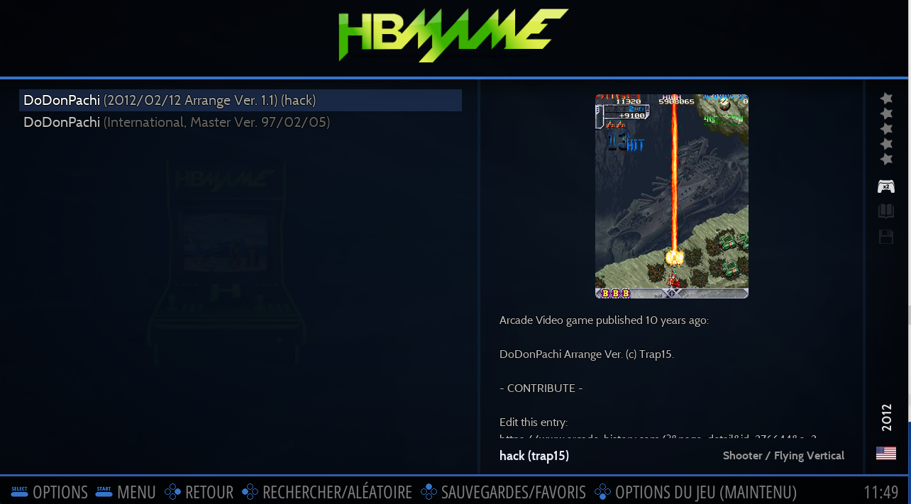

# HomeBrew MAME

<figure><figcaption></figcaption></figure>

**HBMAME** (HomeBrew MAME) est un dérivé de MAME 0.245 qui permet de lancer plusieurs hacks et homebrews.



## Information

<table data-header-hidden><thead><tr><th width="224"></th><th></th></tr></thead><tbody><tr><td><strong>Émulateurs</strong></td><td><ul><li>hbmame</li><li>Libretro : mame</li></ul></td></tr><tr><td><strong>Dossier de jeux</strong></td><td>📂 roms \ 📂 hbmame</td></tr><tr><td><strong>Extensions</strong></td><td>.zip .7z</td></tr></tbody></table>

## Bios

Se référer à la section [MAME](mame.md#bios-information) du wiki, HBMAME a besoin des mêmes BIOS que MAME pour fonctionner.

## Contrôles

[Se référer à la page MAME ](mame.md#controls)du wiki.

## Informations spécifiques au système

### Ajouter des jeux HBMame à Retrobat

La plupart des jeux pour HBMame sont fournis dans des romsets de type "merged", cela signifie, si vous avez lu notre "[guide arcade](../../arcade-guide.md#roms)", que plusieurs jeux et hacks de jeux sont présents dans un seul fichier .zip.

Or, RetroBat et Mame ne supportent pas les roms de type "merged", il est donc nécessaire d'extraire les différentes versions du zip principal afin de les stocker comme n'importe quel autre jeu, dans un fichier .zip indépendant.

L'exemple ci-dessous est réalisé avec le hack "Arrange v1.1" du jeu DoDonPachi:

<figure><figcaption></figcaption></figure>

#### Etape 1: vérifier la rom de jeu

Avant toute chose, il faut s'assurer que la rom de jeu soit correcte et dans une version compatible avec l'émulateur.

Pour cela, vous pouvez télécharger la dernière version de HBMame [ici](https://hbmame.1emulation.com/), et vous assurer que la version que vous possédez du jeu et de ses hacks est correcte en auditant les roms.

Si tout apparaît en vert comme dans l'exemple ci-dessus : vous pouvez continuer.

#### Etape 2: extraire la rom du hack

Placer le zip que vous possédez (jeu + hacks) dans le dossier `\roms\hbmame` de votre installation RetroBat.

Ouvrir l'archive et extraire de l'archive le hack que vous souhaitez lancer depuis RetroBat (`ddonpacha` dans notre exemple):

<figure><figcaption></figcaption></figure>

Une fois extrait, placez-vous dans le dossier `ddonpacha` et créez un fichier zip avec le contenu du dossier (le zip doit avoir le nom officiel du hack, comme illustré dans HBMame):

<figure><figcaption></figcaption></figure>

<figure><figcaption></figcaption></figure>


Assurez-vous que le zip contienne directement le contenu du hack du jeu, sans dossier intermédiaire.


#### Etape 3: lancer le jeu depuis RetroBat

Les 2 roms apparaîssent désormais dans RetroBat: le jeu principal (ddonpach) et le hack (ddonpacha).

<figure><figcaption></figcaption></figure>

Il est possible de lancer le hack du jeu directement depuis RetroBat avec le core Mame ou l'émulateur Mame standalone:

<figure><figcaption></figcaption></figure>

### Version du romset&#x20;

ROM set : 0.245

### Fichiers CHD ou IMG

Se référer au [Guide Arcade](../../arcade-guide.md#fichiers-chd-ou-img).

### **Fichiers Sample**

Se référer au [Guide Arcade](../../arcade-guide.md#samples).
