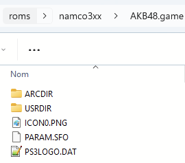

# Namco 357/369

<figure><figcaption></figcaption></figure>

Émulateur de système d'arcade basé sur le hardware Playstation



## Information

<table data-header-hidden><thead><tr><th width="224"></th><th></th></tr></thead><tbody><tr><td><strong>Émulateurs</strong></td><td><ul><li>teknoparrot</li></ul></td></tr><tr><td><strong>Dossier des jeux</strong></td><td>📂 roms \ 📂 namco3xx</td></tr><tr><td><strong>Extensions</strong></td><td>.game</td></tr></tbody></table>

## Fonctionnalités

<table><thead><tr><th width="212">Succès Rétro</th><th width="210">Parties en Réseau</th><th>Auto configuration des contrôles</th></tr></thead><tbody><tr><td>NON</td><td>NON</td><td>OUI (via le fichier yml)</td></tr></tbody></table>

## Bios

Pas de BIOS requis.

## Contrôles

[Voir Teknoparrot](https://wiki.retrobat.org/francais/systemes-and-emulateurs/supported-game-systems/arcade/teknoparrot#controles)

## Informations spécifiques au système

### Ajouter des jeux

Renommer le répertoire du jeu avec l'extension ".game" à la fin:

<figure><figcaption></figcaption></figure>

