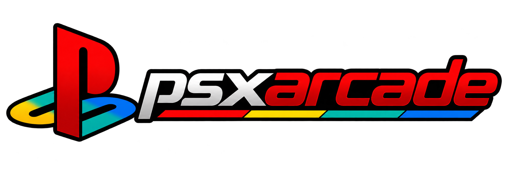

# PSXArcade

<div align="left"><figure><figcaption></figcaption></figure></div>

## Présentation

Le système **PSX Arcade** regroupe les cartes d'arcade construites autour du matériel de la PlayStation, à partir de 1994. Sony fournit la base (processeur R3000A, puce graphique de la console) et chaque éditeur l'adapte à ses bornes : plus de mémoire, puces sonores, lecteurs de CD ou de cartes mémoire.

Les principales cartes :

<table><thead><tr><th width="210.5">Carte</th><th width="202">Éditeur</th><th>Exemples de jeux</th></tr></thead><tbody><tr><td><strong>ZN-1</strong>, <strong>ZN-2</strong></td><td>Capcom</td><td>Street Fighter EX, Star Gladiator, Rival Schools, Strider 2, Tech Romancer</td></tr><tr><td>ZN-1 (autres éditeurs)</td><td>Taito (FX-1), Tecmo, Atlus, Raizing, Video System, Acclaim, Atari</td><td>Ray Storm, G-Darius, Dead or Alive, Fighting Layer, Brave Blade, Beastorizer</td></tr><tr><td><strong>System 11</strong>, <strong>System 12</strong></td><td>Namco</td><td>Tekken, Tekken 2, Tekken 3, Soul Edge, Soul Calibur, Point Blank 2, Ehrgeiz</td></tr><tr><td><strong>G-Net</strong></td><td>Taito</td><td>Psychic Force 2012, Chaos Heat, Zoku Otenamihaiken</td></tr><tr><td><strong>GV</strong>, <strong>GQ</strong>, <strong>System 573</strong>, <strong>Twinkle</strong></td><td>Konami</td><td>Dance Dance Revolution, beatmania IIDX, Simpsons Bowling</td></tr></tbody></table>

## En bref

<table><thead><tr><th width="285.25"></th><th></th></tr></thead><tbody><tr><td><strong>Dossier des jeux</strong></td><td><code>roms\psxarcade</code></td></tr><tr><td><strong>Extensions</strong></td><td>.zip .7z .chd</td></tr><tr><td><strong>Émulateur par défaut</strong></td><td>arcadeduck</td></tr><tr><td><strong>BIOS</strong></td><td>BIOS de la carte au format MAME (<code>coh1000c.zip</code>, <code>coh3002c.zip</code>…), dans <code>bios</code> ou à côté des jeux</td></tr><tr><td><strong>Configuration des manettes</strong></td><td>Automatique : ArcadeDuck, PSXMame, Zinc, core mame, MAME</td></tr><tr><td><strong>Sauvegardes instantanées</strong></td><td>ArcadeDuck (gérées par RetroBat, selon la carte), core mame</td></tr><tr><td><strong>RetroAchievements</strong></td><td>Non</td></tr><tr><td><strong>Jeu en réseau</strong></td><td>core mame</td></tr><tr><td><strong>Pistolets</strong></td><td>ArcadeDuck</td></tr><tr><td><strong>BIOS optionnels</strong></td><td>—</td></tr></tbody></table>

## Quel émulateur choisir ?

<table><thead><tr><th width="157">Émulateur</th><th>Points forts</th><th>Limites</th></tr></thead><tbody><tr><td><strong>arcadeduck</strong> (défaut)</td><td>Émulateur dédié, basé sur DuckStation : très compatible, résolution augmentée, correction des polygones (PGXP), couleurs 24 bits, sauvegardes instantanées, pistolets et trackballs, sorties de la borne (lampes, recul). Lit les sets MAME actuels.</td><td>Sauvegardes instantanées partielles ou absentes sur certaines cartes (System 12 avec carte de liaison, Konami GV, System 573, Twinkle).</td></tr><tr><td><strong>psxmame</strong></td><td>Ancienne version de MAME dédiée à ces cartes, légère.</td><td>Romset ancien, différent du MAME actuel. Ne lit pas les <code>.7z</code> et les <code>.chd</code>.</td></tr><tr><td><strong>zinc</strong></td><td>Émulateur historique, très léger.</td><td>71 jeux seulement, romset ancien. 2 joueurs. Ne lit pas les <code>.7z</code> et les <code>.chd</code>.</td></tr><tr><td><strong>libretro: mame</strong></td><td>MAME dans RetroArch : sauvegardes instantanées, jeu en réseau, shaders.</td><td>Plus lent, moins compatible qu'ArcadeDuck pour ces cartes. Ne lit pas les <code>.chd</code> seuls.</td></tr><tr><td><strong>mame</strong></td><td>Même émulation que le core mame, en émulateur autonome.</td><td>Ne lit pas les <code>.chd</code> seuls.</td></tr></tbody></table>

## BIOS

Chaque carte a son BIOS au format MAME. ArcadeDuck, le core mame et MAME utilisent les mêmes fichiers :

<table><thead><tr><th width="312.75">Carte</th><th>Fichier</th></tr></thead><tbody><tr><td>Capcom ZN-1</td><td><code>coh1000c.zip</code></td></tr><tr><td>Capcom ZN-2</td><td><code>coh3002c.zip</code></td></tr><tr><td>Taito FX-1</td><td><code>coh1000t.zip</code></td></tr><tr><td>Tecmo TPS</td><td><code>coh1002m.zip</code></td></tr><tr><td>Atlus ZN-1</td><td><code>coh1001l.zip</code></td></tr><tr><td>Eighting / Raizing ZN-1</td><td><code>coh1002e.zip</code></td></tr><tr><td>Video System ZN-1</td><td><code>coh1002v.zip</code></td></tr><tr><td>Acclaim ZN-1</td><td><code>coh1000a.zip</code></td></tr><tr><td>Time Warner (Atari) ZN-1</td><td><code>coh1000w.zip</code></td></tr><tr><td>Taito G-Net</td><td><code>coh3002t.zip</code></td></tr><tr><td>Konami GV</td><td><code>konamigv.zip</code></td></tr><tr><td>Konami System 573</td><td><code>sys573.zip</code></td></tr></tbody></table>

Les jeux Namco System 11 et System 12 n'ont pas de BIOS séparé.

* **ArcadeDuck** cherche le BIOS à côté du jeu, puis dans `bios`. S'il manque, RetroBat affiche le nom du fichier attendu.
* **Core mame** et **MAME** le cherchent dans `bios` et dans le dossier des jeux.
* **PSXMame** utilise ses propres BIOS, au format de son romset, dans `bios\psxmame\bios`.
* **Zinc** n'a pas besoin de BIOS.

## Quel format de jeu ?

<table><thead><tr><th width="129">Format</th><th>Remarques</th></tr></thead><tbody><tr><td><strong>.zip</strong>, <strong>.7z</strong></td><td>Jeux au format MAME, à garder tels quels, sans les décompresser ni les renommer (<code>sfex.zip</code>, <code>tekken3.zip</code>, <code>raystorm.zip</code>…). Les clones ont besoin du jeu parent dans le même dossier. Zinc et PSXMame ne lisent que les <code>.zip</code>.</td></tr><tr><td><strong>.chd</strong></td><td>Disques des jeux qui en ont un (Konami System 573, Twinkle, Taito G-Net…), dans un dossier qui porte le nom du jeu (voir <a href="psxarcade.md#jeux-avec-disque-chd"><strong>Guides</strong></a>). Un jeu Taito G-Net en <code>.chd</code> seul se lance directement avec ArcadeDuck.</td></tr></tbody></table>

Les romsets ne sont pas les mêmes pour tous les émulateurs :

* **ArcadeDuck**, **core mame** et **MAME** : romset MAME actuel.
* **PSXMame** : romset de sa version de MAME, plus ancien.
* **Zinc** : romset ancien et liste de jeux fixe (voir [**Guides**](psxarcade.md#jeux-compatibles-avec-zinc)).

Un jeu qui fonctionne avec un émulateur ne fonctionne donc pas forcément avec un autre.

## Contrôles

### Configuration automatique

RetroBat configure les manettes pour tous les émulateurs. Disposition par défaut des boutons (ArcadeDuck, core mame, MAME) :

| Borne         | Manette                            |
| ------------- | ---------------------------------- |
| Joystick      | Croix directionnelle, stick gauche |
| Boutons 1 à 4 | OUEST, SUD, EST, NORD              |
| Boutons 5, 6  | L1, R1                             |
| Start         | START                              |
| Crédit        | SELECT                             |
| Test          | R3                                 |
| Service       | L3                                 |

* **ArcadeDuck** : jusqu'à 4 joueurs. Les commandes de chaque jeu viennent de la base d'ArcadeDuck (joysticks, pistolets, trackballs, boutons de menu de borne). La position des boutons se règle dans `arcadeduck.yml` (par exemple Tekken 3 : poings sur OUEST et NORD, pieds sur SUD et EST, Tag sur R1), et **CONTRÔLES > DISPOSITION DES BOUTONS** choisit la disposition (manette, 6 ou 8 boutons). Voir la page [**Guide Arcade**](../../arcade-guide.md#controles-arcade).
* **PSXMame** : boutons 1 à 4 sur SUD, EST, OUEST, NORD, boutons 5 et 6 sur L1 et R1. **L3 + R3** : service. **SELECT + EST** : pause. **CONTRÔLES > PROFIL DE CONFIGURATION DES MANETTES > PAR JEU** utilise le fichier du jeu dans `emulators\psxmame\ctrlr` (`<jeu>.cfg`) quand il existe. **STICK ANALOGIQUE VERS D-PAD** utilise le stick gauche comme une croix.
* **Zinc** : 2 joueurs. **CONTRÔLES > MÉTHODE DE CONFIGURATION DES MANETTES** : profil dynamique (par défaut), fichiers prédéfinis du dossier `emulators\zinc\cfg`, ou aucune configuration. **CONTRÔLES > SCHÉMA DE CONTRÔLES** choisit le profil dynamique : standard, Street Fighter, Soul Edge ou Tekken. Zinc utilise le stick gauche pour les déplacements : **CONTRÔLES > UTILISER PAD DIRECTIONNEL** passe sur la croix.
* **Core mame**, **MAME** : configuration par jeu de MAME, voir la page [**Configuration des touches MAME**](../../../controleurs/configuration-des-touches-specifique-par-emulateur/configuration-des-touches-mame64.md).

### Pistolets

ArcadeDuck gère les pistolets et la souris pour les jeux au pistolet de ces cartes (**PISTOLETS > ACTIVER LES PISTOLETS**), avec plusieurs pistolets. **PISTOLETS > CIBLE** affiche ou masque la cible, **INVERSER LES PISTOLETS J1 ET J2** échange les joueurs. **CONTRÔLES > SORTIES EXTERNES** envoie les lampes et le recul vers MameHooker ou DemulShooter. Pour plus de détails, voir la page [**Contrôle des pistolets**](../../../controleurs/pistolets_controles.md).

### Raccourcis

**ArcadeDuck**, **core mame**, **MAME** : raccourcis par défaut de RetroBat (sauvegarde, chargement, menu, capture…). Pour plus de détails, voir la page [**Raccourcis**](../../../navigation/hotkeys.md).

#### **PSXMame**, **Zinc**

<table><thead><tr><th width="240.25">Raccourci</th><th>Action</th></tr></thead><tbody><tr><td><strong>HOTKEY + START</strong></td><td>Quitter</td></tr></tbody></table>

## Dossiers

<table><thead><tr><th width="352.75">Contenu</th><th>Dossier</th></tr></thead><tbody><tr><td>BIOS (ArcadeDuck, core mame, MAME)</td><td><code>bios</code> (ou dossier des jeux)</td></tr><tr><td>BIOS (PSXMame)</td><td><code>bios\psxmame\bios</code></td></tr><tr><td>ArcadeDuck : sauvegardes instantanées</td><td><code>saves\psxarcade\arcadeduck</code></td></tr><tr><td>ArcadeDuck : captures d'écran</td><td><code>screenshots\arcadeduck</code></td></tr><tr><td>ArcadeDuck : configuration</td><td><code>emulators\arcadeduck\settings.ini</code></td></tr><tr><td>ArcadeDuck : position des boutons</td><td><code>system\resources\inputmapping\arcadeduck.yml</code> (copie modifiable dans <code>user\inputmapping</code>)</td></tr><tr><td>Core mame : sauvegardes instantanées</td><td><code>saves\psxarcade\libretro.mame</code></td></tr><tr><td>PSXMame : sauvegardes (NVRAM, instantanées)</td><td><code>saves\psxmame\nvram</code>, <code>saves\psxmame\states</code></td></tr><tr><td>PSXMame : profils de manette par jeu</td><td><code>emulators\psxmame\ctrlr</code></td></tr><tr><td>Zinc : profils de manette par jeu</td><td><code>emulators\zinc\cfg</code></td></tr></tbody></table>

## Guides

### Jeux avec disque (CHD)

Certains jeux ont un disque en plus de leur `.zip` (CD des Konami System 573 et Twinkle, carte mémoire des Taito G-Net…). Placez le `.chd` dans un dossier qui porte le nom du jeu, comme pour MAME :

```
roms\
└─ psxarcade\
   ├─ <jeu>\
   │  └─ <disque>.chd
   └─ <jeu>.zip
```

Si le `.chd` apparaît dans la liste des jeux, le lancer démarre le jeu auquel il appartient avec ArcadeDuck.

### Menu de test

En jeu, **R3** (Test) ouvre le menu de test de la borne (crédits, difficulté, contrôles) et **L3** (Service) ajoute un crédit de service, avec ArcadeDuck, le core mame et MAME. Au clavier : `0` (Test) et `9` (Service) avec ArcadeDuck.

### Jeux compatibles avec Zinc

Zinc lance uniquement les jeux de cette liste, avec ce nom de fichier exact :

<details>

<summary>Liste des 71 jeux Zinc</summary>

```
starglad sfex sfexj sfexa sfexp sfexpu1 sfexpj sfex2 sfex2j sfex2p
sfex2pj sfex2pa plsmaswd stargld2 rvschola jgakuen rvschool shiryu2 strider2 kikaioh
techromn ts2 ts2j tgmj sncwgltd beastrzb beastrzr bldyror2 brvblade psyforcj
psyforce psyfrcex mgcldtex raystorj raystorm ftimpcta gdarius gdarius2 danceyes xevi3dg
starswep myangel3 tekkenb tekkena tekken tekken2a tekken2b tekken2 souledga souledgb
souledge dunkmnia dunkmnic primglex weddingr hyperath pbball96 susume fgtlayer ehrgeiz
tekken3 mrdrillr aquarush pacapp glpracr3 shngmtkb cbaj doapp tondemo mfjump
hvnsgate
```

</details>

### Autres options utiles (ArcadeDuck)

| Option                                            | Effet                                                                 |
| ------------------------------------------------- | --------------------------------------------------------------------- |
| **RÉSOLUTION INTERNE**                            | De 1x (native) à 9x (4K).                                             |
| **RAPPORT D'ASPECT**                              | Natif, 4/3, 16/9, pixels carrés ou étiré.                             |
| **RENDU VISUEL > CORRECTION DES TEXTURES (PGXP)** | Réduit les tremblements des polygones et la déformation des textures. |
| **RENDU VISUEL > COULEURS RÉELLES (24 BITS)**     | Rendu en 24 bits, sans tramage.                                       |
| **RENDU VISUEL > MISE À L'ÉCHELLE DE LA SORTIE**  | Nearest, bilinéaire, entier, AMD FSR, NVIDIA NIS.                     |
| **VIDÉO > DÉSACTIVER PLEIN ÉCRAN**                | À utiliser si ArcadeDuck ne s'affiche pas sur le bon écran.           |

## Problèmes connus

| Problème                                                 | Solution                                                                                                                               |
| -------------------------------------------------------- | -------------------------------------------------------------------------------------------------------------------------------------- |
| ArcadeDuck indique un BIOS manquant                      | Placez le BIOS indiqué (par exemple `coh1000c.zip`) à côté du jeu ou dans `bios`.                                                      |
| ArcadeDuck indique « not a set supported by ArcadeDuck » | Le nom ou la version du set ne correspond pas : utilisez le set du MAME actuel, sans le renommer.                                      |
| ArcadeDuck indique « Missing CHD »                       | Placez le `.chd` dans le dossier qui porte le nom du jeu (voir [**Guides**](psxarcade.md#jeux-avec-disque-chd)).                       |
| Zinc indique « Game name not known »                     | Le jeu n'est pas dans la liste Zinc, ou son nom de fichier est différent (voir [**Guides**](psxarcade.md#jeux-compatibles-avec-zinc)). |
| Un jeu ne fonctionne qu'avec un émulateur                | Les romsets diffèrent (voir [**Quel format de jeu ?**](psxarcade.md#quel-format-de-jeu)) : utilisez le romset de l'émulateur choisi.   |
| La sauvegarde instantanée échoue avec ArcadeDuck         | Certaines cartes ne gèrent pas encore les sauvegardes instantanées (System 573, Twinkle, une partie des Konami GV et des System 12).   |
