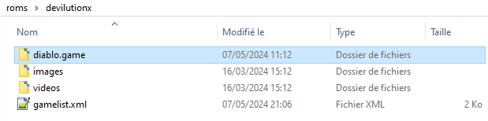

# DevilutionX

<figure><picture><source srcset="../../../.gitbook/assets/devilutionX_W.png" media="(prefers-color-scheme: dark)"></picture><figcaption></figcaption></figure>

Moteur de jeu permettant de jouer à Diablo et son extension Hellfire.



## Information

<table data-header-hidden><thead><tr><th width="240"></th><th></th></tr></thead><tbody><tr><td><strong>Émulateur</strong></td><td><ul><li>devilutionx</li></ul></td></tr><tr><td><strong>Dossier des jeux</strong></td><td>📂 roms \ 📂 devilutionx</td></tr><tr><td><strong>Extensions</strong></td><td>.game .win</td></tr></tbody></table>

## BIOS

Aucun BIOS nécessaire.

## Contrôles

A compléter

## Information spécifique au système

### Organisation des fichiers de jeux

DevilutionX fonctionne avec les fichiers de jeu Diablo (et son extension Hellfire).

Vous pouvez extraire les fichiers depuis le CD original, ou vous procurer le jeu via [GOG](https://www.gog.com/game/diablo), [Battle.net](https://eu.shop.battle.net/fr-fr/family/diablo)ou [STEAM](https://store.steampowered.com/app/961620/Flashback/).

Depuis le dossier `roms\devilutionx`, créer un sous-dossier nommé `diablo.game`.&#x20;

<figure><figcaption></figcaption></figure>

A l'intérieur de ce sous-répertoire, copier le fichier `diabdat.mpq` présent sur votre CD ou votre dossier d'installation de Diablo (ou bien vous pouvez l'[extraire de l'installateur GOG](https://github.com/diasurgical/devilutionX/wiki/Extracting-the-.MPQs-from-the-GoG-installer)).

Pour jouer à l'extension Diablo: Hellfire, il vous faudra copier également les fichiers `hellfire.mpq`, `hfmonk.mpq`, `hfmusic.mpq`, `hfvoice.mpq`.

<figure><figcaption></figcaption></figure>

Vous pouvez également utiliser le fichier`spawn.mpq` depuis [la version d’essai](https://github.com/diasurgical/devilutionx-assets/releases/latest/download/spawn.mpq) [\[2\]](http://ftp.blizzard.com/pub/demos/diablosw.exe), à la place de `diabdat.mpq`, afin de pouvoir lancer la version d'évaluation du jeu. 

### Mods

De nombreux mods existent pour DevilutionX. Vous pouvez les consulter depuis la page [GitHub ](https://github.com/diasurgical/devilutionX/wiki/Mods-and-related-projects)du projet.
