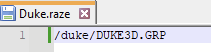
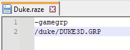

# Raze

<figure><figcaption></figcaption></figure>

Moteur de jeu permettant de jouer à Blood, Duke Nukem 3D, Shadow Warrior et d'autres jeux exploitant le même moteur de jeu.



## Informations

<table data-header-hidden><thead><tr><th width="224"></th><th></th></tr></thead><tbody><tr><td><strong>Émulateur</strong></td><td><ul><li>raze</li></ul></td></tr><tr><td><strong>Dossier des jeux</strong></td><td>📂 roms \ 📂 raze</td></tr><tr><td><strong>Extensions</strong></td><td>.raze</td></tr></tbody></table>

## Bios

Aucun BIOS nécessaire.

## Contrôles

Les contrôles sont à configurer directement dans l'émulateur.

## Information spécifique au système

### Jeux pris en charge

La liste des jeux compatibles avec Raze est disponible ici:



### Ajouter un jeu

Créer un fichier txt et préciser dans le fichier le chemin relatif vers le le fichier à lancer:

<figure><figcaption></figcaption></figure>

Sauvegarder le fichier avec l'extension "`.raze`".

### Modifier les lignes de commande de lancement

RetroBat vous permet de lancer un jeu avec des lignes de commande personnalisée.

Pour cela, créer un fichier .txt et spécifier un argument par ligne:

<figure><figcaption></figcaption></figure>

Sauver le fichier avec l'extension ".raze" et placer le dans le dossier `roms\raze`.


Les lignes commençant par / ou \ sont gérées comme des chemins relatifs au dossier du fichier.

