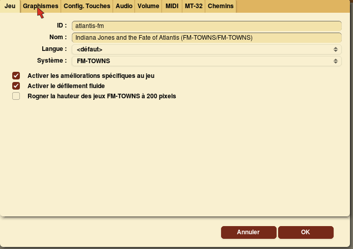
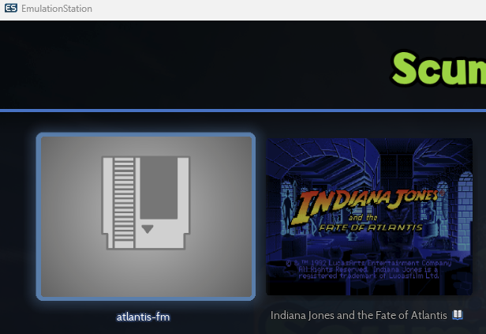

# ScummVM

<figure><figcaption></figcaption></figure>

Émulateur - Année de création : 2001



## Informations

<table data-header-hidden><thead><tr><th width="224"></th><th></th></tr></thead><tbody><tr><td><strong>Émulateurs</strong></td><td><ul><li>Libretro : scummvm</li><li>scummvm</li></ul></td></tr><tr><td><strong>Dossier des jeux</strong></td><td>📂 roms \ 📂 scummvm</td></tr><tr><td><strong>Extensions</strong></td><td>.scummvm .7z .zip .rar .squashfs</td></tr></tbody></table>

## Fonctionnalités

| Retroachievements | NetPlay |
| ----------------- | ------- |
| NON               | NON     |

## BIOS

<table><thead><tr><th width="221">Fichier BIOS</th><th width="177">Dossier</th><th>md5</th></tr></thead><tbody><tr><td>MT32_CONTROL.ROM</td><td><code>\bios\scummvm\extra</code></td><td>5626206284b22c2734f3e9efefcd2675</td></tr><tr><td>MT32_PCM.ROM</td><td><code>\bios\scummvm\extra</code></td><td>89e42e386e82e0cacb4a2704a03706ca</td></tr></tbody></table>

## Contrôles

Il s'agit principalement de jeux prévus pour être joués au clavier et à la souris (point'n'click).&#x20;

Il est possible d'utiliser une configuration [pad2key ](../../../controleurs/pad2key.md)pour utiliser une manette.

## Information spécifique au système

### Ajouter un jeu

Les jeux ScummVM doivent être placés dans le dossier `\roms\scummvm` , chaque jeu dans son propre répertoire:

<figure><figcaption></figcaption></figure>

Au sein de chaque dossier de jeu, créer un fichier .txt avec le nom du jeu, par exemple **Full Throttle.txt** pour le jeu "Full Throttle".

<figure><figcaption></figcaption></figure>

A l'intérieur du fichier .txt, renseigner le **shortname (nom court)** du jeu, se référer au site [https://www.scummvm.org/compatibility/](https://www.scummvm.org/compatibility/) pour retrouver le shortname du jeu.


SLe shortname est composé du moteur de jeu (ici _scumm_), suivi du nom court du jeu (ici _ft_), séparés par un double point.


Enfin, renommer le fichier \*._txt_ en \*._scummvm_ (remplacer l'extension .txt par .scummvm) :\
\
Full Throttle.**txt**  **==>** Full Throttle.**scummvm**

### Lancer une version spécifique d'un jeu et gérer les options par jeu

SCUMMVM permet de gérer différentes versions d'un jeu, cela est particluièrement pour les jeux édités sur plusieurs machine (FM-Towns, DOS, Amiga...).

Si vous possédez plusieurs versions d'un même titre et souhaitez pouvoir sélectionner la version à laquelle jouer, il est nécessaire de procéder comme suit.

**Etape 1**: paramétrage du jeu dans SCUMMVM

* Ouvrir SCUMMVM et sélectionner "ajouter...":

<figure><figcaption></figcaption></figure>

Sélectionner le dossier du jeu.

* Choisir la version du jeu à ajouter:

<figure><figcaption></figcaption></figure>

* Définir l'ID du jeu et sélectionner les options à activer pour le jeu

<figure><figcaption></figcaption></figure>

Cliquer sur OK.

Le jeu est ajouté à SCUMMVM:

<figure><figcaption></figcaption></figure>

**Etape 2**: créer le fichier .scummvm

* Créer un fichier .scummvm spécifique à cette version du jeu dans le dossier `roms\scummvm`:

<figure><figcaption></figcaption></figure>

<figure><figcaption></figcaption></figure>


TLe contenu du fichier .scummvm doit correspondre exactement à l'ID utilisé lors de l'ajout du jeu dans l'émulateur à l'étape précédente.


**Etape 3**: résultat dans RetroBat

Dans RetroBat, plusieurs versions du jeu seront disponibles:

<figure><figcaption>
2 versions de Indiana Jones
</figcaption></figure>

NB: les short ID de chaque jeu installé dans scummvm peuvent être consultées dans le fichier scummvm.ini, ce fichier est situé dans les dossiers:

* \emulators\scummvm (SCUMMVM standalone)
* \bios (libretro:scummvm)

<figure><figcaption></figcaption></figure>

