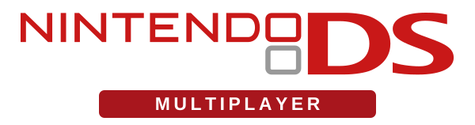

# Nintendo DS Multiplayer

<figure><figcaption></figcaption></figure>

## Présentation

**Nintendo DS Multiplayer** permet de jouer à plusieurs aux jeux **Nintendo DS** sur un seul PC : 2 à 4 consoles DS s'affichent côte à côte dans la même fenêtre, reliées par une liaison sans fil locale émulée, avec une manette par joueur. On retrouve ainsi les parties à plusieurs consoles (DS Wireless Play) ou en **Téléchargement DS** (Download Play, une seule cartouche pour tout le groupe).

Ce système utilise le core libretro **melondsds\_splitscreen** (melonDS DS Splitscreen 1.1, version modifiée de melonDS DS 1.4.0). Il est **expérimental** : version de test, compatibilité encore limitée (voir **Problèmes connus**).

Pour jouer seul aux jeux DS, utilisez le système **Nintendo DS** (voir la page [**Nintendo DS**](nintendo-ds.md)).

## En bref

|                                |                                                                                               |
| ------------------------------ | --------------------------------------------------------------------------------------------- |
| **Dossier des jeux**           | `roms\ndsmultiplayer`                                                                         |
| **Extensions**                 | .nds .zip .7z                                                                                 |
| **Émulateur par défaut**       | libretro: melondsds\_splitscreen                                                              |
| **BIOS**                       | `bios7.bin`, `bios9.bin`, `firmware.bin` dans `bios` (obligatoires pour le Téléchargement DS) |
| **Configuration des manettes** | Automatique, une manette par joueur (2 à 4 joueurs)                                           |
| **Sauvegardes instantanées**   | Non                                                                                           |
| **RetroAchievements**          | Non                                                                                           |
| **Jeu en réseau**              | Non                                                                                           |
| **Pistolets**                  | —                                                                                             |
| **Volants**                    | —                                                                                             |
| **BIOS optionnels**            | —                                                                                             |

## Quel émulateur choisir ?

| Émulateur                                             | Points forts                                                                                                                             | Limites                                                                                                                                                                                                                                                                                        |
| ----------------------------------------------------- | ---------------------------------------------------------------------------------------------------------------------------------------- | ---------------------------------------------------------------------------------------------------------------------------------------------------------------------------------------------------------------------------------------------------------------------------------------------- |
| **libretro: melondsds\_splitscreen** (seul émulateur) | 2 à 4 DS dans une seule fenêtre, liaison sans fil locale émulée, Multi-Card et Téléchargement DS, sauvegarde séparée pour chaque joueur. | Version de test. Son du joueur 1 seulement. Rendu logiciel, recompilateur JIT expérimental (désactivé par défaut) : demande un PC puissant à 3 ou 4 joueurs. Pas de sauvegardes instantanées, de rembobinage, de run-ahead, de RetroAchievements, de codes de triche, de micro ni de slot GBA. |

## BIOS

| Fichier        | Dossier | Rôle                                           |
| -------------- | ------- | ---------------------------------------------- |
| `bios7.bin`    | `bios`  | BIOS ARM7 de la DS                             |
| `bios9.bin`    | `bios`  | BIOS ARM9 de la DS                             |
| `firmware.bin` | `bios`  | Firmware d'une DS ou d'une DS Lite (amorçable) |

Ce sont les mêmes fichiers que pour le système Nintendo DS.

* **Téléchargement DS** : les trois fichiers sont obligatoires, et **ÉMULATION > UTILISER LE BIOS INTERNE** doit rester désactivé.
* **Multi-Card** : les fichiers sont facultatifs, le BIOS intégré du core suffit.

Le contrôle des BIOS de RetroBat les indique comme optionnels, puisqu'ils ne servent qu'au Téléchargement DS.

## Quel format de jeu ?

| Format             | Description                  |
| ------------------ | ---------------------------- |
| **.nds**           | Copie d'une cartouche DS.    |
| **.zip** / **.7z** | Archive contenant le `.nds`. |

Les jeux exclusifs à la DSi sont refusés. Les jeux DS compatibles DSi fonctionnent en mode DS.

## Contrôles

### Menu du core

Au lancement, le core affiche l'écran **Select Players** :

| Bouton (joueur 1)     | Action                                                         |
| --------------------- | -------------------------------------------------------------- |
| Croix gauche / droite | Nombre de joueurs (2 à 4)                                      |
| NORD                  | Mode : **Multi-Card** ou **Download Play** (Téléchargement DS) |
| EST ou START          | Lancer                                                         |

Cet écran s'affiche à chaque lancement. Le nombre de joueurs et le mode proposés au départ se règlent dans RetroBat avec **ÉMULATION > NOMBRE DE JOUEURS** (2 par défaut) et **ÉMULATION > MODE MULTIJOUEUR LOCAL** (Multi-Card par défaut) : il suffit alors d'appuyer sur EST.

> 📷 **Capture à ajouter** : écran Select Players du core (Multi-Card / Download Play).

### Configuration automatique

Chaque joueur utilise sa manette (ports 1 à 4) :

<table><thead><tr><th width="280.25">Manette RetroBat</th><th>DS</th></tr></thead><tbody><tr><td>EST / SUD / NORD / OUEST</td><td>A / B / X / Y</td></tr><tr><td>Croix directionnelle</td><td>Croix directionnelle</td></tr><tr><td>L1 / R1</td><td>L / R</td></tr><tr><td>START / SELECT</td><td>START / SELECT</td></tr><tr><td>Stick droit</td><td>Curseur de l'écran tactile</td></tr><tr><td>R2</td><td>Toucher l'écran</td></tr></tbody></table>

L'écran tactile se commande pour chaque joueur avec sa propre manette (stick droit pour déplacer le curseur, R2 pour toucher).

### Raccourcis

Raccourcis standards de RetroArch (HOTKEY = SELECT), par exemple HOTKEY + START pour quitter. Les sauvegardes instantanées et le rembobinage ne fonctionnent pas avec ce core. Pour plus de détails, voir la page [**Raccourcis**](../../../../navigation/hotkeys.md).

## Dossiers

<table><thead><tr><th width="259">Contenu</th><th>Dossier</th></tr></thead><tbody><tr><td>BIOS</td><td><code>bios</code></td></tr><tr><td>Sauvegardes des jeux (une par joueur)</td><td><code>saves\ndsmultiplayer\&#x3C;jeu>.&#x3C;crc32>.splitscreen-p1.srm</code> … <code>-p4.srm</code></td></tr></tbody></table>

Les sauvegardes sont séparées de celles du système Nintendo DS : une progression faite sur `nds` n'est pas reprise ici.

## Guides

### Partie Multi-Card (chaque joueur a la cartouche)

1. Lancez le jeu, choisissez le nombre de joueurs et **Multi-Card**, puis EST.
2. Chaque joueur ouvre le menu multijoueur du jeu sur sa console (par exemple « Multijoueur » ou « Jeu sans fil »).
3. Un joueur crée la partie, les autres la rejoignent.

### Partie en Téléchargement DS (une seule cartouche)

1. Vérifiez les BIOS et le firmware (voir **BIOS**) et que **ÉMULATION > UTILISER LE BIOS INTERNE** est désactivé.
2. Lancez le jeu, choisissez le nombre de joueurs et **Download Play** (NORD pour changer de mode), puis EST. Pour ne pas avoir à le faire à chaque partie, réglez **ÉMULATION > MODE MULTIJOUEUR LOCAL** sur **TÉLÉCHARGEMENT DS**.
3. Le joueur 1 a la cartouche : il crée la partie dans le jeu.
4. Les invités démarrent sans cartouche, sur l'écran de recherche du Téléchargement DS : ils sélectionnent le jeu et confirment (stick droit pour déplacer le curseur, R2 pour toucher). Si leur firmware affiche un autre menu, ils ouvrent le Téléchargement DS avec R2. Pendant le démarrage, EST, SUD ou R2 rend la main à la manette du joueur.

> 📷 **Capture à ajouter** : 4 consoles, joueur 1 en jeu et invités sur l'écran du Téléchargement DS.

### Options

| Option                                   | Effet                                                                                               |
| ---------------------------------------- | --------------------------------------------------------------------------------------------------- |
| **ÉMULATION > NOMBRE DE JOUEURS**        | Nombre de joueurs proposé sur l'écran Select Players (2, 3 ou 4).                                   |
| **ÉMULATION > MODE MULTIJOUEUR LOCAL**   | Mode proposé sur l'écran Select Players : **MULTI-CARTE** ou **TÉLÉCHARGEMENT DS**.                 |
| **ÉMULATION > LANGUE DE LA CONSOLE**     | Langue des consoles émulées (celle du firmware avec LANGUE DU FIRMWARE).                            |
| **ÉMULATION > UTILISER LE BIOS INTERNE** | BIOS du core au lieu des fichiers du dossier `bios`. À laisser désactivé pour le Téléchargement DS. |
| **ÉMULATION > RECOMPILATEUR JIT**        | Améliore les performances, expérimental avec plusieurs consoles (désactivé par défaut).             |
| **AUDIO > PROFONDEUR DE BITS**           | Qualité du son (automatique par défaut : 10 bits pour la DS).                                       |
| **AUDIO > INTERPOLATION**                | Lissage du son.                                                                                     |

## Problèmes connus

| Problème                                                                                                                  | Solution                                                                                                                                                                                          |
| ------------------------------------------------------------------------------------------------------------------------- | ------------------------------------------------------------------------------------------------------------------------------------------------------------------------------------------------- |
| Compatibilité                                                                                                             | D'après l'auteur (une seule machine de test, Legion Go S), fonctionnent : **Mario Party DS** (Téléchargement DS), **Diddy Kong Racing DS**, **Shrek Smash n' Crash Racing**, **Burnout Legends**. |
| **Mario Kart DS** se bloque en multijoueur                                                                                | Problème connu du core. Les courses en solo côte à côte fonctionnent.                                                                                                                             |
| Le Téléchargement DS refuse de démarrer (« Download Play requires native Nintendo DS BIOS files and bootable firmware. ») | Copiez `bios7.bin`, `bios9.bin` et `firmware.bin` dans `bios` et désactivez **ÉMULATION > UTILISER LE BIOS INTERNE**.                                                                             |
| Pas de son pour les joueurs 2 à 4                                                                                         | Normal : seul le son du joueur 1 est restitué.                                                                                                                                                    |
| Le jeu ralentit à 3 ou 4 joueurs                                                                                          | Le core émule chaque console en rendu logiciel : activez **ÉMULATION > RECOMPILATEUR JIT** (expérimental : désactivez-le si un jeu plante) ou réduisez le nombre de joueurs.                      |
| Un jeu DSi ne démarre pas                                                                                                 | Les jeux exclusifs à la DSi ne sont pas pris en charge.                                                                                                                                           |
| Pas de décoration autour de l'image                                                                                       | Normal : la largeur de l'image dépend du nombre de joueurs (4:3 à 2 joueurs, 2:1 à 3, 8:3 à 4).                                                                                                   |
| L'option de jeu en réseau est proposée                                                                                    | Elle est sans effet : le core ne gère pas le jeu en réseau. Jouez sur un seul PC.                                                                                                                 |
