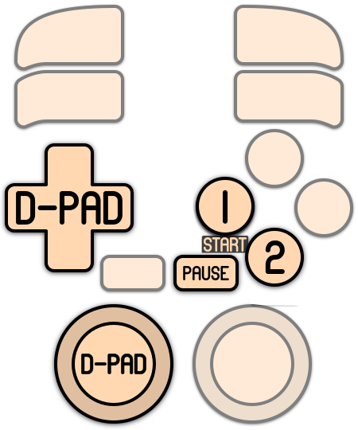

# Game Gear

<figure><figcaption></figcaption></figure>

## Présentation

La **Game Gear** est la console portable 8 bits de Sega, sortie au Japon en octobre 1990, puis en Amérique du Nord et en Europe en 1991. Elle reprend le matériel de la Master System avec un écran couleur rétroéclairé, une palette plus riche et une manette au format paysage. Le câble **Gear-to-Gear** relie deux consoles.

Sa ludothèque compte Sonic the Hedgehog, Sonic Triple Trouble, Columns, The G.G. Shinobi, Shining Force: The Sword of Hajya, Defenders of Oasis, Ristar… L'adaptateur Master Gear Converter permettait aussi d'y jouer aux cartouches Master System : ces jeux se rangent dans `roms\mastersystem`.



## En bref

<table><thead><tr><th width="271.5"></th><th></th></tr></thead><tbody><tr><td><strong>Dossier des jeux</strong></td><td><code>roms\gamegear</code></td></tr><tr><td><strong>Extensions</strong></td><td>.gg .bin .zip .7z</td></tr><tr><td><strong>Émulateur par défaut</strong></td><td>libretro: genesis_plus_gx</td></tr><tr><td><strong>BIOS</strong></td><td>Aucun (<code>bios.gg</code> optionnel)</td></tr><tr><td><strong>Configuration des manettes</strong></td><td>Automatique, tous les émulateurs</td></tr><tr><td><strong>Sauvegardes instantanées</strong></td><td>cores libretro, BizHawk, jgenesis, BlastEm ; Mednafen et ares par raccourcis</td></tr><tr><td><strong>RetroAchievements</strong></td><td>cores libretro, BizHawk</td></tr><tr><td><strong>Jeu en réseau</strong></td><td>cores libretro</td></tr></tbody></table>

## Quel émulateur choisir ?

| Émulateur                                | Pour qui ?               | Points forts                                                          | Limites                                                            |
| ---------------------------------------- | ------------------------ | --------------------------------------------------------------------- | ------------------------------------------------------------------ |
| **libretro: genesis\_plus\_gx** (défaut) | Tout le monde            | Très précis, filtre d'écran LCD, RetroAchievements, jeu en réseau.    | —                                                                  |
| **libretro: picodrive**                  | Petites configurations   | Rapide.                                                               | Peu d'options.                                                     |
| **libretro: gearsystem**                 | Tout le monde            | Précis, jeu à deux par câble Gear-to-Gear.                            | —                                                                  |
| **libretro: fbneo**                      | Utilisateurs de FBNeo    | Jeux au format FBNeo.                                                 | Les jeux doivent suivre les noms de romsets de FBNeo.              |
| **jgenesis**                             | Curieux                  | Émulateur multi-systèmes récent et précis.                            | Pas de RetroAchievements.                                          |
| **blastem**                              | Utilisateurs de BlastEm  | Émulateur Mega Drive précis, avec un mode Game Gear.                  | Pas de RetroAchievements.                                          |
| **mednafen**                             | Utilisateurs de Mednafen | Émulation solide.                                                     | Pas de RetroAchievements. Sauvegardes instantanées par raccourcis. |
| **ares**                                 | Puristes                 | Émulation très précise, rendu fidèle de l'écran LCD.                  | Pas de RetroAchievements. Sauvegardes instantanées par raccourcis. |
| **bizhawk: SMSHawk**                     | Utilisateurs de BizHawk  | RetroAchievements, sauvegardes instantanées dans le menu de RetroBat. | —                                                                  |

**En cas de doute, gardez libretro: genesis\_plus\_gx.**

## BIOS

La Game Gear n'a pas besoin de BIOS : tous les émulateurs démarrent les jeux sans lui. Le BIOS d'origine affiche l'écran de licence Sega au démarrage.

<table><thead><tr><th width="92.75">Fichier</th><th width="272.5">Description</th><th width="74.75">Dossier</th><th>md5</th></tr></thead><tbody><tr><td><code>bios.gg</code></td><td>BIOS de la Game Gear (genesis_plus_gx, gearsystem)</td><td><code>bios</code></td><td>672e104c3be3a238301aceffc3b23fd6</td></tr></tbody></table>

Ce fichier est optionnel et contrôlé par RetroBat. Pour démarrer sur le BIOS, choisissez **ÉMULATION > DÉMARRER DEPUIS LE BIOS** (genesis\_plus\_gx) ou **ÉMULATION > ACTIVER LE BIOS** (gearsystem).

## Quel format de jeu ?

<table><thead><tr><th width="155.25">Format</th><th>Description</th></tr></thead><tbody><tr><td><strong>.gg</strong></td><td>Image d'une cartouche Game Gear.</td></tr><tr><td><strong>.bin</strong></td><td>Même contenu qu'un <code>.gg</code>, sous une autre extension.</td></tr><tr><td><strong>.zip</strong>, <strong>.7z</strong></td><td>Un jeu compressé (un jeu par archive). Avec fbneo : romset au format FBNeo.</td></tr></tbody></table>

## Contrôles

RetroBat configure automatiquement les manettes pour tous les émulateurs. La Game Gear a deux boutons, **1** et **2**, et un bouton **START** :

<table><thead><tr><th width="252.75">Manette RetroBat</th><th>Game Gear</th></tr></thead><tbody><tr><td>Croix directionnelle</td><td>Croix directionnelle</td></tr><tr><td>SUD</td><td>1</td></tr><tr><td>EST</td><td>2</td></tr><tr><td>START</td><td>START</td></tr></tbody></table>

<figure><figcaption></figcaption></figure>

Pour placer les boutons 1 et 2 sur OUEST et SUD, activez **CONTRÔLES > TOURNER LES BOUTONS A/B/X/Y** (cores genesis\_plus\_gx, picodrive et gearsystem, BlastEm, ares) :

| Manette RetroBat | Game Gear |
| ---------------- | --------- |
| OUEST            | 1         |
| SUD              | 2         |

<figure><figcaption></figcaption></figure>

### Raccourcis

Les cores libretro utilisent les raccourcis standards de RetroArch (voir la page [**Raccourcis**](../../../../navigation/hotkeys.md)).

Mednafen, ares, jgenesis et BizHawk utilisent les raccourcis de RetroBat :

| Action                          | Manette             | Clavier          |
| ------------------------------- | ------------------- | ---------------- |
| Quitter                         | HOTKEY + START      | `Échap`          |
| Pause                           | HOTKEY + SUD        | `P`              |
| Sauvegarde instantanée          | HOTKEY + OUEST      | `F2`             |
| Chargement                      | HOTKEY + NORD       | `F4`             |
| Emplacement précédent / suivant | HOTKEY + Bas / Haut | `F6` / `F7`      |
| Rembobiner (si activé)          | HOTKEY + Gauche     | `Retour arrière` |
| Avance rapide (maintenir)       | HOTKEY + Droite     | `L`              |
| Capture d'écran                 | HOTKEY + R3         | `F8`             |
| Plein écran                     | HOTKEY + L3         | `F`              |

jgenesis n'a pas de raccourci pour la capture d'écran.

BlastEm a ses propres raccourcis :

| Action                          | Manette                  | Clavier                |
| ------------------------------- | ------------------------ | ---------------------- |
| Quitter                         | HOTKEY + START           | `Échap`                |
| Menu de BlastEm                 | HOTKEY + SUD             | `F1`                   |
| Pause                           | HOTKEY + L3              | `P`                    |
| Sauvegarde instantanée          | HOTKEY + OUEST           | `F2`                   |
| Chargement                      | HOTKEY + NORD            | `F4`                   |
| Vitesse inférieure / supérieure | HOTKEY + Gauche / Droite | `Retour arrière` / `L` |
| Capture d'écran                 | HOTKEY + R3              | `F8`                   |

## Dossiers

<table><thead><tr><th width="347.75">Contenu</th><th>Dossier</th></tr></thead><tbody><tr><td>Cores libretro, Mednafen : sauvegardes des jeux</td><td><code>saves\gamegear</code></td></tr><tr><td>Cores libretro : sauvegardes instantanées</td><td>
<code>saves\gamegear\libretro.&#x3C;core></code>

(ex. <code>saves\gamegear\libretro.genesis_plus_gx</code>)
</td></tr><tr><td>Mednafen : sauvegardes instantanées</td><td><code>saves\gamegear\mednafen\sstates</code></td></tr><tr><td>ares : sauvegardes des jeux et instantanées</td><td><code>saves\gamegear\ares</code></td></tr><tr><td>BlastEm : sauvegardes des jeux et instantanées</td><td><code>saves\gamegear\blastem\&#x3C;nom du jeu></code></td></tr><tr><td>jgenesis : sauvegardes des jeux</td><td><code>saves\gamegear\jgenesis</code></td></tr><tr><td>BizHawk : sauvegardes des jeux</td><td><code>saves\gamegear\bizhawk</code></td></tr><tr><td>BIOS</td><td><code>bios</code></td></tr><tr><td>Codes de triche</td><td>
<code>cheats\mednafen</code> (Mednafen)

<code>cheats\jgenesis</code> (jgenesis)

<code>cheats\bizhawk\gamegear</code> (BizHawk)
</td></tr><tr><td>Captures d'écran</td><td>
<code>screenshots\mednafen</code>

<code>screenshots\ares</code>

<code>screenshots\bizhawk\gamegear</code>

<code>screenshots</code> (BlastEm)
</td></tr></tbody></table>

## Guides

### Écran LCD

L'écran de la Game Gear laissait une traînée derrière les objets en mouvement. Certains jeux en profitent pour simuler la transparence en faisant clignoter des objets.

| Émulateur              | Option                                            | Effet                                                                   |
| ---------------------- | ------------------------------------------------- | ----------------------------------------------------------------------- |
| core genesis\_plus\_gx | **VIDÉO > FILTRE D'ECRAN LCD**                    | Reproduit la rémanence de l'écran d'origine.                            |
| ares                   | **RENDU VISUEL > MÉLANGE INTER-IMAGE**            | Reproduit la transparence de l'écran (avec un léger flou en mouvement). |
| ares                   | **RENDU VISUEL > ÉMULATION PRÉCISE DES COULEURS** | Couleurs de l'écran d'origine.                                          |
| jgenesis               | **RAPPORT D'ASPECT > GAMEGEAR LCD**               | Proportions de l'écran d'origine (par défaut).                          |

### Jouer à deux (câble Gear-to-Gear)

Le core gearsystem relie deux Game Gear côte à côte, avec le même jeu sur les deux consoles (Columns, Super Monaco GP, Sonic Drift 2…) :

1. Choisissez le core gearsystem pour le jeu.
2. Activez **ÉMULATION > 2 JOUEURS (CÂBLE LINK)**.
3. Choisissez la disposition dans **VIDÉO > POSITIONNEMENT DES ÉCRANS** : **DE GAUCHE À DROITE** (défaut) ou **DE HAUT EN BAS**.

La manette 1 contrôle le premier écran, la manette 2 le second. Les bezels sont désactivés dans ce mode : l'image est trop large.

### Autres options utiles

<table><thead><tr><th width="209.5">Émulateur</th><th>Option</th><th>Effet</th></tr></thead><tbody><tr><td>cores genesis_plus_gx, gearsystem, jgenesis</td><td><strong>DÉSACTIVER LA LIMITE DE SPRITES</strong></td><td>Supprime les clignotements quand beaucoup d'objets sont à l'écran.</td></tr><tr><td>core gearsystem</td><td><strong>ÉMULATION > FORCER LA RÉGION</strong></td><td>Game Gear japonaise, export ou internationale.</td></tr><tr><td>core gearsystem</td><td><strong>ÉMULATION > FORCER LE SYSTÈME</strong></td><td>Lance le jeu comme sur une Game Gear, quelle que soit son extension.</td></tr></tbody></table>

## Problèmes connus

| Problème                                             | Solution                                                                                 |
| ---------------------------------------------------- | ---------------------------------------------------------------------------------------- |
| Les objets laissent une traînée ou l'image est floue | Désactivez **FILTRE D'ECRAN LCD** (genesis\_plus\_gx) ou **MÉLANGE INTER-IMAGE** (ares). |
| Le jeu à deux ne fonctionne pas                      | Utilisez le core gearsystem et activez **2 JOUEURS (CÂBLE LINK)**.                       |
| Un jeu ne démarre pas avec fbneo                     | fbneo ne lit que les romsets au format FBNeo : utilisez genesis\_plus\_gx.               |
| Un jeu Master System (`.sms`) n'apparaît pas         | Les jeux Master System se rangent dans `roms\mastersystem`.                              |

