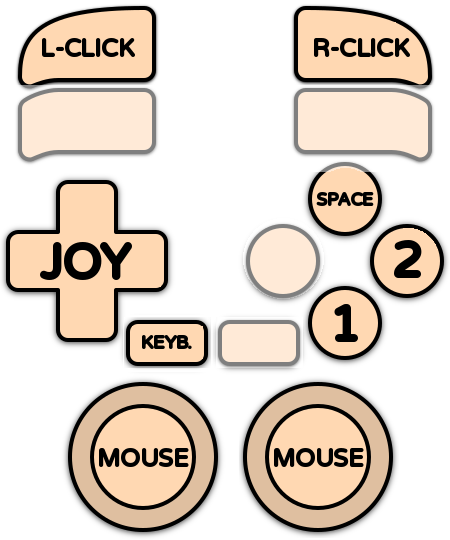

# Amiga CDTV

<div align="left"><figure><figcaption></figcaption></figure></div>

## Présentation

L'**Amiga CDTV** (Commodore Dynamic Total Vision) est le lecteur multimédia de Commodore, sorti en 1991. Présenté comme un appareil hi-fi à poser sous le téléviseur, c'est un Amiga 500 (Motorola 68000, 1 Mo de mémoire) avec un lecteur CD-ROM simple vitesse, une télécommande infrarouge et un Kickstart complété par la ROM CDTV. Un clavier, une souris et un lecteur de disquettes étaient vendus en option.

Le CDTV a reçu une centaine de titres, dont beaucoup d'encyclopédies et de logiciels éducatifs, mais aussi des jeux, souvent des jeux Amiga enrichis de musiques CD et de voix : _Defender of the Crown_, _Lemmings_, _Battle Chess_, _Sim City_, _Wrath of the Demon_, _Psycho Killer_… Ce fut un échec commercial, et Commodore l'a remplacé par la CD32 en 1993.



## En bref

<table><thead><tr><th width="235.25"></th><th></th></tr></thead><tbody><tr><td>Dossier des jeux</td><td>📁 roms \ 📂 amigacdtv</td></tr><tr><td>Extensions</td><td>.cue .chd .iso .ccd .nrg .mds .m3u .rp9 .zip .7z</td></tr><tr><td>Émulateur par défaut</td><td>libretro: puae</td></tr><tr><td>BIOS</td><td>Kickstart 1.3 et ROM étendue CDTV obligatoires</td></tr><tr><td>Configuration des manettes</td><td>Automatique (sauf Amiga Forever)</td></tr><tr><td>RetroAchievements</td><td>Non</td></tr><tr><td>Jeu en réseau</td><td>Non</td></tr><tr><td>Gestionnaire de sauvegardes ES</td><td>cores libretro, Amiberry</td></tr></tbody></table>

## Quel émulateur choisir ?

| Émulateur                   | Points forts                                                           | Limites                                                   |
| --------------------------- | ---------------------------------------------------------------------- | --------------------------------------------------------- |
| **libretro: puae** (défaut) | Fiable, clavier virtuel, Pad2Key, une sauvegarde par titre             |                                                           |
| libretro: amiberry          | Moteur UAE récent, .rp9                                                |                                                           |
| amiberry                    | Version standalone, émulation de la télécommande CDTV, menu Amiberry   | .m3u multi-disques : premier disque seulement             |
| winuae                      | L'émulateur Amiga de référence, le plus précis                         |                                                           |
| amigaforever                | Lance les paquets .rp9 de l'offre commerciale Amiga Forever de Cloanto | Amiga Forever doit être installé, pas d'autoconfiguration |

## BIOS

Le CDTV a besoin de **deux** ROM : le Kickstart 1.3 et la ROM étendue CDTV. Copiez-les dans le dossier `bios` (ou `bios\amiga`).

| Fichier           | Nom court      | Nom Amiga Forever         | MD5 (nom court)                  | Utilisé pour                              |
| ----------------- | -------------- | ------------------------- | -------------------------------- | ----------------------------------------- |
| Kickstart 1.3     | kick34005.A500 | amiga-os-130.rom          | 82a21c1890cae844b3df741f2762d48d | **Obligatoire**                           |
| ROM étendue CDTV  | kick34005.CDTV | amiga-os-130-cdtv-ext.rom | 89da1838a24460e4b93f4f0c5d92d48d | **Obligatoire**                           |
| Clé Amiga Forever | rom.key        |                           |                                  | Optionnel – ROM chiffrées d'Amiga Forever |


RetroBat vérifie la présence des deux fichiers. Le Kickstart 1.3 est le même que pour l'Amiga 500.


* Les **noms courts** fonctionnent avec tous les émulateurs : utilisez-les en cas de doute.
* Les ROM Amiga Forever sont chiffrées : copiez à côté le fichier **rom.key** fourni avec Amiga Forever.

RetroBat émule toujours un CDTV standard (68000, 1 Mo de Chip RAM) : il n'y a pas de modèle à choisir.

## Quel format pour les jeux ?

<table><thead><tr><th width="202.75">Format</th><th>Description</th></tr></thead><tbody><tr><td>.chd</td><td>Image CD compressée, un seul fichier par titre, avec les pistes audio. <strong>Recommandé</strong></td></tr><tr><td>.cue (+ .bin)</td><td>Image CD avec ses pistes audio</td></tr><tr><td>.iso</td><td>Image CD sans les pistes audio : la musique CD manque</td></tr><tr><td>.ccd / .nrg / .mds</td><td>Autres formats d'image CD (CloneCD, Nero, Alcohol)</td></tr><tr><td>.m3u</td><td>Titre sur plusieurs disques</td></tr><tr><td>.rp9</td><td>Paquet Amiga Forever (Amiga Forever, lr-amiberry, lr-puae)</td></tr><tr><td>.zip / .7z</td><td>Images CD compressées, <strong>cores libretro uniquement</strong></td></tr></tbody></table>


Préférez le **.chd** : un seul fichier par titre, plus léger, avec la musique CD. Pour convertir un titre .cue/.bin : `chdman createcd -i "jeu.cue" -o "jeu.chd"`.


## Contrôles

### Configuration automatique des manettes

Le CDTV fonctionne comme un Amiga 500 : le **joystick** se branche dans le port 2 et la **souris** dans le port 1. La manette du joueur 1 va dans le port 2 et la souris de votre PC dans le port 1.

| Émulateur            | Configuration auto | Joueurs |
| -------------------- | ------------------ | ------- |
| lr-puae, lr-amiberry | Oui                | 2       |
| Amiberry             | Oui                | 2       |
| WinUAE               | Oui                | 2       |
| Amiga Forever        | Non                |         |

Le clavier de votre PC sert de clavier CDTV optionnel.

### Disposition par défaut

| CDTV                 | Cores libretro     | Amiberry     |
| -------------------- | ------------------ | ------------ |
| Joystick             | Croix              | Croix        |
| Bouton de tir 1      | SUD                | SUD          |
| Bouton de tir 2      | EST                | EST          |
| Barre d'espace       | NORD               |              |
| Souris               | Sticks analogiques | Souris du PC |
| Boutons de la souris | L2 / R2            | Souris du PC |
| Clavier virtuel      | SELECT             | SELECT       |
| Menu de l'émulateur  |                    | R3           |

<div align="left"><figure><figcaption></figcaption></figure></div>

### Options de contrôle utiles

<table><thead><tr><th width="133.25">Émulateur</th><th>Option</th><th>Description</th></tr></thead><tbody><tr><td>lr-puae</td><td>DISPOSITION DES BOUTONS DE LA MANETTE</td><td>Autres dispositions des boutons (saut sur un bouton…)</td></tr><tr><td>Amiberry</td><td>TYPE DE CONTRÔLEUR</td><td>MANETTE CDTV émule le joystick de la télécommande CDTV</td></tr><tr><td>Amiberry</td><td>PÉRIPHÉRIQUE PORT 1</td><td>Souris, joystick (joueur 2) ou rien dans le port souris</td></tr><tr><td>Amiberry</td><td>INVERSER LES PORTS JOYSTICK</td><td>Pour les quelques titres qui veulent le joystick dans le port 1</td></tr><tr><td>WinUAE</td><td>INVERSER LES PORTS JOYSTICK / DEUXIÈME MANETTE</td><td>Inverser les ports, mettre le joueur 2 dans le port 1</td></tr></tbody></table>

Pour les autres options de contrôle, voir la page Amiga 500.

### Raccourcis

**Cores libretro** : [raccourcis standards](../../../../navigation/hotkeys.md) de RetroBat.

<table><thead><tr><th>Raccourci</th><th>Amiberry</th><th width="149">WinUAE</th><th>Amiga Forever</th></tr></thead><tbody><tr><td>HOTKEY + START</td><td>Quitter</td><td>Quitter</td><td></td></tr><tr><td>HOTKEY + OUEST</td><td>Sauvegarder l'état</td><td></td><td></td></tr><tr><td>HOTKEY + NORD</td><td>Charger l'état</td><td></td><td></td></tr></tbody></table>

Le menu d'Amiberry s'ouvre avec R3 ou F12, celui de WinUAE avec F12.

## Dossiers

| Émulateur   | Contenu                                 | Dossier                                 |
| ----------- | --------------------------------------- | --------------------------------------- |
| lr-puae     | Sauvegardes (NVRAM, une par titre)      | `saves\amigacdtv`                       |
| lr-amiberry | Sauvegardes                             | `saves\amigacdtv\LR-amiberry`           |
| libretro    | Sauvegardes d'état                      | `saves\amigacdtv\libretro.<core>`       |
| Amiberry    | Sauvegardes d'état, sauvegardes (NVRAM) | `saves\amigacdtv\amiberry`              |
| Amiberry    | Captures d'écran                        | `screenshots\amiberry`                  |
| WinUAE      | Sauvegardes d'état                      | `saves\amigacdtv\winuae`                |
| WinUAE      | Sauvegardes (NVRAM)                     | `saves\amigacdtv\winuae\nvram`          |
| WinUAE      | Captures d'écran / vidéos               | `screenshots\winuae` / `records\winuae` |

## Guides

### Sauvegardes

Les titres CDTV sauvegardent dans la mémoire interne de l'appareil (NVRAM). Chaque émulateur la garde dans son propre dossier de sauvegardes : changer d'émulateur ne reprend pas vos sauvegardes. Avec lr-puae, chaque titre a son propre fichier de sauvegarde.

### Titres sur plusieurs disques

Regroupez les disques d'un titre avec un fichier .m3u, par exemple `Titre.m3u` dans `roms\amigacdtv` :

```
Titre (Disc 1).chd
Titre (Disc 2).chd
```

Avec les cores libretro, changez de disque avec HOTKEY + L1 (éjecter/insérer) et HOTKEY + L2/R2 (disque précédent/suivant). Amiberry ne lance que le premier disque : changez de disque depuis son menu.

## Problèmes connus

<table><thead><tr><th width="330.25">Problème</th><th>Solution</th></tr></thead><tbody><tr><td>« Kickstart not found » ou écran noir</td><td>Copiez kick34005.A500 <strong>et</strong> kick34005.CDTV dans le dossier bios.</td></tr><tr><td>Les ROM Amiga Forever ne fonctionnent pas</td><td>Copiez rom.key à côté.</td></tr><tr><td>Pas de musique</td><td>Le format .iso n'a pas l'audio CD : utilisez une image .cue/.bin ou .chd.</td></tr><tr><td>Le titre reste sur le logo CDTV ou ne charge pas</td><td>Avec lr-puae, activez DÉLAI D'INSERTION DU CD. Sinon, essayez un autre émulateur.</td></tr><tr><td>Le titre ne réagit qu'à la souris</td><td>Beaucoup de titres CDTV se pilotent à la souris : utilisez les sticks (libretro) ou la souris du PC.</td></tr><tr><td>Le joystick ne répond pas</td><td>Le titre veut le joystick dans le port 1 : activez INVERSER LES PORTS JOYSTICK (Amiberry, WinUAE).</td></tr><tr><td>Un titre .zip/.7z ne démarre pas</td><td>Seuls les cores libretro lisent les archives : décompressez-le, ou convertissez-le en .chd.</td></tr></tbody></table>
