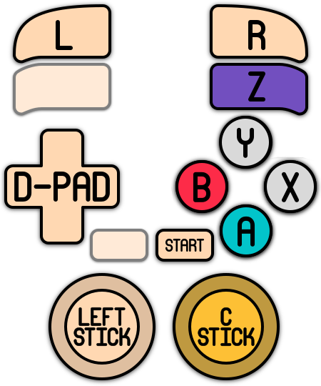
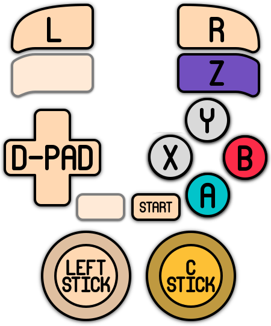
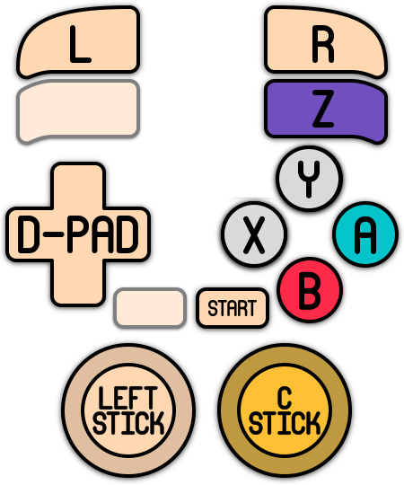

# GameCube

<div align="left"><figure><figcaption></figcaption></figure></div>

## Présentation

La **GameCube** est la quatrième console de salon de Nintendo, après la Nintendo 64. Elle sort au Japon en septembre 2001, en Amérique du Nord en novembre 2001 et en Europe en mai 2002. Compacte, avec sa poignée de transport et ses couleurs vives (violet « indigo », noir, orange…), elle tranche avec ses concurrentes, la PlayStation 2 et la Xbox.

Elle lit des **mini-DVD** de 1,5 Go, un format propre à Nintendo, et repose sur un processeur IBM PowerPC (« Gekko ») et une puce graphique ATI (« Flipper »). Sa manette, avec son gros bouton A central et ses gâchettes analogiques, est restée une référence, notamment pour Super Smash Bros. Un câble permet de la relier à une **Game Boy Advance**, utilisée comme manette ou second écran dans certains jeux. Le Game Boy Player permet aussi d'y jouer aux jeux Game Boy.

Elle s'est vendue à environ 21 millions d'exemplaires, jusqu'en 2007. Sa ludothèque compte de nombreux classiques : Super Smash Bros. Melee, Metroid Prime, The Legend of Zelda: The Wind Waker, Super Mario Sunshine, Mario Kart: Double Dash!!, Resident Evil 4, F-Zero GX, Pikmin, Luigi's Mansion, Animal Crossing, Paper Mario : La Porte Millénaire, Eternal Darkness…



## En bref

<table><thead><tr><th width="254"></th><th></th></tr></thead><tbody><tr><td><strong>Dossier des jeux</strong></td><td><code>roms\gamecube</code></td></tr><tr><td><strong>Extensions</strong></td><td>.dol .gcz .iso .ciso .wbfs .wad .rvz .wia .m3u .zip .7z .squashfs .json .decomp</td></tr><tr><td><strong>Émulateur par défaut</strong></td><td>dolphin</td></tr><tr><td><strong>BIOS</strong></td><td>Aucun obligatoire (IPL optionnel)</td></tr><tr><td><strong>Configuration des manettes</strong></td><td>Automatique, tous les émulateurs</td></tr><tr><td><strong>Sauvegardes instantanées</strong></td><td>core libretro, Dolphin</td></tr><tr><td><strong>RetroAchievements</strong></td><td>core libretro, Dolphin</td></tr><tr><td><strong>Jeu en réseau</strong></td><td>Non</td></tr></tbody></table>

## Quel émulateur choisir ?

<table><thead><tr><th width="117.75">Émulateur</th><th width="148">Pour qui ?</th><th width="252.25">Points forts</th><th>Limites</th></tr></thead><tbody><tr><td><strong>dolphin</strong> (par défaut)</td><td>Tout le monde</td><td>Le plus compatible et le plus complet : HD, écran large, packs de textures, adaptateur GameCube, liaison Game Boy Advance, profils de manette par jeu.</td><td>—</td></tr><tr><td><strong>lr-dolphin</strong></td><td>Utilisateurs de RetroArch</td><td>Fonctions de RetroArch (shaders, menu RetroArch).</td><td>Basé sur une version plus ancienne de Dolphin, moins compatible. Ne lit pas les .zip et .7z.</td></tr></tbody></table>

**Dans le doute, gardez dolphin.**

## BIOS

Aucun BIOS n'est nécessaire : Dolphin lance les jeux sans BIOS. Le BIOS de la GameCube (fichier **IPL.bin**) est **optionnel**. Il permet d'afficher l'animation de démarrage de la console et améliore l'affichage des polices de certains jeux.

<table><thead><tr><th width="82.75">Région</th><th width="85.75">Fichier</th><th width="249.25">MD5</th><th>Emplacement (Dolphin)</th></tr></thead><tbody><tr><td>Europe</td><td>IPL.bin</td><td>0cdda509e2da83c85bfe423dd87346cc</td><td><code>emulators\dolphin-emu\User\GC\EUR</code></td></tr><tr><td>USA</td><td>IPL.bin</td><td>019e39822a9ca3029124f74dd4d55ac4</td><td><code>emulators\dolphin-emu\User\GC\USA</code></td></tr><tr><td>Japon</td><td>IPL.bin</td><td>fc924a7c879b661abc37cec4f018fdf3</td><td><code>emulators\dolphin-emu\User\GC\JAP</code></td></tr></tbody></table>

* Pour lr-dolphin, placez le fichier dans le même sous-dossier GC\<région>, sous `saves\gamecube\dolphin-emu\User`.
* RetroBat ne vérifie pas la présence de l'IPL, puisqu'il n'est pas obligatoire.
* Pour voir l'animation de démarrage, désactivez **SAUTER LE BIOS** dans les options du système ou du jeu.
* La **liaison Game Boy Advance** (voir [Guides](gamecube.md#liaison-game-boy-advance)) utilise le BIOS de la GBA : gba\_bios.bin, dans le dossier bios.

### Changer la langue des jeux

Dans les options avancées du système ou du jeu (Dolphin), réglez **ÉMULATION > LANGUE** : anglais, allemand, français, espagnol, italien ou néerlandais.

Seuls les jeux **européens (PAL)** en tiennent compte : les jeux américains et japonais restent dans leur langue d'origine.

## Quel format de jeu ?

<table><thead><tr><th width="165">Format</th><th width="145">dolphin</th><th width="101.5">lr-dolphin</th><th>Remarques</th></tr></thead><tbody><tr><td><strong>.iso</strong> (conseillé)</td><td>✔</td><td>✔</td><td>Image du disque, non compressée (1,4 Go).</td></tr><tr><td><strong>.rvz</strong> (conseillé)</td><td>✔</td><td>✔</td><td>Format compressé de Dolphin, sans perte : jeux 30 à 70 % plus petits.</td></tr><tr><td>.gcz / .wia / .ciso</td><td>✔</td><td>✔</td><td>Anciens formats compressés.</td></tr><tr><td>.zip / .7z / .squashfs</td><td>✔ (décompressé au lancement)</td><td>✘</td><td>Chargement plus lent.</td></tr><tr><td>.m3u</td><td>✔</td><td>✔</td><td>Jeux multi-disques (<a href="gamecube.md#jeux-multi-disques">voir plus bas</a>).</td></tr><tr><td>.dol</td><td>✔</td><td>✔</td><td>Programmes homebrew.</td></tr><tr><td>.json</td><td>✔</td><td>✘</td><td>Jeux modifiés avec des patchs Riivolution (voir <a href="gamecube.md#guides">Guides</a>).</td></tr></tbody></table>

* Pour convertir un jeu en .rvz, ouvrez Dolphin (`emulators\dolphin-emu\Dolphin.exe`), faites un clic droit sur le jeu, puis **Convertir le fichier…** et choisissez le format **RVZ**.
* Les formats .wbfs et .wad sont des formats **Wii** : ces jeux vont dans `roms\wii`.

### Jeux multi-disques

Quelques jeux tiennent sur deux disques (Resident Evil 4, Metal Gear Solid: The Twin Snakes, Baten Kaitos, Tales of Symphonia…). Créez un fichier texte avec l'extension **.m3u**, qui liste les disques, un par ligne :

```
Tales of Symphonia (Disc 1).rvz
Tales of Symphonia (Disc 2).rvz
```

Dolphin change de disque tout seul quand le jeu le demande. Vous pouvez aussi le faire avec **HOTKEY + L2**.

## Contrôles

### Configuration automatique

RetroBat configure vos manettes automatiquement, pour Dolphin comme pour lr-dolphin, jusqu'à 4 joueurs. Sont pris en charge : les manettes XInput (Xbox…), DualShock 4, DualSense, Switch Pro, la plupart des manettes SDL, ainsi que les **vraies manettes GameCube** branchées sur un adaptateur ([voir plus bas](gamecube.md#utiliser-une-vraie-manette-gamecube-adaptateur)).

| Manette RetroBat     | Manette GameCube                                                                                     |
| -------------------- | ---------------------------------------------------------------------------------------------------- |
| Boutons de façade    | A / B / X / Y (selon la disposition choisie, [voir ci-dessous](gamecube.md#disposition-des-boutons)) |
| R1                   | Z                                                                                                    |
| L2 / R2              | Gâchettes L / R                                                                                      |
| Stick gauche         | Stick principal                                                                                      |
| Stick droit          | Stick C                                                                                              |
| Croix directionnelle | Croix directionnelle                                                                                 |
| START                | START                                                                                                |

### Disposition des boutons

Sur la manette GameCube, le gros bouton **A** est au centre, **B** à gauche, **X** à droite et **Y** en haut. L'option **CONTRÔLES > DISPOSITION DES BOUTONS** (FACE BUTTON LAYOUT) choisit comment ils sont placés sur votre manette :

<table><thead><tr><th>Disposition</th><th width="86">SUD</th><th width="98">EST</th><th width="106">OUEST</th><th width="152.75">NORD</th></tr></thead><tbody><tr><td><strong>NINTENDO</strong> (par défaut)</td><td>B</td><td>A</td><td>Y</td><td>X</td></tr><tr><td><strong>POSITIONNEL</strong></td><td>A</td><td>X</td><td>B</td><td>Y</td></tr><tr><td><strong>XBOX</strong></td><td>A</td><td>B</td><td>X</td><td>Y</td></tr><tr><td><strong>MIX (A/B NINTENDO)</strong></td><td>B</td><td>A</td><td>X</td><td>Y</td></tr></tbody></table>

* **NINTENDO** : les lettres correspondent à celles d'une manette Nintendo (Switch Pro…).

<div align="left"><figure><figcaption></figcaption></figure></div>

* **POSITIONNEL** : reproduit la position des boutons de la manette GameCube.

<div align="left"><figure><figcaption></figcaption></figure></div>

* **XBOX** : les lettres correspondent à celles d'une manette Xbox.

<div align="left"><figure><figcaption></figcaption></figure></div>

* **MIX** : les lettres A/B correspondent à celles d'une manette Nintendo, X/Y à une manette Xbox.

<div align="left"><figure><figcaption></figcaption></figure></div>

### Utiliser une vraie manette GameCube (adaptateur)

Dolphin peut utiliser une vraie manette GameCube via un adaptateur USB (adaptateur officiel Nintendo WUP-028, Mayflash…). Il faut d'abord installer le pilote **Zadig** :

1. Téléchargez Zadig : [https://zadig.akeo.ie/](https://zadig.akeo.ie/)
2. Lancez Zadig, ouvrez **Options** et cochez **List All Devices**.
3. Choisissez l'adaptateur dans la liste (par exemple **WUP-028**).
4. Avec les flèches à droite, sélectionnez le pilote **libusbK**.
5. Cliquez sur **Replace Driver** et patientez (jusqu'à 5 minutes).
6. Dans RetroBat, réglez **CONTRÔLES > TYPE DE MANETTE JOUEUR 1** (et suivants) sur **ADAPTATEUR GAMECUBE**.

Si l'adaptateur ne fonctionne pas, il n'est peut-être pas pris en charge par Dolphin.

Les adaptateurs **Mayflash** et **Raphnet** sont aussi reconnus sans Zadig : RetroBat les configure comme une manette ordinaire. Dans ce cas, ne réglez **pas** le type de manette sur **ADAPTATEUR GAMECUBE**.

### Profil de manette pour un jeu

Pour utiliser votre propre configuration sur un jeu précis, créez un profil dans Dolphin et associez-le au jeu : voir la page [Configuration des touches Dolphin](../../../../controleurs/configuration-des-touches-specifique-par-emulateur/configuration-des-touches-dolphin.md). Pour configurer toutes les manettes vous-même, réglez **AUTOCONFIGURER LES MANETTES** sur **OFF**.

### Raccourcis

**Dolphin** utilise les raccourcis suivants :

<table><thead><tr><th width="347.75">Action</th><th>Manette</th></tr></thead><tbody><tr><td>Quitter le jeu</td><td>HOTKEY + START</td></tr><tr><td>Pause</td><td>HOTKEY + EST</td></tr><tr><td>Sauvegarde d'état (avec capture d'écran) / Chargement d'état</td><td>HOTKEY + OUEST / HOTKEY + NORD</td></tr><tr><td>Emplacement de sauvegarde suivant / précédent</td><td>HOTKEY + HAUT / HOTKEY + BAS</td></tr><tr><td>Accélérer / ralentir</td><td>HOTKEY + DROITE / HOTKEY + GAUCHE</td></tr><tr><td>Changer de disque / éjecter</td><td>HOTKEY + L2 / HOTKEY + L1</td></tr><tr><td>Plein écran</td><td>HOTKEY + L3</td></tr></tbody></table>

**lr-dolphin** utilise les raccourcis de RetroArch (voir la [page Raccourcis](../../../../navigation/hotkeys.md)).

## Dossiers

### Sauvegardes

Sur GameCube, les jeux sauvegardent sur une **carte mémoire**. RetroBat la crée pour vous, une par région :

<table><thead><tr><th width="259">Contenu</th><th>Dossier</th></tr></thead><tbody><tr><td>Sauvegardes Dolphin</td><td><code>saves\gamecube\dolphin-emu\User\GC\&#x3C;région></code></td></tr><tr><td>Sauvegardes lr-dolphin</td><td><code>saves\gamecube\dolphin-emu\User\GC\&#x3C;région>\Card A</code></td></tr><tr><td>Sauvegardes d'état Dolphin</td><td><code>saves\gamecube\dolphin</code></td></tr><tr><td>Sauvegardes d'état lr-dolphin</td><td><code>saves\gamecube\libretro.dolphin</code></td></tr></tbody></table>

* La région (EUR, USA ou JAP) est détectée automatiquement à partir du jeu. **ÉMULATION > RÉGION DU SYSTÈME** force une région, par exemple pour retrouver une sauvegarde faite avec la version d'une autre région.
* Par défaut, chaque sauvegarde est un fichier séparé (format **GCI**). **ÉMULATION > FORMAT DES SAUVEGARDES > CARTE MÉMOIRE** utilise à la place un fichier unique par région (comme une vraie carte mémoire), rangé dans `saves\gamecube\dolphin-emu\User\GC`.
* Dolphin et lr-dolphin n'utilisent pas le même dossier. Pour passer de l'un à l'autre sans perdre vos sauvegardes, activez **ÉMULATION > SYNCHRONISER LES SAUVEGARDES ENTRE CORE ET STANDALONE**.

### Autres dossiers utiles

<table><thead><tr><th width="352.75">Contenu</th><th>Dossier</th></tr></thead><tbody><tr><td>BIOS (IPL.bin)</td><td><code>emulators\dolphin-emu\User\GC\&#x3C;région></code></td></tr><tr><td>Packs de textures</td><td><code>saves\gamecube\dolphin-emu\User\Load\Textures</code></td></tr><tr><td>Resource packs</td><td><code>saves\gamecube\dolphin-emu\User\ResourcePacks</code></td></tr><tr><td>Captures (dumps) de textures et de vidéos</td><td><code>saves\gamecube\dolphin-emu\User\Dump</code></td></tr><tr><td>Profils de manette et réglages de Dolphin</td><td><code>emulators\dolphin-emu\User\Config</code></td></tr></tbody></table>

## Guides

### Succès (RetroAchievements) et jeux en .rvz

Dolphin et lr-dolphin gèrent les [succès RetroAchievements](../../../../utilisation-avancee/retroachievements.md). Mais RetroBat ne sait pas reconnaître les jeux au format **.rvz** lors de son indexation : l'icône de trophée n'apparaît pas dans la liste des jeux, alors que Dolphin annonce bien les succès au lancement.

RetroBat fournit un outil qui fait cette indexation à sa place :

1. Activez les succès dans **MENU PRINCIPAL > PARAMÈTRES DES JEUX > PARAMÈTRES DES SUCCÈS RETRO**, avec votre compte RetroAchievements.
2. Lancez au moins une fois un jeu GameCube avec Dolphin, pour qu'il soit installé.
3. **Quittez complètement RetroBat.**
4. Lancez le fichier **indexcheevosrvz.bat**, dans le dossier `system\tools` de RetroBat.
5. Relancez RetroBat : les jeux reconnus affichent l'icône de trophée.

L'outil traite tous les fichiers .rvz de `roms\gamecube` et de `roms\wii`, et enregistre l'identifiant RetroAchievements de chaque jeu dans le fichier gamelist.xml du système. Les jeux déjà indexés sont ignorés : relancez-le après avoir ajouté de nouveaux jeux. Un jeu absent de la base de RetroAchievements reste sans trophée.


Vous pouvez aussi ajouter l'identifiant à la main. Il apparaît dans la barre d'adresse de la page du jeu sur retroachievements.org (par exemple 1234 dans `retroachievements.org/game/1234`). Ajoutez la ligne suivante dans l'entrée du jeu, dans `roms\gamecube\gamelist.xml`, RetroBat étant fermé :

```
<cheevosId>1234</cheevosId>
```


### Textures personnalisées (Dolphin)

Des packs de textures HD existent pour de nombreux jeux.

1. Trouvez le **Game ID** du jeu : dans Dolphin, faites un clic droit sur le jeu, puis **Propriétés** (par exemple GZLE01 pour The Wind Waker US).
2. Copiez le pack dans `saves\gamecube\dolphin-emu\User\Load\Textures`, dans un dossier qui porte **exactement** ce Game ID.
3. Activez **RENDU VISUEL > TEXTURES PERSONNALISÉES** dans les options du jeu. **PRÉCHARGER LES TEXTURES** rend le jeu plus fluide, mais utilise beaucoup de mémoire.

### Jeux modifiés (patchs Riivolution, fichiers .json)

Dolphin peut lancer un jeu avec des patchs **Riivolution** (traductions, mods, corrections…) sans modifier le fichier du jeu. Les choix sont enregistrés dans un fichier **.json** (un « préréglage ») : placé dans `roms\gamecube`, il apparaît dans RetroBat comme un jeu à part.

1. Lancez une fois un jeu GameCube depuis RetroBat avec Dolphin, pour que Dolphin utilise les dossiers GameCube.
2. Copiez le mod dans `saves\gamecube\dolphin-emu\User\Load\Riivolution`. Le dossier **riivolution** du mod, qui contient les fichiers .xml, doit se trouver dans `Load\Riivolution\riivolution`.
3. Ouvrez Dolphin (`emulators\dolphin-emu\Dolphin.exe`). Vos jeux apparaissent dans la liste.
4. Faites un clic droit sur le jeu, puis **Start with Riivolution Patches…** (Démarrer avec les patchs Riivolution).
5. Activez les options du mod, cliquez sur **Save Preset…** (Enregistrer le préréglage) et enregistrez le fichier .json dans `roms\gamecube`, avec le nom à afficher dans RetroBat.
6. Fermez Dolphin et mettez à jour les listes de jeux dans RetroBat : le jeu modifié apparaît dans la liste.


* Le fichier .json contient le chemin complet du jeu d'origine et du mod : si vous déplacez RetroBat ou le jeu, recréez le préréglage. Ne supprimez pas le jeu d'origine.
* Seul **Dolphin** lance les fichiers .json, pas lr-dolphin.


### Liaison Game Boy Advance

Certains jeux utilisent une Game Boy Advance comme manette ou second écran (The Legend of Zelda: Four Swords Adventures, Final Fantasy Crystal Chronicles…). Dolphin peut émuler la GBA :

1. Placez gba\_bios.bin dans le dossier bios.
2. Réglez **CONTRÔLES > TYPE DE MANETTE** du joueur concerné sur **GBA**.
3. Si le jeu a besoin d'une cartouche GBA, choisissez-la avec **GBA ROM** et **GBA ROM PORT**.

## Problèmes connus

**L'icône de trophée n'apparaît pas pour un jeu compatible** Le jeu est au format .rvz : utilisez l'outil d'indexation (voir [Guides](gamecube.md#succes-retroachievements-et-jeux-en-.rvz)).

**Mes sauvegardes ont disparu**

* Vous êtes passé de Dolphin à lr-dolphin (ou l'inverse) : activez **SYNCHRONISER LES SAUVEGARDES ENTRE CORE ET STANDALONE**.
* Le jeu n'a pas la même région que votre sauvegarde : réglez **RÉGION DU SYSTÈME** sur la région de la sauvegarde.
* Vous avez changé de **FORMAT DES SAUVEGARDES** : les deux formats ne partagent pas les sauvegardes.

**lr-dolphin ne lance pas le jeu** lr-dolphin ne lit pas les jeux en .zip ou .7z : décompressez-les, ou utilisez Dolphin.

**L'adaptateur GameCube ne répond pas** Vérifiez que le pilote Zadig (libusbK) est installé et que le type de manette est réglé sur **ADAPTATEUR GAMECUBE**. Pour un adaptateur Mayflash ou Raphnet utilisé sans Zadig, le type de manette doit au contraire rester par défaut.
