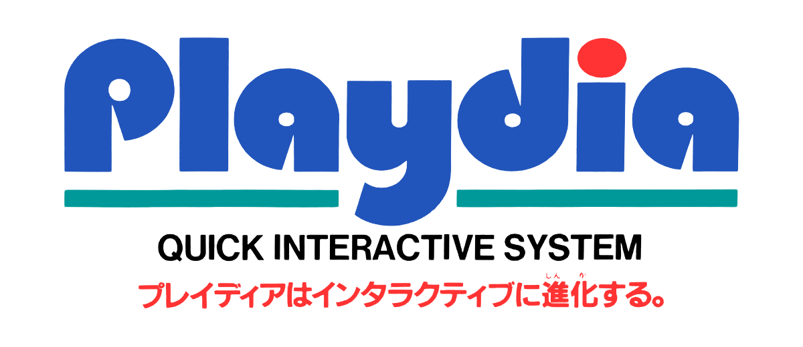
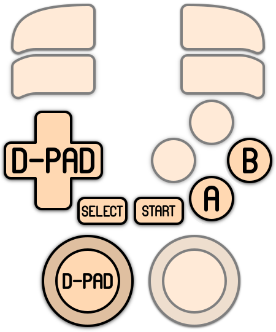

# Bandai Playdia

<figure><figcaption></figcaption></figure>

## Présentation

La **Playdia** (プレイディア) est une console de salon de Bandai, sortie uniquement au Japon le 23 septembre 1994, au prix de 24 800 yens. Bandai la présente comme un « Quick Interactive System » : les jeux sont des dessins animés interactifs, lus depuis un CD-ROM, où le joueur oriente l'histoire en choisissant parmi quelques réponses à l'écran. La manette, sans fil et infrarouge, se range dans la façade de la console.

Conçue pour les enfants, la Playdia s'appuie sur les licences de Bandai : **Sailor Moon**, **Dragon Ball Z**, **Ultraman**, **Anpanman**, **SD Gundam**… Une grande partie du catalogue est éducative (série **Playdia iQ Kids** : hiragana, chiffres, premiers mots d'anglais). Les ventes restent faibles et la console s'arrête en 1996, avec une trentaine de jeux.

RetroBat propose un émulateur : le core libretro **playdiaemu** (PlaydiaEmu).



## En bref

<table><thead><tr><th width="289"></th><th></th></tr></thead><tbody><tr><td><strong>Dossier des jeux</strong></td><td><code>roms\playdia</code></td></tr><tr><td><strong>Extensions</strong></td><td>.cue .iso .bin .img .zip</td></tr><tr><td><strong>Émulateur par défaut</strong></td><td>libretro: playdiaemu</td></tr><tr><td><strong>BIOS</strong></td><td>Aucun</td></tr><tr><td><strong>Configuration des manettes</strong></td><td>Automatique</td></tr><tr><td><strong>Sauvegardes instantanées</strong></td><td>core libretro</td></tr><tr><td><strong>RetroAchievements</strong></td><td>Non</td></tr><tr><td><strong>Jeu en réseau</strong></td><td>Non</td></tr></tbody></table>

## Quel émulateur choisir ?

| Émulateur                         | Points forts                                                                       | Limites                                                                                                                                                                                     |
| --------------------------------- | ---------------------------------------------------------------------------------- | ------------------------------------------------------------------------------------------------------------------------------------------------------------------------------------------- |
| **libretro: playdiaemu** (défaut) | Pas de BIOS, lit directement les archives `.zip` Redump, sauvegardes instantanées. | Émulateur récent : l'image est reconnaissable mais pas encore identique à la vraie console, et tous les jeux n'ont pas été testés jusqu'au bout. Pas de retour arrière ni de jeu en réseau. |

## BIOS

Aucun BIOS n'est nécessaire : PlaydiaEmu lit les disques avec son propre lecteur (émulation de haut niveau), sans le programme interne de la console.

## Quel format de jeu ?

<table><thead><tr><th width="189">Format</th><th>Remarques</th></tr></thead><tbody><tr><td><strong>.cue</strong> (+ .bin)</td><td>Image de CD Redump (deux pistes). Le format conseillé.</td></tr><tr><td><strong>.zip</strong></td><td>Archive Redump contenant le <code>.cue</code> et les <code>.bin</code> (ou un seul <code>.bin</code> / <code>.iso</code>). Lue directement, sans décompression.</td></tr><tr><td><strong>.iso</strong>, <strong>.bin</strong>, <strong>.img</strong></td><td>Image d'une seule piste.</td></tr></tbody></table>

Les `.chd` ne sont pas lus : gardez les jeux en `.cue` / `.bin` ou en `.zip`.

## Contrôles

### Configuration automatique

RetroBat configure la manette automatiquement. La manette Playdia n'a qu'une croix et quelques boutons : dans les jeux, la croix et les boutons servent à choisir une réponse à l'écran.

<table><thead><tr><th width="242.75">Manette RetroBat</th><th>Playdia</th></tr></thead><tbody><tr><td>Croix, stick gauche</td><td>Croix</td></tr><tr><td>EST</td><td>A</td></tr><tr><td>SUD</td><td>B</td></tr><tr><td>START</td><td>Start</td></tr><tr><td>SELECT</td><td>Select</td></tr></tbody></table>

**CONTRÔLES > INVERSER LES BOUTONS A/B** met A sur SUD et B sur EST.

|                                                 |                                                |
| ----------------------------------------------- | ---------------------------------------------- |
| .png>) |  |

Quand un jeu attend une réponse et que vous n'appuyez sur rien, il continue tout seul au bout d'une dizaine de secondes, avec le choix par défaut.

### Raccourcis

playdiaemu utilise les raccourcis standards de RetroArch (voir la page [**Raccourcis**](../../../navigation/hotkeys.md)). Le retour arrière (HOTKEY + GAUCHE) n'est pas disponible avec ce core.

## Dossiers

<table><thead><tr><th width="269">Contenu</th><th>Dossier</th></tr></thead><tbody><tr><td>Sauvegardes instantanées</td><td><code>saves\playdia\libretro.playdiaemu</code></td></tr><tr><td>Captures d'écran</td><td><code>screenshots</code></td></tr></tbody></table>

La Playdia n'a pas de mémoire de sauvegarde : seules les sauvegardes instantanées gardent la progression.

## Problèmes connus

<table><thead><tr><th width="367.75">Problème</th><th>Solution</th></tr></thead><tbody><tr><td>Un jeu en <code>.chd</code> n'apparaît pas ou ne démarre pas</td><td>Le core ne lit pas les <code>.chd</code> : utilisez le <code>.cue</code> / <code>.bin</code> ou l'archive <code>.zip</code> Redump.</td></tr><tr><td>Une sauvegarde instantanée ne se charge pas</td><td>Elle est liée au disque : elle ne se charge que sur exactement le même jeu (même image).</td></tr><tr><td>Le jeu reste sur le logo BANDAI</td><td>Appuyez sur A (EST) pour passer le logo.</td></tr><tr><td>L'image ne ressemble pas tout à fait à la vraie console</td><td>L'émulation de la vidéo est récente et encore en cours d'amélioration ; les mises à jour du core arrivent avec RetroBat.</td></tr></tbody></table>
