# Megadrive - Genesis (MSU)

<div align="left"><figure><figcaption></figcaption></figure></div>

## Présentation

MSU-MD est un pilote créé par des fans qui permet aux jeux MegaDrive de jouer une musique en qualité CD. Le jeu tourne normalement depuis la cartouche, et le Mega-CD ne sert qu'à lire les pistes audio (c'est ce qu'on appelle le « Mode 1 »). La communauté a patché de nombreux jeux de cette façon (Sonic, Streets of Rage, OutRun, Castlevania Bloodlines…) avec des bandes-son réorchestrées ou originales.

RetroBat lance aussi les patchs **MD+** (prévus pour la cartouche MegaSD) depuis le même dossier : ils fonctionnent de la même manière, mais sans BIOS.

Dans EmulationStation, MSU-MD apparaît dans le groupe **MegaDrive**.

## En bref

<table><thead><tr><th width="280.25"></th><th></th></tr></thead><tbody><tr><td><strong>Dossier des jeux</strong></td><td><code>roms\megadrive-msu</code></td></tr><tr><td><strong>Extensions</strong></td><td>.68k .sgd .smd .bin .gen .md .zip .7z</td></tr><tr><td><strong>Émulateur par défaut</strong></td><td>libretro: genesis_plus_gx</td></tr><tr><td><strong>BIOS</strong></td><td><code>bios_CD_U.bin</code> (ou E / J) obligatoire pour MSU-MD, aucun pour MD+</td></tr><tr><td><strong>Configuration des manettes</strong></td><td>Automatique, tous les émulateurs</td></tr><tr><td><strong>Sauvegardes instantanées</strong></td><td>cores libretro, BlastEm</td></tr><tr><td><strong>RetroAchievements</strong></td><td>cores libretro (ROM patchée en général non reconnue)</td></tr><tr><td><strong>Jeu en réseau</strong></td><td>cores libretro</td></tr><tr><td><strong>Pistolets</strong></td><td>cores libretro (genesis_plus_gx)</td></tr></tbody></table>

## Quel émulateur choisir ?

<table><thead><tr><th width="321.5">Émulateur</th><th>Quand l'utiliser</th></tr></thead><tbody><tr><td><strong>Genesis Plus GX</strong> (libretro, par défaut)</td><td>Le meilleur choix. Gère MSU-MD et MD+, et lit les pistes BIN, WAV et OGG.</td></tr><tr><td><strong>Genesis Plus GX Wide</strong> (libretro)</td><td>Identique, avec un affichage en 16:9. Certains jeux ont des défauts graphiques sur les côtés.</td></tr><tr><td><strong>Genesis Plus GX Expanded</strong> (libretro)</td><td>Version faite surtout pour Paprium. Rien de plus pour MSU-MD.</td></tr><tr><td><strong>BlastEm</strong></td><td>Émulateur très précis. MSU-MD fonctionne, MD+ non. Certains packs audio peuvent ne pas être lus (voir Problèmes connus).</td></tr></tbody></table>

Pour changer d'émulateur : sélectionnez le système ou le jeu, appuyez sur **SELECT** › **OPTIONS AVANCÉES DU SYSTÈME** (ou **OPTIONS AVANCÉES DU JEU**) › **ÉMULATEUR**.

## BIOS

MSU-MD utilise un vrai Mega-CD : il faut donc un BIOS Mega-CD dans le dossier `bios` (les mêmes fichiers que pour le système Mega-CD) :

<table><thead><tr><th width="183.25">Fichier</th><th width="322">MD5</th><th>Région</th></tr></thead><tbody><tr><td><code>bios_CD_U.bin</code></td><td><code>854b9150240a198070150e4566ae1290</code></td><td>USA (Sega CD)</td></tr><tr><td><code>bios_CD_E.bin</code></td><td><code>e66fa1dc5820d254611fdcdba0662372</code></td><td>Europe</td></tr><tr><td><code>bios_CD_J.bin</code></td><td><code>278a9397d192149e84e820ac621a8edd</code></td><td>Japon</td></tr></tbody></table>

L'émulateur utilise le BIOS qui correspond à la région de la console. La plupart des patchs MSU-MD refusent de tourner sur une console PAL : **c'est donc `bios_CD_U.bin` qu'il vous faut en priorité**.

Les jeux MD+ n'utilisent aucun BIOS.

## Formats

Un jeu MSU-MD se compose de trois éléments, tous dans le même dossier :

* la **ROM patchée** (`.md`, `.bin`, `.gen`, `.smd`) ;
* un **fichier `.cue` portant exactement le même nom** que la ROM ;
* les **pistes audio** listées dans le `.cue` (`.ogg`, `.wav` ou `.bin`).

Exemple :

```
roms\megadrive-msu\
├── Sonic the Hedgehog (MSU-MD).md
├── Sonic the Hedgehog (MSU-MD).cue
├── Sonic the Hedgehog (MSU-MD)-01.ogg
├── Sonic the Hedgehog (MSU-MD)-02.ogg
└── ...
```

Vous pouvez aussi ranger chaque jeu dans son propre sous-dossier.


* Seule la ROM apparaît dans la liste des jeux : c'est normal, le `.cue` est chargé automatiquement.
* Ne **zippez pas** la ROM : l'émulateur risque de ne plus trouver le `.cue`, et le jeu jouera sa musique d'origine.
* Le patch doit être appliqué à la ROM au préalable : RetroBat ne patche pas les jeux MSU-MD à la volée.


Genesis Plus GX accepte aussi un `.chd` de même nom à la place du `.cue` et de ses pistes.

## Contrôles

Les contrôles sont exactement les mêmes que sur **MegaDrive** : les manettes sont **configurées automatiquement**, et les mêmes options sont disponibles (disposition des boutons, mode 3 boutons, multitap, manettes spéciales, pistolets).

👉 Consultez la [page MegaDrive](megadrive-genesis.md#controles) pour la disposition complète et les options, et la [page Manettes spéciales](../../../../controleurs/supported-controllers/gamepads/controleurs-speciaux.md) pour les manettes Sega 6 boutons.

<div align="left"><figure><figcaption></figcaption></figure></div>

## Dossiers

<table><thead><tr><th width="369">Contenu</th><th>Emplacement</th></tr></thead><tbody><tr><td>ROMs, <code>.cue</code> et pistes</td><td><code>roms\megadrive-msu</code></td></tr><tr><td>BIOS</td><td><code>bios</code></td></tr><tr><td>Sauvegardes et sauvegardes instantanées (libretro)</td><td><code>saves\megadrive-msu</code></td></tr><tr><td>Sauvegardes et sauvegardes instantanées (BlastEm)</td><td><code>saves\megadrive-msu\blastem\&#x3C;nom du jeu></code></td></tr><tr><td>Captures d'écran</td><td><code>screenshots</code></td></tr></tbody></table>

## Guides

### Créer un jeu MSU-MD

1. Téléchargez le patch MSU-MD et son pack audio (le patch est généralement fourni avec ses pistes et un `.cue`).
2. Lisez le readme du patch : il indique **la version exacte de la ROM** à utiliser (nom, révision ou checksum). Une mauvaise ROM est la première cause d'échec.
3. Appliquez le patch sur votre ROM avec l'outil indiqué par l'auteur (Floating IPS / Flips pour les fichiers `.ips` et `.bps`, ou le script fourni).
4. Renommez la ROM patchée pour qu'elle porte **le même nom** que le `.cue` (ou renommez le `.cue`, sans modifier les noms des pistes écrits à l'intérieur).
5. Copiez la ROM, le `.cue` et les pistes dans `roms\megadrive-msu`.
6. Mettez à jour les listes de jeux (**START** › **PARAMÈTRES DES JEUX** › **METTRE À JOUR LES LISTES DE JEUX**).

## Problèmes connus

**Écran « MSU-MD lockout » ou message indiquant qu'aucun Mega-CD n'est détecté**

* Le BIOS Mega-CD est absent : ajoutez `bios_CD_U.bin`.
* La console est en mode PAL (ROM européenne) : réglez **RÉGION DE LA CONSOLE** sur **NTSC US** dans les options avancées du jeu (Genesis Plus GX), ou **RÉGION** avec BlastEm.

**Le jeu se lance mais avec sa musique d'origine**

* La ROM et le `.cue` n'ont pas exactement le même nom.
* La ROM est zippée : décompressez-la.
* Un nom de piste écrit dans le `.cue` ne correspond pas aux fichiers.
* **CD ADD-ON** a été forcé sur la mauvaise extension : laissez-le en automatique (les patchs MD+ ont besoin du MegaSD, les patchs MSU-MD du Mega CD).

**Pas de musique avec BlastEm** BlastEm ne gère pas les patchs MD+, et certains packs audio peuvent ne pas être lus. Utilisez Genesis Plus GX.

**Pas de succès** RetroAchievements reconnaît les jeux par leur ROM : une ROM patchée n'est en général pas reconnue.
