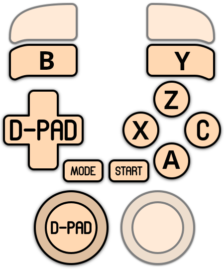

# Megadrive - Genesis

<table data-header-hidden><thead><tr><th></th><th></th><th data-hidden></th></tr></thead><tbody><tr><td></td><td></td><td></td></tr></tbody></table>

## Présentation

La **Mega Drive** (appelée **Genesis** en Amérique du Nord) est la console 16 bits de Sega. Elle est sortie au Japon en octobre 1988, en Amérique du Nord en 1989 et en Europe en 1990. Construite autour d'un processeur Motorola 68000, avec un Z80 et une puce sonore FM Yamaha YM2612, elle a amené des jeux dignes de l'arcade dans le salon et s'est vendue à environ 30 millions d'exemplaires. Sa ludothèque compte plus de 900 jeux : _Sonic the Hedgehog_, _Streets of Rage 2_, _Gunstar Heroes_, _Phantasy Star IV_, _Shinobi III_, _Ecco the Dolphin_, _Thunder Force IV_…

La manette d'origine a **3 boutons** (A, B, C). Une **manette 6 boutons** (avec X, Y, Z et un bouton MODE) a suivi en 1993, surtout pour les jeux de combat comme _Street Fighter II'_.

Les jeux Mega-CD, 32X et MSU-MD ont leurs propres systèmes : voir les pages [Mega-CD](mega-cd-sega-cd.md), [32X](sega-32x.md) et [Megadrive (MSU)](megadrive-genesis-msu.md).



## En bref

<table><thead><tr><th width="292.75"></th><th></th></tr></thead><tbody><tr><td>Dossier des jeux</td><td>📁 roms \ 📂 megadrive</td></tr><tr><td>Extensions</td><td>.68k .sgd .smd .bin .gen .md .sg .wad .zip .7z</td></tr><tr><td>Émulateur par défaut</td><td>libretro: genesis_plus_gx</td></tr><tr><td>BIOS</td><td>Aucun obligatoire</td></tr><tr><td>Configuration des manettes</td><td>Automatique, tous les émulateurs</td></tr><tr><td>RetroAchievements</td><td>cores libretro, BizHawk</td></tr><tr><td>Jeu en réseau</td><td>cores libretro</td></tr><tr><td>Gestionnaire de sauvegardes ES</td><td>cores libretro, BlastEm, Jgenesis, BizHawk</td></tr></tbody></table>

## Quel émulateur choisir ?

| Émulateur                                | Points forts                                                                                              | Limites                                             |
| ---------------------------------------- | --------------------------------------------------------------------------------------------------------- | --------------------------------------------------- |
| **libretro: genesis\_plus\_gx** (défaut) | Précis et complet : manettes 3/6 boutons, adaptateurs multijoueurs, souris, pistolets, cartouches lock-on |                                                     |
| libretro: genesis\_plus\_gx\_wide        | Le même, en écran large (16:9)                                                                            | Défauts graphiques sur les côtés dans certains jeux |
| libretro: genesis\_plus\_gx\_expanded    | Lit les très grosses ROM et **Paprium**                                                                   | À réserver à ces jeux                               |
| libretro: picodrive                      | Très rapide, pour les PC modestes                                                                         | Moins précis                                        |
| libretro: fbneo                          | Alternative FBNeo                                                                                         | Les jeux doivent porter les noms de la base FBNeo   |
| jgenesis                                 | Émulateur standalone récent et précis, shaders                                                            | 2 joueurs, pas de RetroAchievements                 |
| blastem                                  | Émulateur standalone très précis, adaptateur multijoueurs, choix du modèle de console                     | Pas de RetroAchievements                            |
| mednafen                                 | Précis, adaptateur multijoueurs                                                                           | Pas de RetroAchievements                            |
| ares                                     | Émulateur multi-systèmes précis                                                                           | 2 joueurs, pas de RetroAchievements                 |
| kega-fusion                              | Émulateur historique, léger, adaptateur multijoueurs                                                      | N'est plus maintenu                                 |
| bizhawk: Genplus-gx                      | Genesis Plus GX avec les outils de BizHawk (TAS, RetroAchievements)                                       | 2 joueurs                                           |

## BIOS

Aucun BIOS n'est nécessaire pour jouer. Quelques fichiers optionnels ajoutent des fonctions avec les cores Genesis Plus GX. Copiez-les dans le dossier `bios` :

<table><thead><tr><th width="163.25">Fichier</th><th>Utilisé pour</th><th>MD5</th></tr></thead><tbody><tr><td>bios_MD.bin</td><td>Afficher l'écran de démarrage de la console (option DÉMARRER DEPUIS LE BIOS)</td><td>45e298905a08f9cfb38fd504cd6dbc84</td></tr><tr><td>sk.bin</td><td>Lock-on Sonic &#x26; Knuckles</td><td>4ea493ea4e9f6c9ebfccbdb15110367e</td></tr><tr><td>sk2chip.bin</td><td>Lock-on Sonic &#x26; Knuckles (partie Sonic 2)</td><td>b4e76e416b887f4e7413ba76fa735f16</td></tr><tr><td>ggenie.bin</td><td>Cartouche Game Genie</td><td>b5d5ff1147036b06944b4d2cac2dd1e7</td></tr><tr><td>areplay.bin</td><td>Cartouche Action Replay</td><td>a0028b3043f9d59ceeb03da5b073b30d</td></tr></tbody></table>


RetroBat indique ces fichiers comme OPTIONAL : leur absence n'empêche jamais un jeu de démarrer.


### Région des jeux

La Mega Drive n'a pas de langue système : la région décide quelle version d'un jeu tourne (japonaise, américaine ou européenne, 60 ou 50 Hz). Tous les émulateurs la détectent automatiquement. Pour la forcer, utilisez RÉGION DE LA CONSOLE (lr-genesis\_plus\_gx, BizHawk, Kega Fusion), RÉGION (lr-picodrive), FORCER LA RÉGION (BlastEm, Jgenesis) ou RÉGION PRÉFÉRÉE (Ares).

<figure><figcaption></figcaption></figure>

## Quel format pour les jeux ?

<table><thead><tr><th width="282.75">Format</th><th>Description</th></tr></thead><tbody><tr><td>.md / .bin / .gen / .smd</td><td>Copie de cartouche (formats les plus courants)</td></tr><tr><td>.68k / .sgd / .sg / .wad</td><td>Autres formats de cartouche</td></tr><tr><td>.zip / .7z</td><td>Jeux compressés</td></tr></tbody></table>

## Contrôles

### Configuration automatique des manettes

<table><thead><tr><th width="238">Émulateur</th><th width="150.75">Configuration auto</th><th>Joueurs</th></tr></thead><tbody><tr><td>lr-genesis_plus_gx (les 3 cores)</td><td>Oui</td><td>2, jusqu'à 8 avec un adaptateur (TYPE DE CONTRÔLEUR)</td></tr><tr><td>lr-picodrive</td><td>Oui</td><td>2</td></tr><tr><td>lr-fbneo</td><td>Oui</td><td>2</td></tr><tr><td>Jgenesis</td><td>Oui</td><td>2</td></tr><tr><td>BlastEm</td><td>Oui</td><td>2, jusqu'à 8 (ADAPTATEUR MULTIJOUEURS)</td></tr><tr><td>Mednafen</td><td>Oui</td><td>2, jusqu'à 8 (ADAPTATEUR MULTIJOUEURS)</td></tr><tr><td>Ares</td><td>Oui</td><td>2</td></tr><tr><td>Kega Fusion</td><td>Oui</td><td>2, jusqu'à 8 (ADAPTATEUR MULTIJOUEURS, automatique au-delà de 2 manettes)</td></tr><tr><td>BizHawk</td><td>Oui</td><td>2</td></tr></tbody></table>

### Disposition par défaut (manette 6 boutons)

| Mega Drive | Manette | Mega Drive | Manette |
| ---------- | ------- | ---------- | ------- |
| A          | OUEST   | X          | L1      |
| B          | SUD     | Y          | NORD    |
| C          | EST     | Z          | R1      |
| START      | START   | MODE       | SELECT  |

La croix et le stick gauche servent tous les deux de croix Mega Drive.

<figure><figcaption></figcaption></figure>

### Autres dispositions

L'option **DISPOSITION DES BOUTONS** (sous-menu CONTRÔLES) déplace les boutons, par exemple pour mettre C ou Z sur une gâchette. Le tattoo suit la disposition choisie.

<figure><figcaption></figcaption></figure>

<table><thead><tr><th width="196.75">Option</th><th width="91.75">OUEST</th><th width="79.25">SUD</th><th width="84.25">EST</th><th width="80.5">NORD</th><th width="85">L1</th><th>R1</th></tr></thead><tbody><tr><td>L/R pour X/Z (défaut)</td><td>A</td><td>B</td><td>C</td><td>Y</td><td>X</td><td>Z</td></tr><tr><td>L/R pour Z/C</td><td>X</td><td>A</td><td>B</td><td>Y</td><td>Z</td><td>C</td></tr><tr><td>L/R pour Y/Z</td><td>A</td><td>B</td><td>C</td><td>X</td><td>Y</td><td>Z</td></tr><tr><td>L/R pour Y/B</td><td>X</td><td>A</td><td>C</td><td>Z</td><td>Y</td><td>B</td></tr><tr><td>L/R pour B/Y</td><td>X</td><td>A</td><td>C</td><td>Z</td><td>B</td><td>Y</td></tr></tbody></table>

Disponible avec tous les émulateurs.

<table><thead><tr><th width="249">Option / émulateurs</th><th>Schéma de contrôle</th></tr></thead><tbody><tr><td>L/R pour Z/C</td><td></td></tr><tr><td>L/R pour Y/Z</td><td></td></tr><tr><td>L/R pour Y/B</td><td></td></tr><tr><td>L/R pour B/Y</td><td></td></tr></tbody></table>

### Manette 3 boutons

Quelques jeux anciens réagissent mal à la manette 6 boutons (boutons ou menus qui se déclenchent seuls). Passez en manette 3 boutons : A, B et C restent alors sur OUEST, SUD et EST, quelle que soit la disposition.

<figure><figcaption></figcaption></figure>

<table><thead><tr><th width="385.25">Émulateur</th><th>Option</th></tr></thead><tbody><tr><td>lr-genesis_plus_gx</td><td>TYPE DE CONTRÔLEUR > MANETTE 3 BOUTONS</td></tr><tr><td>Mednafen</td><td>TYPE DE CONTRÔLEUR</td></tr><tr><td>lr-picodrive, Jgenesis, BlastEm, Ares, BizHawk</td><td>MANETTE 3-BOUTONS</td></tr></tbody></table>

Ares passe tout seul en 3 boutons pour les jeux connus pour être incompatibles.

<figure><figcaption></figcaption></figure>

### Manettes de type Mega Drive

RetroBat reconnaît les manettes qui reproduisent celle de la Mega Drive (8BitDo M30) et les configure bouton pour bouton. Selon le mode de la manette, c'est automatique ou il faut activer l'option **UTILISER UNE MANETTE DE TYPE MEGADRIVE** (sous-menu CONTRÔLES). Dans Kega Fusion, choisissez OUI(MODE DPAD) ou OUI(MODE STICK ANALOGIQUE).

<figure><figcaption></figcaption></figure>

Liste complète des manettes et des modes : voir la page [Contrôleurs spéciaux](../../../../controleurs/supported-controllers/gamepads/controleurs-speciaux.md).

### Adaptateurs multijoueurs (jusqu'à 8 joueurs)

Certains jeux acceptent plus de 2 joueurs avec un adaptateur : le **Team Player** de Sega (_Gauntlet IV_…) ou le **4-Way Play** d'EA (jeux EA Sports comme _FIFA_ ou _NHL_).

<table><thead><tr><th width="196.5">Émulateur</th><th>Option</th></tr></thead><tbody><tr><td>lr-genesis_plus_gx</td><td>TYPE DE CONTRÔLEUR > MANETTE 3/6 BOUTONS + TEAMPLAYER, ou + 4-WAY PLAY</td></tr><tr><td>BlastEm</td><td>ADAPTATEUR MULTIJOUEURS : PORT 1, PORT 2 ou DANS CHAQUE PORT</td></tr><tr><td>Mednafen</td><td>ADAPTATEUR MULTIJOUEURS</td></tr><tr><td>Kega Fusion</td><td>ADAPTATEUR MULTIJOUEURS (automatique quand plus de 2 manettes sont branchées)</td></tr></tbody></table>

### Pistolets, souris et joystick analogique

Avec les cores Genesis Plus GX :

* **Pistolets** : activez les pistolets (sous-menu PISTOLETS) et choisissez le TYPE DE PISTOLET : **Menacer** (_T2: The Arcade Game_, _Body Count_, _Menacer 6-in-1_…) ou **Justifier** (_Lethal Enforcers I_ et _II_). Voir la page Pistolets.
* **Souris** : TYPE DE CONTRÔLEUR > SOURIS, pour les rares jeux compatibles avec la Sega Mouse.
* **XE-1AP** : TYPE DE CONTRÔLEUR > XE-1AP, le joystick analogique utilisé par quelques jeux comme _After Burner II_.

### Raccourcis

**Cores libretro et Mednafen** : [raccourcis standards de RetroBat](../../../../navigation/hotkeys.md).

<table><thead><tr><th>Raccourci</th><th width="121.75">BlastEm</th><th width="124.25">Jgenesis</th><th width="121.75">Ares</th><th width="121.25">BizHawk</th><th width="120">Kega Fusion</th></tr></thead><tbody><tr><td>HOTKEY + START</td><td>Quitter</td><td>Quitter</td><td>Quitter</td><td>Quitter</td><td>Quitter</td></tr><tr><td>HOTKEY + OUEST</td><td>Sauvegarder l'état</td><td>Sauvegarder l'état</td><td>Sauvegarder l'état</td><td>Sauvegarder l'état</td><td></td></tr><tr><td>HOTKEY + NORD</td><td>Charger l'état</td><td>Charger l'état</td><td>Charger l'état</td><td>Charger l'état</td><td></td></tr></tbody></table>

## Dossiers

<table><thead><tr><th width="172">Émulateur</th><th width="213">Contenu</th><th>Dossier</th></tr></thead><tbody><tr><td>libretro</td><td>Sauvegardes</td><td><code>saves\megadrive</code></td></tr><tr><td>libretro</td><td>Sauvegardes d'état</td><td><code>saves\megadrive\libretro.&#x3C;core></code></td></tr><tr><td>BlastEm</td><td>Sauvegardes et sauvegardes d'état</td><td><code>saves\megadrive\blastem\&#x3C;jeu></code></td></tr><tr><td>Jgenesis</td><td>Sauvegardes</td><td><code>saves\megadrive\jgenesis</code></td></tr><tr><td>Mednafen</td><td>Sauvegardes / sauvegardes d'état</td><td><code>saves\megadrive</code> / <code>saves\megadrive\mednafen\sstates</code></td></tr><tr><td>Ares</td><td>Sauvegardes</td><td><code>saves\megadrive\ares</code></td></tr><tr><td>Kega Fusion</td><td>Sauvegardes / sauvegardes d'état</td><td><code>saves\megadrive</code> / <code>saves\megadrive\kega-fusion\sstates</code></td></tr><tr><td>BizHawk</td><td>Sauvegardes</td><td><code>saves\megadrive\bizhawk</code></td></tr><tr><td>Captures d'écran</td><td></td><td><code>screenshots</code> (un sous-dossier par émulateur)</td></tr></tbody></table>

## Guides

### Jouer à Paprium

_Paprium_ (WaterMelon, 2020) est un beat 'em up dont la cartouche contient une puce supplémentaire et une bande-son de qualité CD. Seul le core **genesis\_plus\_gx\_expanded** le fait tourner entièrement : avec le core standard, seul le mini-jeu de démonstration se lance.

1. Copiez le jeu dans `roms\megadrive`.
2. Pour la musique, créez le dossier `roms\megadrive\paprium` et copiez-y les fichiers MP3 de la bande-son officielle, **avec leurs noms d'origine** (par exemple `02 90's Acid Dub Character Select.mp3`). Sans eux, le jeu est muet.
3. Dans les options du jeu, choisissez l'émulateur **libretro: genesis\_plus\_gx\_expanded**.

<figure><figcaption></figcaption></figure>

4. N'activez pas le run-ahead avec ce jeu.

Les versions récentes de FBNeo lancent aussi Paprium : le jeu doit alors être dans `roms\megadrive\paprium.zip` et les fichiers MP3 dans `bios\fbneo\samples\paprium.zip`.

### Lock-on Sonic & Knuckles

Sur la console, _Sonic & Knuckles_ accepte une autre cartouche par-dessus (_Sonic 2_, _Sonic 3_). Avec lr-genesis\_plus\_gx, copiez `sk.bin` (et `sk2chip.bin` pour Sonic 2) dans `bios`, réglez **CARTOUCHE ADDITIONNELLE** sur SONIC AND KNUCKLES, puis lancez le jeu _Sonic 2_ ou _Sonic 3_. La même option charge le Game Genie (`ggenie.bin`) et l'Action Replay (`areplay.bin`).

<figure><figcaption></figcaption></figure>

### Écran large

Le core **genesis\_plus\_gx\_wide** affiche les jeux en 16:9 en dessinant des colonnes supplémentaires sur les côtés. L'option **ÉCRAN LARGE - NOMBRE DE COLONNES ADDITIONNELLES** règle leur nombre. Certains jeux montrent des défauts sur les bords : revenez au core standard pour ceux-là.

## Problèmes connus

<table><thead><tr><th width="327.75">Problème</th><th>Solution</th></tr></thead><tbody><tr><td>Un jeu réagit bizarrement (boutons ou menus qui se déclenchent seuls)</td><td>Utilisez la manette 3 boutons.</td></tr><tr><td>Les boutons ne sont pas où je les attends</td><td>Changez la DISPOSITION DES BOUTONS, ou vérifiez qu'UTILISER UNE MANETTE DE TYPE MEGADRIVE est désactivé avec une manette classique.</td></tr><tr><td>Ma 8BitDo M30 n'est pas bien configurée</td><td>Activez UTILISER UNE MANETTE DE TYPE MEGADRIVE (modes X-input et Switch). Voir la page <a href="../../../../controleurs/supported-controllers/gamepads/controleurs-speciaux.md">Contrôleurs spéciaux</a>.</td></tr><tr><td>Un jeu ne démarre pas avec lr-fbneo</td><td>FBNeo n'accepte que les jeux nommés comme dans sa base : utilisez lr-genesis_plus_gx.</td></tr><tr><td>Paprium ne lance qu'un mini-jeu</td><td>Utilisez le core genesis_plus_gx_expanded.</td></tr><tr><td>Un jeu tourne trop vite ou trop lentement</td><td>Mauvaise région (PAL/NTSC) : forcez la région dans les options de l'émulateur.</td></tr><tr><td>Seulement 2 joueurs dans un jeu à 4</td><td>Activez un adaptateur multijoueurs (TYPE DE CONTRÔLEUR ou ADAPTATEUR MULTIJOUEURS).</td></tr></tbody></table>

