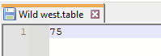

# Pinball FX

<figure><figcaption></figcaption></figure>

Simulation de Flipper sortie en 2022.



## Information

<table data-header-hidden><thead><tr><th width="197"></th><th></th><th data-hidden></th></tr></thead><tbody><tr><td><strong>Émulateur</strong></td><td><ul><li>Steam</li><li>nonSteam</li></ul></td><td></td></tr><tr><td><strong>Dossier des tables</strong></td><td>📂roms \ 📂 pinballfx</td><td></td></tr><tr><td><strong>Extensions</strong></td><td>.table</td><td></td></tr></tbody></table>

## BIOS

Aucun BIOS nécessaire

## Contrôles

<table><thead><tr><th width="258">RetroBat</th><th width="443">Pinball FX</th></tr></thead><tbody><tr><td>START</td><td>Ouvrir menu</td></tr><tr><td>SELECT</td><td>Ouvrir menu</td></tr><tr><td>D-PAD</td><td></td></tr><tr><td>Left Analog stick</td><td>Bousculer le flipper</td></tr><tr><td>Right Analog stick</td><td>Haut: Vue back box / Bas: Lancer la bille</td></tr><tr><td></td><td>Lancement automatique de la bille</td></tr><tr><td></td><td>Extras visuels</td></tr><tr><td></td><td>Pouvoir de magicien</td></tr><tr><td></td><td>Modifier la vue</td></tr><tr><td>L1</td><td>Flipper gauche</td></tr><tr><td>R1</td><td>Flipper droit</td></tr><tr><td>L2</td><td>Flipper gauche</td></tr><tr><td>R2</td><td>Flipper droit</td></tr><tr><td>L3</td><td></td></tr><tr><td>R3</td><td></td></tr></tbody></table>

## Information spécifique au système

### Tables

Créer un fichier .txt dans le dossier :open\_file\_folder:`roms\`:open\_file\_folder:`pinballfx`.&#x20;

Renseigner dans ce fichier le numéro de la table à lancer, puis sauvegarder le fichier avec l'extension '.table'.

Exemple de fichier pour la tablee "Wild West Rampage" (table 75):

<figure><figcaption></figcaption></figure>

Numérotation des tables

Civil War – 1\
Star Wars™ Pinball: Masters of the Force – 2\
Fear Itself – 5\
Star Wars™ Pinball: Starfighter Assault – 6\
Thor – 7\
Star Wars™ Pinball: Han Solo – 10\
Star Wars™ Pinball: Episode IV A New Hope – 12\
Marvel’s The Avengers – 17\
Ghost Rider – 21\
Deadpool – 22\
Pasha – 23\
Star Wars™ Pinball: Episode VI Return of the Jedi – 24\
Biolab – 27\
Star Wars™ Pinball: Darth Vader – 28\
Adventure Land – 29\
Doctor Strange – 30\
Rome – 31\
Sorcerer’s Lair – 33\
Fantastic Four –38\
CastleStorm – 40\
Star Wars™ Pinball: Episode V The Empire Strikes Back – 43\
Blade – 45\
Spider-Man – 46\
Star Wars™ Pinball: The Clone Wars – 47\
Captain America – 48\
Moon Knight – 49\
Marvel’s Guardians of the Galaxy – 50\
Star Wars™ Pinball: Boba Fett– 53\
World War Hulk – 56\
Star Wars™ Pinball: Droids™ – 58\
X-Men – 59\
The Infinity Gauntlet – 60\
Iron Man – 65\
Secrets of the Deep – 66\
Wolverine – 71\
Venom – 73\
Wild West Rampage – 75\
Star Wars™ Pinball: Star Wars Rebels™ – 77\
Marvel’s Avengers: Age of Ultron – 78\
Marvel’s Ant-Man – 79\
Son of Zeus – 80\
Star Wars™ Pinball: The Force Awakens™ – 88 \
Star Wars™ Pinball: Might of the First Order – 89\
Marvel’s Women of Power: A-Force – 93\
Marvel’s Women of Power: Champions – 94\
Jaws™ Pinball – 95\
E.T.™ Pinball – 96\
Back to the Future™ Pinball – 97\
Star Wars™ Pinball: Rogue One™ – 98\
Jurassic Park™ Pinball – 100 \
Jurassic World™ Pinball – 101 \
Jurassic Park Pinball Mayhem™ 102\
Star Wars™ Pinball: The Last Jedi™ – 103 \
Star Wars™ Pinball: Ahch-To Island – 104 \
Star Wars™ Pinball: Solo – 105\
Star Wars™ Pinball: Calrissian Chronicles – 106\
Star Wars™ Pinball: Battle of Mimban – 107\
Fish Tales – 108\
Williams™️ Medieval Madness™ – 109\
Williams™️ JunkYard™ – 110\
Williams™️ The Getaway: High Speed II™ – 111\
Curse of the Mummy – 112\
Sky Pirates:Treasures of the Clouds – 113\
Williams™️ Theatre of Magic™ – 117\
Williams™️ Black Rose™ – 118\
Williams™️ Attack from Mars™ – 119\
Williams™️ The Party Zone™ – 120\
Williams™️ The Champion Pub™ – 121\
Williams™️ Safe Cracker™ – 122\
Pinball Noir – 123\
Williams™️ White Water™ – 124\
Williams™️ Red and Ted’s Road Show™ – 125\
Williams™️ Hurricane™ – 126\
Williams™️ Cirqus Voltaire™ – 127\
Williams™️ No Good Gofers™ – 128\
Williams™️ Space Station™️ – 129\
Williams™️ Monster Bash™ – 130\
Williams™️ Creature from the Black Lagoon™ – 131\
Williams™️ Tales of the Arabian Nights™ – 132\
Williams™️ Indiana Jones™: The Pinball Adventure – 133\
Williams™️ FunHouse™️ – 134\
Williams™️ Dr. Dude and his Excellent Ray™️ – 135\
Star Wars™ Pinball: The Mandalorian – 136\
Star Wars™ Pinball: Classic Collectibles – 137\
Hasbro’s MY LITTLE PONY – 138\
DreamWorks Kung Fu Panda Pinball – 139\
DreamWorks Trolls Pinball – 140\
DreamWorks How to Train Your Dragon Pinball – 141\
Garfield Pinball – 145\
Peanuts’ Snoopy Pinball – 146\
Wrath of the Elder Gods – 147\
Williams™️ The Machine™️: Bride of Pin·Bot™️ – 148\
Williams™️ Swords of Fury™ – 149\
Homeworld®️: Journey to Hiigara Pinball – 150\
Brothers in Arms®: Win the War Pinball – 151\
Borderlands®: Vault Hunter Pinball – 152\
Kong Pinball – 153\
World War Z Pinball – 154\
Grimm Tales – 155\
Williams™️ The Addams Family – 156 \
Williams™️ World Cup Soccer – 157\
Godzilla Pinball – 158 \
Godzilla vs Kong Pinball – 160\
Crypt of the NecroDancer Pinball – 161\
Williams™️ Twilight Zone – 162\
Williams™ Pinball: Star Trek™: The Next Generation – 163\
Verne’s Mysterious Island – 164\
A Samurai’s Vengeance – 165\
Williams™️ Whirlwind – 168


Seules les tables pour lesquelles vous possédez une licence pourront être lancées directement depuis RetroBat.

