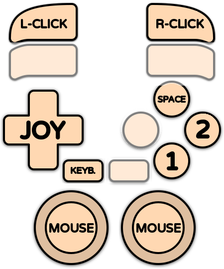

# Amiga 1200

<div align="left"><figure><figcaption></figcaption></figure></div>

## Présentation

L'**Amiga 1200** est un ordinateur personnel sorti par Commodore en 1992. Il succède à l'Amiga 500 avec un processeur plus rapide (Motorola 68020), 2 Mo de mémoire et surtout le nouveau jeu de puces **AGA** : 256 couleurs à l'écran parmi 16,8 millions, de quoi faire entrer les graphismes Amiga dans les années 1990. Il était livré avec le Kickstart 3.0, puis 3.1.

L'Amiga 1200 a été le dernier Amiga grand public avant la faillite de Commodore en 1994. Il a reçu des versions améliorées de nombreux jeux et des titres exclusivement AGA : _Banshee_, _Alien Breed 3D_, _Gloom_, _Super Stardust_, _Simon the Sorcerer_, _The Settlers II_, _Pinball Fantasies AGA_, _Theme Park_, _Uridium 2_… Équipé d'une carte accélératrice et d'un disque dur, c'est aussi la machine de référence pour les jeux **WHDLoad**.

Ce système (Amiga AGA) correspond à l'Amiga 1200. L'Amiga 4000 et la CD32, qui utilisent aussi le jeu de puces AGA, ont leur propre page.



## En bref

<table><thead><tr><th width="295.25"></th><th></th></tr></thead><tbody><tr><td>Dossier des jeux</td><td>📁 roms \ 📂 amiga1200</td></tr><tr><td>Extensions</td><td>.adf .adz .dms .ipf .hdf .lha .uae .rp9 .m3u .zip .7z</td></tr><tr><td>Émulateur par défaut</td><td>libretro: puae</td></tr><tr><td>BIOS</td><td>Kickstart 3.1 (A1200) obligatoire</td></tr><tr><td>Configuration des manettes</td><td>Automatique (sauf Amiga Forever)</td></tr><tr><td>RetroAchievements</td><td>Non</td></tr><tr><td>Jeu en réseau</td><td>Non</td></tr><tr><td>Gestionnaire de sauvegardes ES</td><td>cores libretro, Amiberry</td></tr></tbody></table>

## Quel émulateur choisir ?

<table><thead><tr><th width="223.25">Émulateur</th><th width="284.5">Points forts</th><th>Limites</th></tr></thead><tbody><tr><td><strong>libretro: puae</strong> (défaut)</td><td>Fiable, tous les formats, clavier virtuel, Pad2Key</td><td></td></tr><tr><td>libretro: amiberry</td><td>Moteur UAE récent, WHDLoad et .rp9, Pad2Key</td><td></td></tr><tr><td>amiberry</td><td>Version standalone : très bonne compatibilité, choix du modèle, du processeur et de la mémoire, crayon optique, menu Amiberry</td><td>2 joueurs</td></tr><tr><td>winuae</td><td>L'émulateur Amiga de référence, le plus précis</td><td>2 joueurs</td></tr><tr><td>amigaforever</td><td>Lance les paquets .rp9 de l'offre commerciale Amiga Forever de Cloanto</td><td>Amiga Forever doit être installé, pas d'autoconfiguration</td></tr></tbody></table>

## BIOS

### Fichiers Kickstart

L'Amiga a besoin de sa ROM système, le **Kickstart**. Copiez-le dans le dossier `bios` (ou `bios\amiga`).

| Kickstart             | Nom court       | Nom Amiga Forever      | MD5 (nom court)                  | Utilisé pour                                    |
| --------------------- | --------------- | ---------------------- | -------------------------------- | ----------------------------------------------- |
| Kickstart 3.1 (A1200) | kick40068.A1200 | amiga-os-310-a1200.rom | 646773759326fbac3b2311fd8c8793ee | **Obligatoire** – Amiga 1200                    |
| Kickstart 1.3 (A500)  | kick34005.A500  | amiga-os-130.rom       | 82a21c1890cae844b3df741f2762d48d | Optionnel – certains jeux WHDLoad (lr-amiberry) |
| Kickstart 3.1 (A600)  | kick40063.A600  | amiga-os-310-a600.rom  | e40a5dfb3d017ba8779faba30cbd1c8e | Optionnel – certains jeux WHDLoad (lr-amiberry) |
| Clé Amiga Forever     | rom.key         |                        |                                  | Optionnel – ROM chiffrées d'Amiga Forever       |


RetroBat vérifie la présence du Kickstart 3.1 (A1200). Les autres fichiers sont indiqués comme OPTIONAL.


### Quel nom de fichier utiliser ?

* Les **noms courts** (`kick40068.A1200`…) fonctionnent avec tous les émulateurs : utilisez-les en cas de doute.
* Amiberry, lr-amiberry et WinUAE acceptent aussi les noms **Amiga Forever** (`amiga-os-310-a1200.rom`…) et les noms TOSEC habituels.
* Les ROM Amiga Forever sont chiffrées : copiez à côté le fichier **rom.key** fourni avec Amiga Forever.

### Choisir le modèle d'Amiga

Par défaut, RetroBat émule un **Amiga 1200 avec le Kickstart 3.1**. Les options (sous-menu ÉMULATION) permettent d'ajuster la mémoire et le processeur :

<div align="left"><figure><figcaption></figcaption></figure></div>

| Émulateur   | Option                                      | Choix                                                             |
| ----------- | ------------------------------------------- | ----------------------------------------------------------------- |
| lr-puae     | MODÈLE                                      | A1200 (2M Chip), A1200 (2M Chip + 8M Fast)                        |
| lr-amiberry | MODÈLE                                      | A1200 d'origine (2M Chip), A1200 (2M Chip + 8M Fast)              |
| Amiberry    | MODÈLE / CPU / FAST RAM / Z3 FAST RAM       | A1200 avec ou sans Fast RAM, 68020 à 68040, Fast RAM jusqu'à 8 Mo |
| WinUAE      | FAST RAM / ACTIVER LE JIT / UTILISER LE FPU | Fast RAM (activée par défaut), JIT et FPU pour les jeux 3D        |

## Quel format pour les jeux ?

### Formats

| Format     | Description                                                                                                      |
| ---------- | ---------------------------------------------------------------------------------------------------------------- |
| .adf       | Image de disquette standard (.adz : .adf compressé, .dms : archive DiskMasher)                                   |
| .ipf       | Image de disquette protégée (SPS). Demande le plugin `capsimg.dll`, fourni avec RetroBat dans `bios`             |
| .lha       | Jeu **WHDLoad** : un jeu sur disquettes installé pour tourner depuis un disque dur, sans changement de disquette |
| .hdf       | Image de disque dur                                                                                              |
| .uae       | Fichier de configuration UAE (vos propres réglages), Amiberry et WinUAE                                          |
| .rp9       | Paquet Amiga Forever (Amiga Forever, lr-amiberry)                                                                |
| .m3u       | Jeu sur plusieurs disquettes                                                                                     |
| .zip / .7z | Images de disquettes compressées                                                                                 |


Pour plus de simplicité, préférez les versions **WHDLoad** (.lha) des jeux : elles démarrent directement, chargent plus vite et ne demandent pas de changer de disquette.


### Jeux sur plusieurs disquettes

Utilisez un fichier .m3u pour regrouper les disquettes d'un jeu. Exemple pour _Simon the Sorcerer_ : créez le fichier `Simon the Sorcerer.m3u` dans le dossier `roms\amiga1200` avec ce contenu :

```
Simon the Sorcerer (Disk 1).adf
Simon the Sorcerer (Disk 2).adf
Simon the Sorcerer (Disk 3).adf
```

Pour changer de disquette :

* **cores libretro** : utilisez les raccourcis de changement de disque (HOTKEY + L1 pour éjecter/insérer, HOTKEY + L2/R2 pour choisir la disquette précédente/suivante), ou le menu du clavier virtuel.
* **Amiberry** : les premières disquettes vont dans les lecteurs (option **LECTEURS DE DISQUETTES**, jusqu'à 4), les suivantes dans le gestionnaire de disquettes du menu Amiberry.
* **WinUAE** : trouve aussi tout seul les disquettes suivantes quand elles sont nommées « Disk 1 », « Disk 2 »…

## Contrôles

### Configuration automatique des manettes

L'Amiga a deux ports : le **joystick** se branche dans le port 2 et la **souris** dans le port 1. RetroBat respecte cette disposition : la manette du joueur 1 va dans le port 2 et la souris de votre PC dans le port 1.

| Émulateur            | Configuration auto | Joueurs |
| -------------------- | ------------------ | ------- |
| lr-puae, lr-amiberry | Oui                | 2       |
| Amiberry             | Oui                | 2       |
| WinUAE               | Oui                | 2       |
| Amiga Forever        | Non                |         |

Le clavier de votre PC sert de clavier Amiga avec tous les émulateurs.

### Disposition par défaut

| Amiga                   | Cores libretro     | Amiberry     |
| ----------------------- | ------------------ | ------------ |
| Joystick                | Croix              | Croix        |
| Bouton de tir 1 (rouge) | SUD                | SUD          |
| Bouton de tir 2 (bleu)  | EST                | EST          |
| Barre d'espace          | NORD               |              |
| Souris                  | Sticks analogiques | Souris du PC |
| Boutons de la souris    | L2 / R2            | Souris du PC |
| Clavier virtuel         | SELECT             | SELECT       |
| Menu de l'émulateur     |                    | R3           |

<div align="left"><figure><figcaption></figcaption></figure></div>

### Options de contrôle utiles

| Émulateur | Option                                         | Description                                                   |
| --------- | ---------------------------------------------- | ------------------------------------------------------------- |
| lr-puae   | DISPOSITION DES BOUTONS DE LA MANETTE          | Autres dispositions des boutons (saut sur un bouton…)         |
| lr-puae   | CONTRÔLE À LA SOURIS                           | Sticks qui pilotent la souris                                 |
| Amiberry  | PÉRIPHÉRIQUE PORT 1 / PÉRIPHÉRIQUE PORT 2      | Souris, joystick (joueur 2) ou rien dans chaque port          |
| Amiberry  | INVERSER LES PORTS JOYSTICK                    | Pour les quelques jeux qui veulent le joystick dans le port 1 |
| Amiberry  | BOUTON MENU / BOUTON CLAVIER VIRTUEL           | Changer les boutons qui ouvrent le menu et le clavier virtuel |
| WinUAE    | INVERSER LES PORTS JOYSTICK / DEUXIÈME MANETTE | Inverser les ports, mettre le joueur 2 dans le port 1         |

### Jeux qui demandent le clavier

Beaucoup de jeux Amiga utilisent le clavier (barre d'espace, touches F1 à F10, réponses dans les jeux d'aventure…). Avec les cores libretro, utilisez **Pad2Key** pour placer des touches sur votre manette, ou le clavier virtuel (SELECT).

### Raccourcis

**Cores libretro** : raccourcis standards de RetroBat.

| Raccourci      | Amiberry           | WinUAE  | Amiga Forever |
| -------------- | ------------------ | ------- | ------------- |
| HOTKEY + START | Quitter            | Quitter |               |
| HOTKEY + OUEST | Sauvegarder l'état |         |               |
| HOTKEY + NORD  | Charger l'état     |         |               |

Le menu d'Amiberry s'ouvre avec R3 ou F12, celui de WinUAE avec F12.

### Crayon optique

Amiberry émule un **crayon optique** (ou un pistolet **Trojan Phazer**) avec votre souris ou votre pistolet : activez **ACTIVER LES PISTOLETS** (sous-menu PISTOLETS) et choisissez le **TYPE DE PISTOLET**.

## Dossiers

| Émulateur   | Contenu                               | Dossier                                                                |
| ----------- | ------------------------------------- | ---------------------------------------------------------------------- |
| lr-puae     | Sauvegardes                           | `saves\amiga1200`                                                      |
| lr-amiberry | Sauvegardes                           | `saves\amiga1200\LR-amiberry`                                          |
| libretro    | Sauvegardes d'état                    | `saves\amiga1200\libretro.<core>`                                      |
| Amiberry    | Sauvegardes d'état, disquettes, NVRAM | `saves\amiga1200\amiberry`                                             |
| Amiberry    | Captures d'écran                      | `screenshots\amiberry`                                                 |
| Amiberry    | Vos configurations .uae               | `emulators\amiberry\Configurations`                                    |
| WinUAE      | Sauvegardes d'état                    | `saves\amiga1200\winuae`                                               |
| WinUAE      | Sauvegardes des disquettes / WHDLoad  | `saves\amiga1200\winuae\saveimages` / `saves\amiga1200\winuae\whdload` |
| WinUAE      | Captures d'écran / vidéos             | `screenshots\winuae` / `records\winuae`                                |

## Guides

### Jouer aux jeux WHDLoad

Les jeux WHDLoad (.lha) démarrent automatiquement avec tous les émulateurs sauf Amiga Forever : RetroBat ou l'émulateur prépare l'environnement disque dur. Avec Amiberry, les options **WHDLOAD : ÉCRAN DE DÉMARRAGE** et **WHDLOAD : ATTENDRE UN BOUTON** affichent l'écran WHDLoad avant le jeu ; avec lr-puae, utilisez **ÉCRAN D'ACCUEIL WHDLOAD**.

### Fast RAM, JIT et FPU

* La **Fast RAM** est une mémoire supplémentaire utilisée par de nombreux jeux WHDLoad. Quelques jeux d'origine sur disquette refusent de démarrer avec : choisissez le modèle sans Fast RAM (lr-puae, lr-amiberry, Amiberry) ou désactivez **FAST RAM** (WinUAE).
* Le **JIT** accélère fortement l'émulation du processeur, utile pour les jeux 3D (_Alien Breed 3D_, _Gloom_). Il n'est pas compatible avec l'émulation cycle exact et peut gêner certains jeux plus anciens : **ACTIVER LE JIT** (Amiberry, WinUAE).
* Le **FPU** (coprocesseur mathématique) est demandé par certains jeux 3D tardifs : **FPU** (Amiberry), **UTILISER LE FPU** (WinUAE).

### Utiliser votre propre configuration .uae

Amiberry et WinUAE lancent tels quels les fichiers **.uae** placés dans `roms\amiga1200` : RetroBat ne les modifie pas. Vous pouvez ainsi préparer une configuration précise (mémoire, carte accélératrice, disques durs) pour un jeu ou pour le Workbench.

### Améliorer la précision

* **Amiberry** : option **PRÉCISION**, CYCLE EXACT pour les démos et les jeux sensibles au timing (demande un PC rapide).
* **WinUAE** : option **CYCLE EXACT**.
* **lr-puae** : option **COMPATIBILITÉ DU CPU**.

## Problèmes connus

<table><thead><tr><th width="315.25">Problème</th><th>Solution</th></tr></thead><tbody><tr><td>« Kickstart not found » ou écran noir</td><td>Copiez kick40068.A1200 (Kickstart 3.1 A1200) dans le dossier bios.</td></tr><tr><td>Les ROM Amiga Forever ne fonctionnent pas</td><td>Copiez rom.key à côté.</td></tr><tr><td>Les jeux .ipf ne démarrent pas</td><td>Vérifiez que capsimg.dll est dans le dossier bios.</td></tr><tr><td>Un jeu sur disquette ne démarre pas ou se bloque</td><td>Désactivez la Fast RAM (voir Guides).</td></tr><tr><td>Un jeu 3D est trop lent</td><td>Activez le JIT (Amiberry, WinUAE).</td></tr><tr><td>Le joystick ne répond pas dans un jeu</td><td>Le jeu veut le joystick dans le port 1 : activez INVERSER LES PORTS JOYSTICK (Amiberry, WinUAE).</td></tr><tr><td>Le jeu demande une autre disquette</td><td>Utilisez un fichier .m3u, ou la version WHDLoad du jeu.</td></tr><tr><td>Le jeu demande le clavier</td><td>Utilisez le clavier du PC, le clavier virtuel (SELECT) ou Pad2Key.</td></tr></tbody></table>
