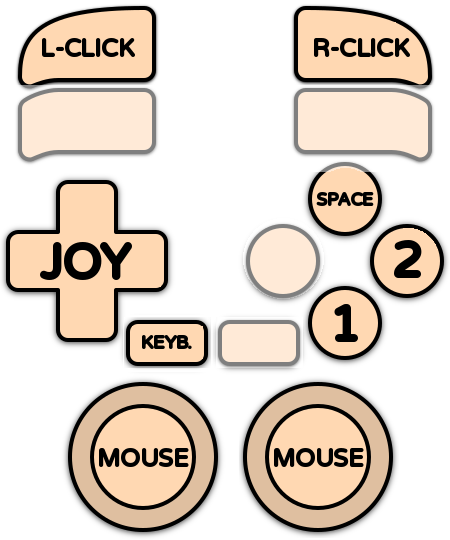

# Amiga 4000

<div align="left"><figure><figcaption></figcaption></figure></div>

## Présentation

L'**Amiga 4000** est le modèle haut de gamme de la famille Amiga, sorti par Commodore en 1992. Ordinateur de bureau destiné aux professionnels, il associait le jeu de puces **AGA** de l'Amiga 1200 à un processeur beaucoup plus puissant (Motorola 68040 à 25 MHz sur l'A4000/040, 68030 sur l'A4000/030, moins cher), jusqu'à 16 Mo de mémoire sur la carte mère, un disque dur IDE et des emplacements d'extension Zorro III. Une version tour, l'A4000T, a suivi en 1994.

L'Amiga 4000 a surtout servi à la vidéo et à la 3D : avec le Video Toaster et LightWave 3D, il est à l'origine des effets spéciaux de plusieurs séries télévisées des années 1990. Pour le jeu, il fait tourner plus vite les titres AGA de l'Amiga 1200, ainsi que les jeux tardifs et les démos les plus exigeants : _Alien Breed 3D II_, _Breathless_, _Gloom Deluxe_, les adaptations Amiga de _Doom_ et _Quake_…

Pour les jeux classiques de l'Amiga 500 et de l'Amiga 1200, préférez les systèmes Amiga OCS/ECS et Amiga AGA : leurs modèles offrent une meilleure compatibilité avec ces jeux.



## En bref

|                                |                                                       |
| ------------------------------ | ----------------------------------------------------- |
| Dossier des jeux               | 📁 roms \ 📂 amiga4000                                |
| Extensions                     | .adf .adz .dms .ipf .hdf .lha .uae .rp9 .m3u .zip .7z |
| Émulateur par défaut           | libretro: puae                                        |
| BIOS                           | Kickstart 3.1 (A4000) obligatoire                     |
| Configuration des manettes     | Automatique (sauf Amiga Forever)                      |
| RetroAchievements              | Non                                                   |
| Jeu en réseau                  | Non                                                   |
| Gestionnaire de sauvegardes ES | cores libretro, Amiberry                              |

## Quel émulateur choisir ?

| Émulateur                   | Points forts                                                                                               | Limites                                                   |
| --------------------------- | ---------------------------------------------------------------------------------------------------------- | --------------------------------------------------------- |
| **libretro: puae** (défaut) | Fiable, tous les formats, clavier virtuel, Pad2Key                                                         | Pas de JIT : plus lent dans les jeux 3D                   |
| libretro: amiberry          | Moteur UAE récent, WHDLoad et .rp9, Pad2Key                                                                |                                                           |
| amiberry                    | Version standalone : JIT activé par défaut, choix du modèle, du processeur et de la mémoire, menu Amiberry | 2 joueurs                                                 |
| winuae                      | L'émulateur Amiga de référence, le plus précis                                                             | 2 joueurs                                                 |
| amigaforever                | Lance les paquets .rp9 de l'offre commerciale Amiga Forever de Cloanto                                     | Amiga Forever doit être installé, pas d'autoconfiguration |

## BIOS

### Fichiers Kickstart

L'Amiga a besoin de sa ROM système, le **Kickstart**. Copiez-le dans le dossier `bios` (ou `bios\amiga`).

| Kickstart             | Nom court       | Nom Amiga Forever      | MD5 (nom court)                  | Utilisé pour                                    |
| --------------------- | --------------- | ---------------------- | -------------------------------- | ----------------------------------------------- |
| Kickstart 3.1 (A4000) | kick40068.A4000 | amiga-os-310-a4000.rom | 9bdedde6a4f33555b4a270c8ca53297d | **Obligatoire** – Amiga 4000                    |
| Kickstart 1.3 (A500)  | kick34005.A500  | amiga-os-130.rom       | 82a21c1890cae844b3df741f2762d48d | Optionnel – certains jeux WHDLoad (lr-amiberry) |
| Kickstart 3.1 (A1200) | kick40068.A1200 | amiga-os-310-a1200.rom | 646773759326fbac3b2311fd8c8793ee | Optionnel – certains jeux WHDLoad (lr-amiberry) |
| Clé Amiga Forever     | rom.key         |                        |                                  | Optionnel – ROM chiffrées d'Amiga Forever       |


RetroBat vérifie la présence du Kickstart 3.1 (A4000). Les autres fichiers sont indiqués comme OPTIONAL.


### Quel nom de fichier utiliser ?

* Les **noms courts** (`kick40068.A4000`…) fonctionnent avec tous les émulateurs : utilisez-les en cas de doute.
* Amiberry, lr-amiberry et WinUAE acceptent aussi les noms **Amiga Forever** (`amiga-os-310-a4000.rom`…) et les noms TOSEC habituels.
* Les ROM Amiga Forever sont chiffrées : copiez à côté le fichier **rom.key** fourni avec Amiga Forever.

### Choisir le modèle d'Amiga

Par défaut, RetroBat émule un **Amiga 4000/040 avec le Kickstart 3.1**, 2 Mo de Chip RAM et 8 Mo de Fast RAM. Les options (sous-menu ÉMULATION) permettent de l'ajuster :

<div align="left"><figure><figcaption></figcaption></figure></div>

<table><thead><tr><th width="180.75">Émulateur</th><th width="284.25">Option</th><th>Choix</th></tr></thead><tbody><tr><td>lr-puae</td><td>MODÈLE</td><td>A4000/030, A4000/040</td></tr><tr><td>lr-amiberry</td><td>MODÈLE</td><td>A4000/030, A4000/040</td></tr><tr><td>Amiberry</td><td>MODÈLE / CPU / FAST RAM Z3</td><td>A4000/040 ou /030, 68030 à 68060, mémoire Zorro III jusqu'à 64 Mo</td></tr><tr><td>WinUAE</td><td>CPU / ACTIVER LE JIT / UTILISER LE FPU</td><td>68040 ou 68030, JIT et FPU</td></tr></tbody></table>

## Quel format pour les jeux ?

### Formats

| Format     | Description                                                                                                      |
| ---------- | ---------------------------------------------------------------------------------------------------------------- |
| .adf       | Image de disquette standard (.adz : .adf compressé, .dms : archive DiskMasher)                                   |
| .ipf       | Image de disquette protégée (SPS). Demande le plugin `capsimg.dll`, fourni avec RetroBat dans `bios`             |
| .lha       | Jeu **WHDLoad** : un jeu sur disquettes installé pour tourner depuis un disque dur, sans changement de disquette |
| .hdf       | Image de disque dur, par exemple une installation du Workbench                                                   |
| .uae       | Fichier de configuration UAE (vos propres réglages), Amiberry et WinUAE                                          |
| .rp9       | Paquet Amiga Forever (Amiga Forever, lr-amiberry)                                                                |
| .m3u       | Jeu sur plusieurs disquettes                                                                                     |
| .zip / .7z | Images de disquettes compressées                                                                                 |


Pour plus de simplicité, préférez les versions **WHDLoad** (.lha) des jeux : elles démarrent directement, chargent plus vite et ne demandent pas de changer de disquette.


### Jeux sur plusieurs disquettes

Utilisez un fichier .m3u pour regrouper les disquettes d'un jeu. Exemple pour _Alien Breed 3D II_ : créez le fichier `Alien Breed 3D II.m3u` dans le dossier `roms\amiga4000` avec ce contenu :

```
Alien Breed 3D II (Disk 1).adf
Alien Breed 3D II (Disk 2).adf
Alien Breed 3D II (Disk 3).adf
Alien Breed 3D II (Disk 4).adf
```

Pour changer de disquette :

* **cores libretro** : utilisez les raccourcis de changement de disque (HOTKEY + L1 pour éjecter/insérer, HOTKEY + L2/R2 pour choisir la disquette précédente/suivante), ou le menu du clavier virtuel.
* **Amiberry** : les premières disquettes vont dans les lecteurs (option **LECTEURS DE DISQUETTES**, jusqu'à 4), les suivantes dans le gestionnaire de disquettes du menu Amiberry.
* **WinUAE** : trouve aussi tout seul les disquettes suivantes quand elles sont nommées « Disk 1 », « Disk 2 »…

## Contrôles

### Configuration automatique des manettes

L'Amiga a deux ports : le **joystick** se branche dans le port 2 et la **souris** dans le port 1. RetroBat respecte cette disposition : la manette du joueur 1 va dans le port 2 et la souris de votre PC dans le port 1.

| Émulateur            | Configuration auto | Joueurs |
| -------------------- | ------------------ | ------- |
| lr-puae, lr-amiberry | Oui                | 2       |
| Amiberry             | Oui                | 2       |
| WinUAE               | Oui                | 2       |
| Amiga Forever        | Non                |         |

Le clavier de votre PC sert de clavier Amiga avec tous les émulateurs.

### Disposition par défaut

| Amiga                   | Cores libretro     | Amiberry     |
| ----------------------- | ------------------ | ------------ |
| Joystick                | Croix              | Croix        |
| Bouton de tir 1 (rouge) | SUD                | SUD          |
| Bouton de tir 2 (bleu)  | EST                | EST          |
| Barre d'espace          | NORD               |              |
| Souris                  | Sticks analogiques | Souris du PC |
| Boutons de la souris    | L2 / R2            | Souris du PC |
| Clavier virtuel         | SELECT             | SELECT       |
| Menu de l'émulateur     |                    | R3           |

<div align="left"><figure><figcaption></figcaption></figure></div>

### Options de contrôle utiles

<table><thead><tr><th width="128.25">Émulateur</th><th>Option</th><th>Description</th></tr></thead><tbody><tr><td>lr-puae</td><td>DISPOSITION DES BOUTONS DE LA MANETTE</td><td>Autres dispositions des boutons (saut sur un bouton…)</td></tr><tr><td>lr-puae</td><td>CONTRÔLE À LA SOURIS</td><td>Sticks qui pilotent la souris</td></tr><tr><td>Amiberry</td><td>PÉRIPHÉRIQUE PORT 1 / PÉRIPHÉRIQUE PORT 2</td><td>Souris, joystick (joueur 2) ou rien dans chaque port</td></tr><tr><td>Amiberry</td><td>INVERSER LES PORTS JOYSTICK</td><td>Pour les quelques jeux qui veulent le joystick dans le port 1</td></tr><tr><td>Amiberry</td><td>BOUTON MENU / BOUTON CLAVIER VIRTUEL</td><td>Changer les boutons qui ouvrent le menu et le clavier virtuel</td></tr><tr><td>WinUAE</td><td>INVERSER LES PORTS JOYSTICK / DEUXIÈME MANETTE</td><td>Inverser les ports, mettre le joueur 2 dans le port 1</td></tr></tbody></table>

### Jeux qui demandent le clavier

Beaucoup de jeux Amiga utilisent le clavier (barre d'espace, touches F1 à F10, réponses dans les jeux d'aventure…). Avec les cores libretro, utilisez **Pad2Key** pour placer des touches sur votre manette, ou le clavier virtuel (SELECT).

### Raccourcis

**Cores libretro** : raccourcis standards de RetroBat.

| Raccourci      | Amiberry           | WinUAE  | Amiga Forever |
| -------------- | ------------------ | ------- | ------------- |
| HOTKEY + START | Quitter            | Quitter |               |
| HOTKEY + OUEST | Sauvegarder l'état |         |               |
| HOTKEY + NORD  | Charger l'état     |         |               |

Le menu d'Amiberry s'ouvre avec R3 ou F12, celui de WinUAE avec F12.

## Dossiers

<table><thead><tr><th width="133.25">Émulateur</th><th>Contenu</th><th>Dossier</th></tr></thead><tbody><tr><td>lr-puae</td><td>Sauvegardes</td><td><code>saves\amiga4000</code></td></tr><tr><td>lr-amiberry</td><td>Sauvegardes</td><td><code>saves\amiga4000\LR-amiberry</code></td></tr><tr><td>libretro</td><td>Sauvegardes d'état</td><td><code>saves\amiga4000\libretro.&#x3C;core></code></td></tr><tr><td>Amiberry</td><td>Sauvegardes d'état, disquettes, NVRAM</td><td><code>saves\amiga4000\amiberry</code></td></tr><tr><td>Amiberry</td><td>Captures d'écran</td><td><code>screenshots\amiberry</code></td></tr><tr><td>Amiberry</td><td>Vos configurations .uae</td><td><code>emulators\amiberry\Configurations</code></td></tr><tr><td>WinUAE</td><td>Sauvegardes d'état</td><td><code>saves\amiga4000\winuae</code></td></tr><tr><td>WinUAE</td><td>Sauvegardes des disquettes / WHDLoad</td><td><code>saves\amiga4000\winuae\saveimages</code> / <code>saves\amiga4000\winuae\whdload</code></td></tr><tr><td>WinUAE</td><td>Captures d'écran / vidéos</td><td><code>screenshots\winuae</code> / <code>records\winuae</code></td></tr></tbody></table>

## Guides

### Jouer aux jeux WHDLoad

Les jeux WHDLoad (.lha) démarrent automatiquement avec tous les émulateurs sauf Amiga Forever : RetroBat ou l'émulateur prépare l'environnement disque dur. Avec Amiberry, les options **WHDLOAD : ÉCRAN DE DÉMARRAGE** et **WHDLOAD : ATTENDRE UN BOUTON** affichent l'écran WHDLoad avant le jeu ; avec lr-puae, utilisez **ÉCRAN D'ACCUEIL WHDLOAD**.

### JIT et FPU

* Le **JIT** accélère fortement l'émulation du processeur : c'est lui qui rend l'Amiga 4000 rapide dans les jeux 3D. Il est activé par défaut avec Amiberry (**ACTIVER LE JIT**) et peut être activé avec WinUAE (**ACTIVER LE JIT**). Il n'est pas compatible avec l'émulation cycle exact.
* Le **FPU** (coprocesseur mathématique) est demandé par certains jeux 3D et démos. Il est intégré au 68040 et activé par défaut avec Amiberry et WinUAE. Avec le 68030, Amiberry ajoute par défaut un 68882 ; avec WinUAE, activez **UTILISER LE FPU**. L'option **FPU** d'Amiberry permet de le changer ou de le retirer.

### Utiliser votre propre configuration .uae

Amiberry et WinUAE lancent tels quels les fichiers **.uae** placés dans `roms\amiga4000` : RetroBat ne les modifie pas. Vous pouvez ainsi préparer une configuration précise (carte graphique, mémoire Zorro III, disques durs) pour le Workbench ou pour un jeu exigeant.

## Problèmes connus

| Problème                                                    | Solution                                                                                                                             |
| ----------------------------------------------------------- | ------------------------------------------------------------------------------------------------------------------------------------ |
| « Kickstart not found » ou écran noir                       | Copiez kick40068.A4000 (Kickstart 3.1 A4000) dans le dossier bios.                                                                   |
| Les ROM Amiga Forever ne fonctionnent pas                   | Copiez rom.key à côté.                                                                                                               |
| Les jeux .ipf ne démarrent pas                              | Vérifiez que capsimg.dll est dans le dossier bios.                                                                                   |
| Un jeu ancien ne démarre pas, se bloque ou tourne trop vite | Le 68040 est trop rapide ou pas compatible : utilisez le modèle A4000/030, ou placez le jeu dans le système Amiga 1200 ou Amiga 500. |
| Un jeu 3D est trop lent                                     | Utilisez Amiberry, ou activez le JIT avec WinUAE.                                                                                    |
| Un jeu 3D plante ou affiche une erreur de calcul            | Le jeu demande le FPU : gardez le 68040, ou activez UTILISER LE FPU (WinUAE) / FPU (Amiberry) avec le 68030.                         |
| Le joystick ne répond pas dans un jeu                       | Le jeu veut le joystick dans le port 1 : activez INVERSER LES PORTS JOYSTICK (Amiberry, WinUAE).                                     |
| Le jeu demande le clavier                                   | Utilisez le clavier du PC, le clavier virtuel (SELECT) ou Pad2Key.                                                                   |
