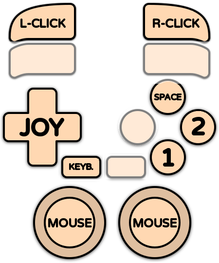

# Amiga 500

<div align="left"><figure><figcaption></figcaption></figure></div>

## Présentation

L'**Amiga 500** est un ordinateur personnel sorti par Commodore en 1987. Construit autour d'un processeur Motorola 68000 et de puces spécialisées (Agnus, Denise et Paula, le jeu de puces **OCS**), il offrait des graphismes et un son très en avance sur les autres ordinateurs de son époque : 4096 couleurs, défilement et sprites matériels, son numérique sur 4 voies.

Abordable et branché sur la télévision familiale, il est devenu l'ordinateur de toute une génération, surtout en Europe où il a dominé le marché du jeu jusqu'au milieu des années 1990. Il a été suivi de l'**Amiga 500+** (1991) et de l'**Amiga 600** (1992), qui utilisent le jeu de puces amélioré **ECS** et le Kickstart 2.

Sa ludothèque compte des milliers de jeux : _Shadow of the Beast_, _Lemmings_, _Speedball 2_, _Sensible Soccer_, _Cannon Fodder_, _Turrican II_, _Another World_, _The Secret of Monkey Island_, _Pinball Dreams_, _Lotus Turbo Challenge_, _The Settlers_… sans oublier une célèbre scène démo.

Ce système (Amiga OCS/ECS) regroupe les Amiga 500, 500+, 600 et 2000.



## En bref

<table><thead><tr><th width="259"></th><th></th></tr></thead><tbody><tr><td><strong>Dossier des jeux</strong></td><td><code>roms\amiga500</code></td></tr><tr><td><strong>Extensions</strong></td><td>.adf .uae .ipf .dms .adz .lha .rp9 .hdf .ags .m3u .zip .7z</td></tr><tr><td><strong>Émulateur par défaut</strong></td><td>libretro: puae</td></tr><tr><td><strong>BIOS</strong></td><td><code>kick34005.A500</code> ou <code>amiga-os-130.rom</code> (Kickstart 1.3)</td></tr><tr><td><strong>Configuration des manettes</strong></td><td>Automatique, sauf Amiga Forever</td></tr><tr><td><strong>Sauvegardes instantanées</strong></td><td>cores libretro, Amiberry</td></tr><tr><td><strong>RetroAchievements</strong></td><td>Non</td></tr><tr><td><strong>Jeu en réseau</strong></td><td>Non</td></tr><tr><td><strong>Pistolets</strong></td><td>Amiberry (light pen)</td></tr></tbody></table>

## Quel émulateur choisir ?

| Émulateur                   | Points forts                                                                                                   | Limites                                                   |
| --------------------------- | -------------------------------------------------------------------------------------------------------------- | --------------------------------------------------------- |
| **libretro: puae** (défaut) | Fiable, tous les formats, clavier virtuel, Pad2Key                                                             |                                                           |
| libretro: amiberry          | Moteur UAE récent, WHDLoad et .rp9, Pad2Key                                                                    |                                                           |
| amiberry                    | Version standalone : très bonne compatibilité, choix du modèle et de la mémoire, crayon optique, menu Amiberry | 2 joueurs                                                 |
| winuae                      | L'émulateur Amiga de référence, le plus précis                                                                 | 2 joueurs                                                 |
| amigaforever                | Lance les paquets .rp9 de l'offre commerciale Amiga Forever de Cloanto                                         | Amiga Forever doit être installé, pas d'autoconfiguration |

## BIOS

### Fichiers Kickstart

L'Amiga a besoin de sa ROM système, le **Kickstart**. Copiez-le dans le dossier `bios` (ou `bios\amiga`).

| Kickstart              | Nom court       | Nom Amiga Forever      | MD5 (nom court)                  | Utilisé pour                                    |
| ---------------------- | --------------- | ---------------------- | -------------------------------- | ----------------------------------------------- |
| Kickstart 1.3 (A500)   | kick34005.A500  | amiga-os-130.rom       | 82a21c1890cae844b3df741f2762d48d | **Obligatoire** – Amiga 500 (modèle par défaut) |
| Kickstart 1.2 (A500)   | kick33180.A500  | amiga-os-120.rom       | 85ad74194e87c08904327de1a9443b7a | Optionnel – modèle A500 KS 1.2                  |
| Kickstart 2.04 (A500+) | kick37175.A500  | amiga-os-204.rom       | dc10d7bdd1b6f450773dfb558477c230 | Optionnel – modèle Amiga 500+                   |
| Kickstart 3.1 (A600)   | kick40063.A600  | amiga-os-310-a600.rom  | e40a5dfb3d017ba8779faba30cbd1c8e | Optionnel – modèle Amiga 600                    |
| Kickstart 3.1 (A1200)  | kick40068.A1200 | amiga-os-310-a1200.rom | 646773759326fbac3b2311fd8c8793ee | Optionnel – certains jeux WHDLoad               |
| Clé Amiga Forever      | rom.key         |                        |                                  | Optionnel – ROM chiffrées d'Amiga Forever       |


RetroBat vérifie la présence du Kickstart 1.3. Les autres fichiers sont indiqués comme OPTIONAL.


### Quel nom de fichier utiliser ?

* Les **noms courts** (`kick34005.A500`…) fonctionnent avec tous les émulateurs : utilisez-les en cas de doute.
* Amiberry, lr-amiberry et WinUAE acceptent aussi les noms **Amiga Forever** (`amiga-os-130.rom`…) et les noms TOSEC habituels.
* Les ROM Amiga Forever sont chiffrées : copiez à côté le fichier **rom.key** fourni avec Amiga Forever.

### Choisir le modèle d'Amiga

Par défaut, RetroBat émule un **Amiga 500 avec le Kickstart 1.3**, qui fait tourner presque tous les jeux du système. Pour émuler un autre modèle, utilisez l'option de modèle (sous-menu ÉMULATION) :

<div align="left"><figure><figcaption></figcaption></figure></div>

| Émulateur   | Option       | Modèles                                                      |
| ----------- | ------------ | ------------------------------------------------------------ |
| lr-puae     | MODÈLE       | A500, A500+, A600…                                           |
| lr-amiberry | MODÈLE       | A500, A500+, A600…                                           |
| Amiberry    | MODÈLE       | A500 (KS 1.3), A500 (KS 1.2), A500+ (KS 2.04), A600 (KS 3.1) |
| WinUAE      | MODÈLE ÉMULÉ | Amiga 500, Amiga 500+                                        |

Chaque modèle a besoin de son propre Kickstart (voir le tableau ci-dessus).

## Quel format pour les jeux ?

### Formats

<table><thead><tr><th width="155.25">Format</th><th>Description</th></tr></thead><tbody><tr><td>.adf</td><td>Image de disquette standard (.adz : .adf compressé, .dms : archive DiskMasher)</td></tr><tr><td>.ipf</td><td>Image de disquette protégée (SPS). Demande le plugin <code>capsimg.dll</code>, fourni avec RetroBat dans <code>bios</code></td></tr><tr><td>.lha</td><td>Jeu <strong>WHDLoad</strong> : un jeu sur disquettes installé pour tourner depuis un disque dur, sans changement de disquette</td></tr><tr><td>.hdf</td><td>Image de disque dur</td></tr><tr><td>.uae</td><td>Fichier de configuration UAE (vos propres réglages), Amiberry et WinUAE</td></tr><tr><td>.ags</td><td>Amiga Game Selector (WinUAE)</td></tr><tr><td>.rp9</td><td>Paquet Amiga Forever (Amiga Forever, lr-amiberry)</td></tr><tr><td>.m3u</td><td>Jeu sur plusieurs disquettes</td></tr><tr><td>.zip / .7z</td><td>Images de disquettes compressées</td></tr></tbody></table>


Pour plus de simplicité, préférez les versions **WHDLoad** (.lha) des jeux : elles démarrent directement, chargent plus vite et ne demandent pas de changer de disquette.


### Jeux sur plusieurs disquettes

Utilisez un fichier .m3u pour regrouper les disquettes d'un jeu. Exemple pour _Monkey Island_ : créez le fichier `Monkey Island.m3u` dans le dossier `roms\amiga500` avec ce contenu :

```
Monkey Island (Disk 1).adf
Monkey Island (Disk 2).adf
Monkey Island (Disk 3).adf
Monkey Island (Disk 4).adf
```

Pour changer de disquette :

* **cores libretro** : utilisez les raccourcis de changement de disque (HOTKEY + L1 pour éjecter/insérer, HOTKEY + L2/R2 pour choisir la disquette précédente/suivante), ou le menu du clavier virtuel.
* **Amiberry** : les premières disquettes vont dans les lecteurs (option **LECTEURS DE DISQUETTES**, jusqu'à 4), les suivantes dans le gestionnaire de disquettes du menu Amiberry.
* **WinUAE** : trouve aussi tout seul les disquettes suivantes quand elles sont nommées « Disk 1 », « Disk 2 »…

## Contrôles

### Configuration automatique des manettes

L'Amiga a deux ports : le **joystick** se branche dans le port 2 et la **souris** dans le port 1. RetroBat respecte cette disposition : la manette du joueur 1 va dans le port 2 et la souris de votre PC dans le port 1.

<table><thead><tr><th width="233">Émulateur</th><th width="192">Configuration auto</th><th>Joueurs</th></tr></thead><tbody><tr><td>lr-puae, lr-amiberry</td><td>Oui</td><td>2</td></tr><tr><td>Amiberry</td><td>Oui</td><td>2</td></tr><tr><td>WinUAE</td><td>Oui</td><td>2</td></tr><tr><td>Amiga Forever</td><td>Non</td><td></td></tr></tbody></table>

Le clavier de votre PC sert de clavier Amiga avec tous les émulateurs.

### Disposition par défaut

| Amiga                   | Cores libretro     | Amiberry     |
| ----------------------- | ------------------ | ------------ |
| Joystick                | Croix              | Croix        |
| Bouton de tir 1 (rouge) | SUD                | SUD          |
| Bouton de tir 2 (bleu)  | EST                | EST          |
| Barre d'espace          | NORD               |              |
| Souris                  | Sticks analogiques | Souris du PC |
| Boutons de la souris    | L2 / R2            | Souris du PC |
| Clavier virtuel         | SELECT             | SELECT       |
| Menu de l'émulateur     |                    | R3           |

<div align="left"><figure><figcaption></figcaption></figure></div>

### Options de contrôle utiles

| Émulateur | Option                                         | Description                                                   |
| --------- | ---------------------------------------------- | ------------------------------------------------------------- |
| lr-puae   | DISPOSITION DES BOUTONS DE LA MANETTE          | Autres dispositions des boutons (saut sur un bouton…)         |
| lr-puae   | CONTRÔLE À LA SOURIS                           | Sticks qui pilotent la souris                                 |
| Amiberry  | PÉRIPHÉRIQUE PORT 1 / PÉRIPHÉRIQUE PORT 2      | Souris, joystick (joueur 2) ou rien dans chaque port          |
| Amiberry  | INVERSER LES PORTS JOYSTICK                    | Pour les quelques jeux qui veulent le joystick dans le port 1 |
| Amiberry  | BOUTON MENU / BOUTON CLAVIER VIRTUEL           | Changer les boutons qui ouvrent le menu et le clavier virtuel |
| WinUAE    | INVERSER LES PORTS JOYSTICK / DEUXIÈME MANETTE | Inverser les ports, mettre le joueur 2 dans le port 1         |

### Jeux qui demandent le clavier

Beaucoup de jeux Amiga utilisent le clavier (barre d'espace, touches F1 à F10, réponses dans les jeux d'aventure…). Avec les cores libretro, utilisez **Pad2Key** pour placer des touches sur votre manette, ou le clavier virtuel (SELECT).

### Raccourcis

**Cores libretro** : [raccourcis standards de RetroBat](../../../../navigation/hotkeys.md).

| Raccourci      | Amiberry           | WinUAE  | Amiga Forever |
| -------------- | ------------------ | ------- | ------------- |
| HOTKEY + START | Quitter            | Quitter |               |
| HOTKEY + OUEST | Sauvegarder l'état |         |               |
| HOTKEY + NORD  | Charger l'état     |         |               |

Le menu d'Amiberry s'ouvre avec R3 ou F12, celui de WinUAE avec F12.

### Crayon optique

Amiberry émule un **crayon optique** (ou un pistolet **Trojan Phazer**) avec votre souris ou votre pistolet : activez **ACTIVER LES PISTOLETS** (sous-menu PISTOLETS) et choisissez le **TYPE DE PISTOLET**.

## Dossiers

| Émulateur   | Contenu                               | Dossier                                                              |
| ----------- | ------------------------------------- | -------------------------------------------------------------------- |
| lr-puae     | Sauvegardes                           | `saves\amiga500`                                                     |
| lr-amiberry | Sauvegardes                           | `saves\amiga500\LR-amiberry`                                         |
| libretro    | Sauvegardes d'état                    | `saves\amiga500\libretro.<core>`                                     |
| Amiberry    | Sauvegardes d'état, disquettes, NVRAM | `saves\amiga500\amiberry`                                            |
| Amiberry    | Captures d'écran                      | `screenshots\amiberry`                                               |
| Amiberry    | Vos configurations .uae               | `emulators\amiberry\Configurations`                                  |
| WinUAE      | Sauvegardes d'état                    | `saves\amiga500\winuae`                                              |
| WinUAE      | Sauvegardes des disquettes / WHDLoad  | `saves\amiga500\winuae\saveimages` / `saves\amiga500\winuae\whdload` |
| WinUAE      | Captures d'écran / vidéos             | `screenshots\winuae` / `records\winuae`                              |

## Guides

### Jouer aux jeux WHDLoad

Les jeux WHDLoad (.lha) démarrent automatiquement avec tous les émulateurs sauf Amiga Forever : RetroBat ou l'émulateur prépare l'environnement disque dur. Avec Amiberry, les options **WHDLOAD : ÉCRAN DE DÉMARRAGE** et **WHDLOAD : ATTENDRE UN BOUTON** affichent l'écran WHDLoad avant le jeu ; avec lr-puae, utilisez **ÉCRAN D'ACCUEIL WHDLOAD**.

Certains jeux WHDLoad demandent un Kickstart 3.1 : ajoutez `kick40068.A1200` (et `kick40063.A600`) dans le dossier bios.

### Utiliser votre propre configuration .uae

Amiberry et WinUAE lancent tels quels les fichiers **.uae** placés dans `roms\amiga500` : RetroBat ne les modifie pas. Vous pouvez ainsi préparer une configuration précise (mémoire, carte accélératrice, disques durs) pour un jeu ou pour le Workbench.

### Améliorer la précision

* **Amiberry** : option **PRÉCISION**, CYCLE EXACT pour les démos et les jeux sensibles au timing (demande un PC rapide).
* **WinUAE** : option **CYCLE EXACT**.
* **lr-puae** : option **COMPATIBILITÉ DU CPU**.

## Problèmes connus

<table><thead><tr><th width="369">Problème</th><th>Solution</th></tr></thead><tbody><tr><td>« Kickstart not found » ou écran noir</td><td>Copiez kick34005.A500 (Kickstart 1.3) dans le dossier bios.</td></tr><tr><td>Les ROM Amiga Forever ne fonctionnent pas</td><td>Copiez rom.key à côté.</td></tr><tr><td>Les jeux .ipf ne démarrent pas</td><td>Vérifiez que capsimg.dll est dans le dossier bios.</td></tr><tr><td>Le joystick ne répond pas dans un jeu</td><td>Le jeu veut le joystick dans le port 1 : activez INVERSER LES PORTS JOYSTICK (Amiberry, WinUAE).</td></tr><tr><td>Le jeu demande une autre disquette</td><td>Utilisez un fichier .m3u, ou la version WHDLoad du jeu.</td></tr><tr><td>Le jeu demande le clavier</td><td>Utilisez le clavier du PC, le clavier virtuel (SELECT) ou Pad2Key.</td></tr></tbody></table>
