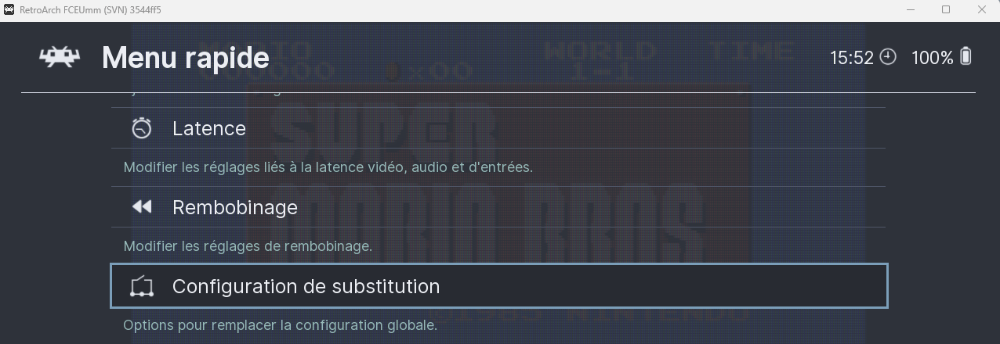
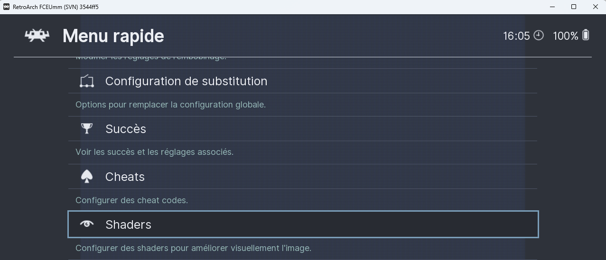

# Utiliser les overrides Retroarch

Si vous ne souhaitez pas utiliser la configuration globale de RetroBat pour les options générales de RetroArch ou si vous souhaitez régler vous-même les Shaders, cela est possible en activant les options de RetroBat permettant de charger automatiquement les fichiers "overrides" préalablement créés dans RetroArch.

### Override pour les options

Vous pouvez enregistrer un fichier d'override pour un jeu, un dossier de contenu ou un core libretro depuis le menu rapide de RetroArch.


Activez d'abord **AUTORISER OPTIONS DU JEU/CORE** dans RetroBat (**MENU PRINCIPAL > PARAMÈTRES DES JEUX > OPTIONS RETROARCH > ÉMULATION**), **avant** de lancer le jeu : sinon le menu **Overrides** est masqué dans RetroArch.


Activer l'option d'override dans RetroBat dans le [**menu principal de RetroBat > Paramètres des jeux > Options RetroArch > Emulation**](../navigation/main-menu.md#parametres-des-jeux):

<div align="left"><figure><figcaption></figcaption></figure></div>

Pour générer un fichier d'override, lancer le menu RetroArch depuis un jeu en appuyant sur **HOTKEY + SUD**  (1).png>) de votre manette (F1 sur le clavier). Effectuer les réglages souhaités puis aller dans le menu de "Configuration de Substitution":

<div align="left"><figure><figcaption></figcaption></figure></div>

A partir de ce menu, sauvegarder le fichier d'override pour le niveau souhaité (jeu, coeur, contenu):

<div align="left"><figure><figcaption></figcaption></figure></div>

RetroArch va automatiquement sauvegardé un fichier d'override dans le sous-dossier du coeur:

<div align="left"><figure><figcaption></figcaption></figure></div>

Les overrides sont enregistrés dans `emulators\retroarch\config\<nom du core>\` :

* `<nom du jeu>.cfg` : override du jeu (priorité la plus haute) ;
* `<nom du dossier>.cfg` : override du dossier de contenu ;
* `<nom du core>.cfg` : override du core.


RetroBat retire des fichiers d'override les réglages des manettes et des raccourcis, pour qu'ils ne remplacent pas la configuration automatique des manettes de RetroBat.


### Override pour les shaders

Vous pouvez enregistrer un preset de shaders pour un jeu, un dossier de contenu, un core ou pour tout (global) depuis le menu rapide de RetroArch.


Sans **AUTORISER SHADERS PAR JEU/CORE**, RetroBat applique ses propres **SHADERS** et ignore les presets de RetroArch. Avec cette option, un preset enregistré dans RetroArch remplace les SHADERS choisis dans RetroBat.


Pour générer un fichier d'override de shaders, lancer le menu RetroArch depuis un jeu en appuyant sur **HOTKEY + SUD**  (1).png>) de votre manette (F1 sur le clavier). Puis aller dans le menu **Shaders** pour effectuer les réglages souhaités:

<div align="left"><figure><figcaption></figcaption></figure></div>

Une fois les réglages terminés, aller dans le menu "**Enregistrer le préréglage**":

<div align="left"><figure><figcaption></figcaption></figure></div>

Sauvegarder au niveau souhaité (dossier, coeur, jeu, global):

<div align="left"><figure><figcaption></figcaption></figure></div>

RetroArch va automatiquement sauvegardé un fichier d'override :

<div align="left"><figure><figcaption></figcaption></figure></div>

Enfin, activer l'option d'override de shaders dans RetroBat dans le [**menu principal de RetroBat > Paramètres des jeux > Options RetroArch > Rendu visuel**](../navigation/main-menu.md#parametres-des-jeux):

<div align="left"><figure><figcaption></figcaption></figure></div>

### Override du format d'affichage personnalisé dans RetroArch <a href="#override-pour-les-options-2" id="override-pour-les-options-2"></a>

Lorsque vous souhaitez utiliser le format d'affichage "personnalisé" dans **CONFIGURATION AVANCÉE DU SYSTÈME > RAPPORT D'ASPECT**, il est possible d'appliquer la valeur du ration a appliquer dans RetroArch en créant un fichier .txt contenant les informations suivantes :&#x20;

* width (largeur)
* height (hauteur)
* top (haut)
* left (gauche)

Les informations contenues dans le fichier rempliront automatiquement les champs suivants dans RetroArch :

<div align="left"><figure><figcaption></figcaption></figure></div>

Pour ce faire, créez un fichier texte contenant la largeur, la hauteur et la position (gauche et haut) de l'image, dans ce format :

```json
{ "width": 1440, "height": 1080, "left": 240, "top": 0 }
```

Placer le fichier avec le bon nommage dans un de ces emplacements:

<table><thead><tr><th width="275.75">Emplacement</th><th width="259.5">Nom du fichier</th><th>Pour</th></tr></thead><tbody><tr><td>Dossier du jeu (<code>roms\&#x3C;système></code>)</td><td><code>&#x3C;nom de la rom>_customratio.txt</code></td><td>Un jeu</td></tr><tr><td>Dossier du jeu (<code>roms\&#x3C;système></code>)</td><td><code>&#x3C;système>_customratio.txt</code></td><td>Tout le système</td></tr><tr><td>Dossier <code>user\customratio</code> de RetroBat</td><td><code>&#x3C;système>_&#x3C;nom de la rom>_customratio.txt</code></td><td>Un jeu</td></tr><tr><td>Dossier <code>user\customratio</code> de RetroBat</td><td><code>&#x3C;système>_customratio.txt</code></td><td>Tout le système</td></tr></tbody></table>


Le fichier doit garder exactement ce format (accolades, guillemets, virgules) : un fichier mal formé est ignoré.


Enfin, sélectionner la valeur "PERSONNALISÉ" dans le champs **RAPPORT D'ASPECT** de RetroBat :

<div align="left"><figure><figcaption></figcaption></figure></div>
